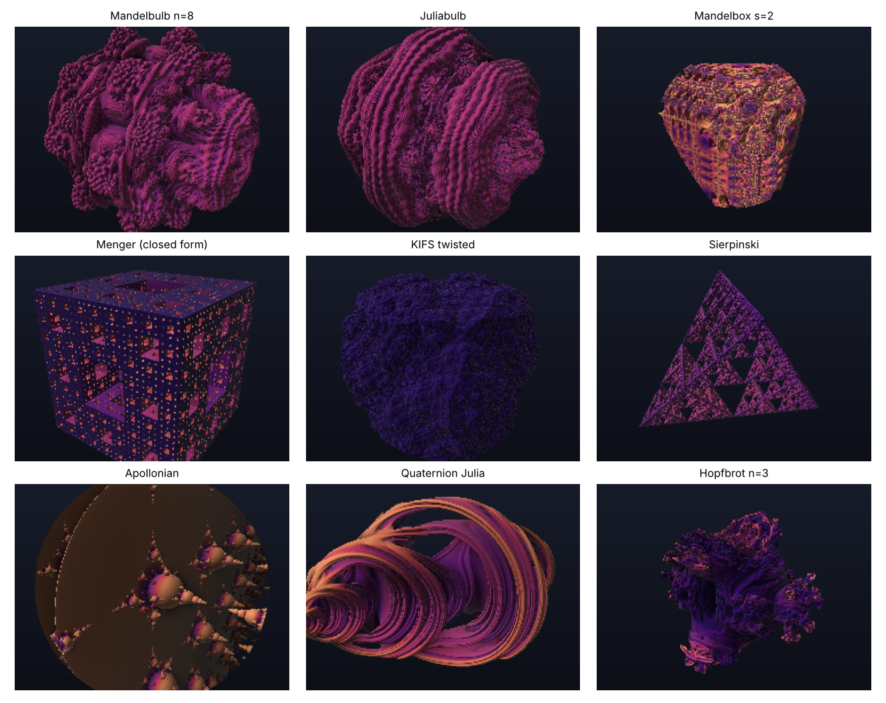
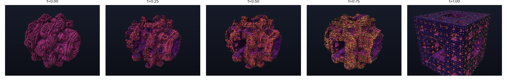

# fractalkit

Modular numpy model of the fractals in ray, for exploring and plotting from Python
(numpy, scipy, sympy, matplotlib). Needs no Rust.

    pip install -r requirements.txt
    python -m pytest tests -q
    cd examples && python gallery.py && python mixing.py && python hopf.py && python dimension.py   # -> out/*.png

## Model
Everything is a `Field`: `field.de(P)` -> `(distance, trap)` for points `(...,3)`, the same
contract as ray's Rust kernels (`src/formulas`, `src/render/vm.rs`).

- `fractals.py` ports: Mandelbulb/Juliabulb, Mandelbox, KIFS (Menger preset), Sierpinski,
  Apollonian, PseudoKleinian, closed-form Menger, QuaternionJulia, Hopfbrot.
- `core.py` operators: `|`, `&`, `-`, `smooth_union`, `blend`, `scaled/rotated/translated/repeated/warped/shell`.
- `Hybrid` interleaves the *steps* of `IterMap`s; a schedule entry that is a list runs several
  steps in one iteration. `folds.py` has BoxFold, SphereFold, Scale, AbsFold, Rotate, Offset.
- `geometry.py`: primitives, `FiberNetwork` (capsule graphs, knots, lattices), `HopfFibers`
  (stereographic circles, `ring_base` for nested tori), sympy `Implicit` surfaces (gyroid).
- `scene.py`: build from dict/JSON specs; `register()` adds your own types.
- `render.py` (slices, numpy sphere tracer, point cloud), `analysis.py` (box counting),
  `symbolic.py` (sympy checks of the bulb map and Hopf map).

## Caveats
- Hybrids are parameter-sensitive: estimates from different maps disagree, so expect speckle and
  use small march steps. The `bulbbox` recipe matches the Rust one only qualitatively.
- Box-counting is exact only with the grid base aligned to the fractal (3 for Menger, 2 for Sierpinski).
- The bulb DE `n r^(n-1)` is a lower bound on the true Jacobian norm (up to ~6x at n=8 near the poles).
