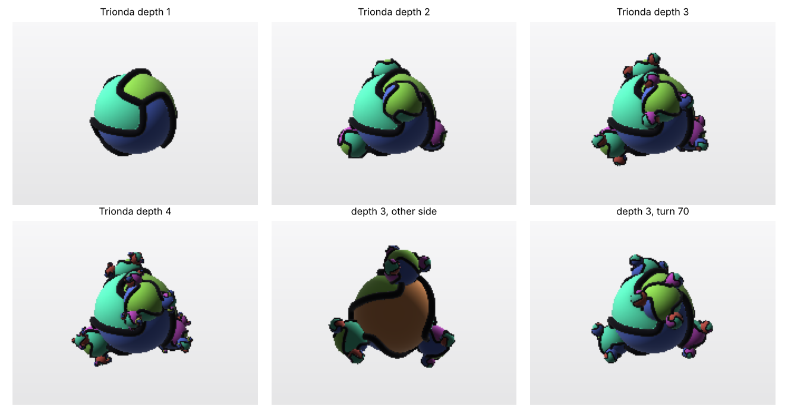
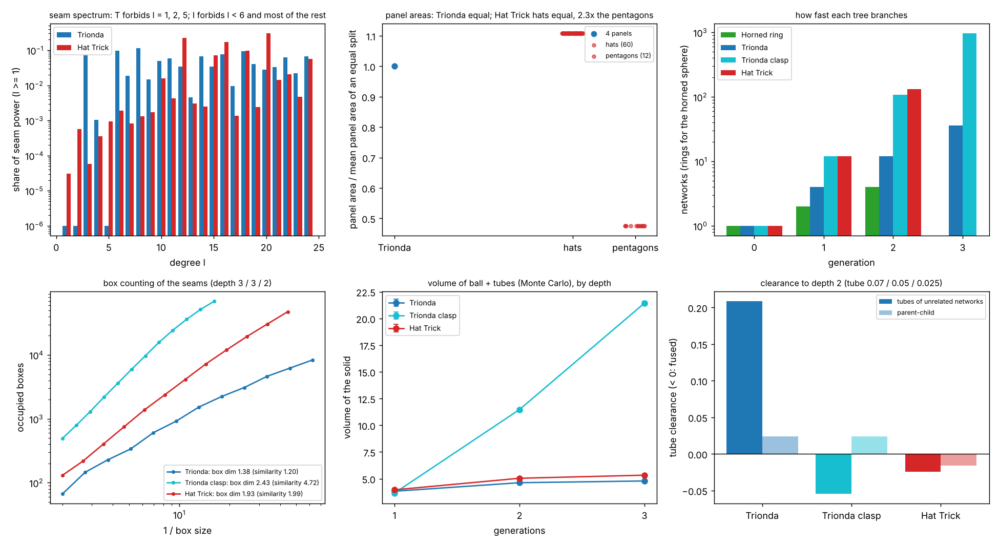

# fractalkit

From Horned Spheres to Hopf Trees: Linking Graphs, Möbius Invariants, and Coxeter Reflection Families
https://doi.org/10.21203/rs.3.rs-11763427/v1

## Riemann sphere and horned sphere

**Slices.** Each panel is a flat cut through a field, computed by evaluating `field.de` on a grid.

- *Left: the horned sphere in its ring plane (z = 0)*, coloured by signed distance (blue inside, red outside; the black line is the surface). The big body and its two horns are the root ring. Each horn tip is cut and carries two smaller rings of the next generation. They show up in the gap between the tips as small islands, which are cross-sections of those child rings. The clasp is the point of the construction: the two children are linked with each other, and the recursion repeats that inside every child. `HornedSphere` is a recursive `Field` with its own `_de`, a ported tree search that prunes subtrees with a bound on each (see `fractalkit/horned.py`).
- *Middle: the Riemann sphere at y = 0*, coloured by the orbit trap (the nearest approach of the orbit to the y = 0 plane). The pattern has fourfold symmetry, which comes from the `|sin|` folds treating x and z alike. It has four large petals around the origin, fine radial filaments between them, and dark arcs at the four tips.
- *Right: the same map at x = 0*, as an inside/outside mask. Here the symmetry is broken, because the map's constant `c = (0, 1, 0)` points along y. The result is a one-sided body with a fan of lobes of falling size on the +y side.

The Riemann sphere is an `IterMap`. Each step puts the orbit on a sphere, projects it stereographically, folds the plane with `|sin(pi s + a)|`, projects back and raises the radius to a power set by the projection's own stretch. It follows the Rust kernel's log-space handling of the huge last step (`fractalkit/fractals.py`).

**Mixes.** Fields compose, so the new shapes can be combined with each other and with the fibre geometry.

- *Left: horned sphere smooth-unioned with Hopf fibres.* Three latitudes of twelve fibres each (`ring_base([-0.5, 0, 0.5], 12)`), scaled by 0.45 and merged into the horned sphere with a blend of 0.05. Every pair of Hopf fibres links once, so the fibres form a linked family wrapped round a body that is itself built from linked rings.
- *Middle: Riemann sphere threaded by fibres*, a plain union (`|`) with fibres scaled by 0.35. The fibres wrap around the studded body.
- *Right: a morph halfway between the Riemann and horned spheres* (`RiemannSphere.blend(HornedSphere, 0.5)`). `blend` averages the two distance estimates. It is a morph, not a true interpolation of shapes, so the result is an artefact of the averaging and not a meaningful intermediate object, but it is a good way to find new forms.

Reproduce both figures with `cd examples && python riemann_horned.py`, which writes them to `out/`. Related: `hopf_tree.py` builds a horned-style tree whose clasped pairs are Hopf pairs, and `linking_networks.py` computes linking numbers across such trees.

Modular numpy model of the fractals in ray, for exploring and plotting from Python
(numpy, scipy, sympy, matplotlib). Needs no Rust.

    pip install -r requirements.txt
    python -m pytest tests -q
    cd examples && python gallery.py && python mixing.py && python hopf.py && python dimension.py   # -> out/*.png

## Seam trees: horned spheres built from Trionda and Hat Trick balls

The horned sphere hangs two smaller rings on the two cut ends of a ring. A *seam tree* does the same with the seam network of a ball, the curves that cut the sphere into panels, and hangs copies on the network's rotation axes. A copy `shrink` times smaller goes on each axis with its own axis 0 turned back onto the parent's (sunk by `sink`, spun by `turn`). The root uses every axis; later networks spend axis 0 on their parent. Each network is its seam tubes, plus an optional solid ball (`body`) just inside them, so the seams stand out as ridges and the panels can be coloured per panel and per generation.

- `TriondaHorned` (`fractalkit/trionda_horned.py`): the tetrahedral Trionda of [ballgen](https://github.com/brentharts/ballgen). Six S-shaped seams join the four tetrahedron vertices and cut the sphere into four equal chiral panels (rotation group T, order 12). Copies hang on the 4 vertices: 4 children on the root and 3 on every later network.
- `HatTrickHorned` (`fractalkit/hattrick_horned.py`): the Hat Trick ball of [hexasphere](https://github.com/brentharts/hexasphere) (60 aperiodic hats and 12 pentagons, group I, order 60), baked into `fractalkit/data/hattrick.npz` by `tools/bake_hattrick.py`. Copies hang on the 12 pentagon centres: 12 children on the root, 11 on later networks. Each hat takes the colour of its pentagon's patch.
- `TriondaHorned.clasp()`: a *sibling clasp* variant, described below.
- `SeamTree` (`fractalkit/seamtree.py`) is the shared base: a new ball needs only its curves, panels and axes. `fractalkit/seamstats.py` has the numbers used below.

Reproduce with `cd examples && python trionda_horned.py` (about 4 minutes; writes the three galleries to `out/`).

### Do the children clasp?

In the horned sphere the two children link each other. For a seam tree I count a clasp as linked *panel loops*: each panel boundary is a closed curve, and I take Gauss linking numbers between loops of different networks (`linking_matrix`), together with the clearance between tubes (distance between seam curves minus both tube radii, negative = fused).

- **Default Trionda tree (children at the vertices).** Each child links its parent's panel loops (6 of 16 loop pairs at the defaults). This is close to automatic: the child's axis sits inside the parent sphere (`sink` < 1), so its loops pass through the parent's surface. Siblings never link, because they are about 1 unit apart. Tubes are clear to depth 2 (0 fused pairs).
- **Sibling clasp.** Pushing one child sideways breaks the tetrahedral symmetry, so the preset puts a symmetric *trio* of children around each vertex (the 3-fold rotations of one child), 12 on the root and 9 on later networks. `tools/scan_clasp.py` searched 500 random placements: 15 had all 12 within-trio pairs linked (4 linked loop pairs each) with tubes not fused. A local search then raised the smallest clearance to 0.029 (tube 0.05). The preset is `shrink` 0.628, `sink` 0.003, `lateral` 0.79, `lean` 326, `turn` 7.6. Trios do not link each other.
- **The clasp does not survive recursion.** At depth 2, 264 pairs of tubes fuse (clearance -0.055). A further local search only reached -0.047. Nine children per network at `shrink` 0.63 give a similarity dimension of 4.7, above 3, so the copies are forced to overlap; the solid's volume grows 3.7, 11.5, 21.4 with depth. Treat the clasp as a depth-1 construction.
- **Hat Trick.** None of the 144 pentagon-loop pairs between a parent and a child are linked, and 60 pairs of tubes fuse at depth 2 at the default `tube` 0.025, `shrink` 0.3, `turn` 10. Only pentagon loops were tested, since linking all 72 panel loops per network is too slow. The defaults were not tuned for linking or clearance.

### Comparison

`cd examples && python compare_seamtrees.py` (about 90 s; `--quick` is faster and less exact) writes the figure and table below, plus `seamtree_compare.json`, to `out/`.

| | Horned ring | Trionda | Trionda clasp | Hat Trick |
|---|---|---|---|---|
| rotation group order | - | 12 | 12 | 60 |
| panels | - | 4 | 4 | 72 |
| seam length (unit sphere) | - | 15.35 | 15.35 | 65.82 |
| panel area CV | - | 0.000 | 0.000 | 0.235 |
| hat : pentagon area | - | - | - | 2.33 |
| chirality (deg to mirror image) | - | 8.27 | 8.27 | 0.96 |
| seam power in forbidden degrees | - | 0.000 | 0.000 | 0.024 |
| shrink | 0.45 | 0.40 | 0.628 | 0.30 |
| children: root / later | 2 / 2 | 4 / 3 | 12 / 9 | 12 / 11 |
| networks per generation | 1, 2, 4 | 1, 4, 12, 36 | 1, 12, 108, 972 | 1, 12, 132 |
| similarity dimension | 0.87 | 1.20 | 4.72 | 1.99 |
| box-counting dimension of the seams | - | 1.38 | 2.43 | 1.93 |
| tube clearance, unrelated / parent-child | - | +0.209 / +0.024 | -0.055 / +0.024 | -0.024 / -0.016 |
| fused pairs (depth 2) | - | 0 | 264 | 60 |
| volume at depth 1 / 2 / 3 | - | 3.83 / 4.63 / 4.79 | 3.66 / 11.47 / 21.44 | 3.96 / 5.04 / 5.33 |
| parent-child loop pairs linked | - | 6 of 16 | 4 of 16 | 0 of 144 |
| sibling pairs linked | 3 of 3 | - | - | - |

What the numbers say:

- **Symmetry shows in the spectrum.** The spherical-harmonic power of the seam density vanishes at l = 1, 2, 5 for the Trionda, as the group T forbids. The Hat Trick should have nothing below l = 6; it carries about 2% of its power in forbidden degrees. I think that is sampling noise (the baked outlines list every seam twice) but have not confirmed it. The Hat Trick's strong degrees are l = 10 and 12.
- **Panels.** The four Trionda panels have exactly equal area. The Hat Trick's 60 hats are equal and each is 2.33 times a pentagon, matching hexasphere's report. Hat Trick panels are less compact (0.57 against 0.67, where 1 is a disc), since hats are far from round.
- **Chirality.** The Trionda seams are 8.3 degrees from their mirror image (mean nearest-point distance, minimised over rotations). The Hat Trick is 1.0 degrees, so as a seam network it is nearly mirror-symmetric even though each hat is chiral; this agrees with ballgen's 1.0 to 1.7 degrees. The number depends on the search, so I use 30 random starts.
- **Dimension.** Self-similarity gives log(children)/log(1/shrink) where `children` counts later networks. The Trionda tree gives 1.20 and the Hat Trick 1.99, measured by box counting at 1.38 and 1.93; the ring horned sphere gives 0.87. A value below 1 means the tree adds less than one network's worth of curve at each scale, and a value above 3 (the clasp) means the copies must overlap. Box counting over only 3 generations is rough, and the Trionda estimate is pulled up by the root network, which is itself one-dimensional.
- **Volume.** For the default Trionda and Hat Trick, the solid's volume settles quickly with depth (4.79 and 5.33 at depth 3). Only the clasp grows without bound.

Limits: volumes are Monte Carlo (150,000 points), the box-counting range is short, and the fusing checks only go to depth 2. The Hat Trick is built from hexasphere's frequency-3, variant-0 tiling only; hexasphere finds no symmetric tiling at other odd frequencies. The seam trees have no tests yet.

## Model
Everything is a `Field`: `field.de(P)` -> `(distance, trap)` for points `(...,3)`, the same
contract as ray's Rust kernels (`src/formulas`, `src/render/vm.rs`).

- `fractals.py` ports: Mandelbulb/Juliabulb, Mandelbox, KIFS (Menger preset), Sierpinski,
  Apollonian, PseudoKleinian, closed-form Menger, QuaternionJulia, Hopfbrot.
- `core.py` operators: `|`, `&`, `-`, `smooth_union`, `blend`, `scaled/rotated/translated/repeated/warped/shell`.
- `Hybrid` interleaves the *steps* of `IterMap`s; a schedule entry that is a list runs several
  steps in one iteration. `folds.py` has BoxFold, SphereFold, Scale, AbsFold, Rotate, Offset.
- `geometry.py`: primitives, `FiberNetwork` (capsule graphs, knots, lattices), `HopfFibers`
  (stereographic circles, `ring_base` for nested tori), sympy `Implicit` surfaces (gyroid).
- `scene.py`: build from dict/JSON specs; `register()` adds your own types.
- `render.py` (slices, numpy sphere tracer, point cloud), `analysis.py` (box counting),
  `symbolic.py` (sympy checks of the bulb map and Hopf map).

## Caveats
- Hybrids are parameter-sensitive: estimates from different maps disagree, so expect speckle and
  use small march steps. The `bulbbox` recipe matches the Rust one only qualitatively.
- Box-counting is exact only with the grid base aligned to the fractal (3 for Menger, 2 for Sierpinski).
- The bulb DE `n r^(n-1)` is a lower bound on the true Jacobian norm (up to ~6x at n=8 near the poles).
