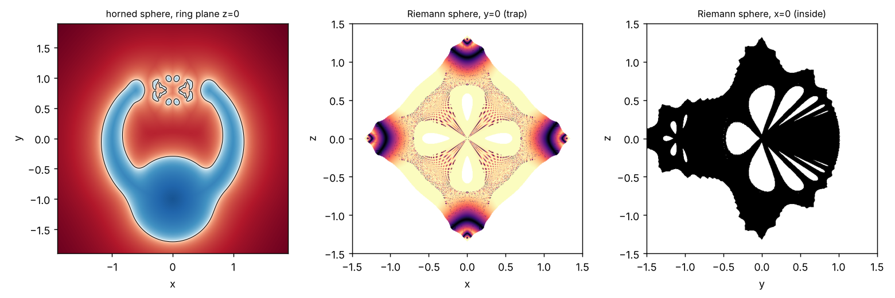
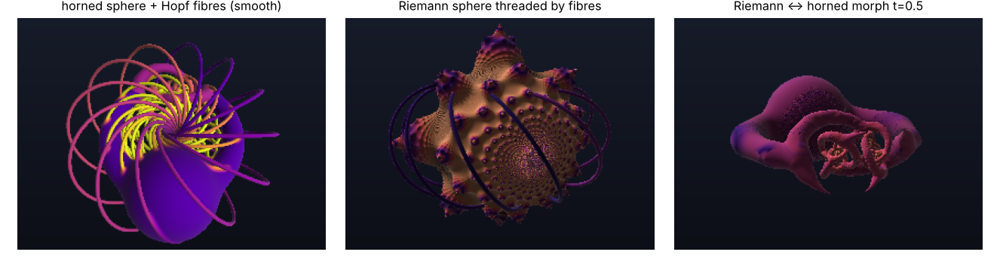
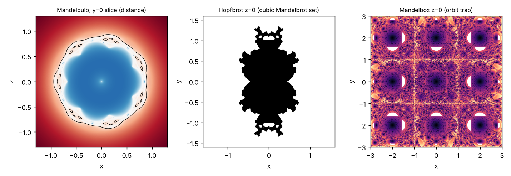

# fractalkit

From Horned Spheres to Hopf Trees: Linking Graphs, Möbius Invariants, and Coxeter Reflection Families
https://doi.org/10.21203/rs.3.rs-11763427/v1

## Riemann sphere and horned sphere

**Slices.** Each panel is a flat cut through a field, computed by evaluating `field.de` on a grid.

- *Left: the horned sphere in its ring plane (z = 0)*, coloured by signed distance (blue inside, red outside; the black line is the surface). The big body and its two horns are the root ring. Each horn tip is cut and carries two smaller rings of the next generation. They show up in the gap between the tips as small islands, which are cross-sections of those child rings. The clasp is the point of the construction: the two children are linked with each other, and the recursion repeats that inside every child. `HornedSphere` is a recursive `Field` with its own `_de`, a ported tree search that prunes subtrees with a bound on each (see `fractalkit/horned.py`).
- *Middle: the Riemann sphere at y = 0*, coloured by the orbit trap (the nearest approach of the orbit to the y = 0 plane). The pattern has fourfold symmetry, which comes from the `|sin|` folds treating x and z alike. It has four large petals around the origin, fine radial filaments between them, and dark arcs at the four tips.
- *Right: the same map at x = 0*, as an inside/outside mask. Here the symmetry is broken, because the map's constant `c = (0, 1, 0)` points along y. The result is a one-sided body with a fan of lobes of falling size on the +y side.

The Riemann sphere is an `IterMap`. Each step puts the orbit on a sphere, projects it stereographically, folds the plane with `|sin(pi s + a)|`, projects back and raises the radius to a power set by the projection's own stretch. It follows the Rust kernel's log-space handling of the huge last step (`fractalkit/fractals.py`).

**Mixes.** Fields compose, so the new shapes can be combined with each other and with the fibre geometry.

- *Left: horned sphere smooth-unioned with Hopf fibres.* Three latitudes of twelve fibres each (`ring_base([-0.5, 0, 0.5], 12)`), scaled by 0.45 and merged into the horned sphere with a blend of 0.05. Every pair of Hopf fibres links once, so the fibres form a linked family wrapped round a body that is itself built from linked rings.
- *Middle: Riemann sphere threaded by fibres*, a plain union (`|`) with fibres scaled by 0.35. The fibres wrap around the studded body.
- *Right: a morph halfway between the Riemann and horned spheres* (`RiemannSphere.blend(HornedSphere, 0.5)`). `blend` averages the two distance estimates. It is a morph, not a true interpolation of shapes, so the result is an artefact of the averaging and not a meaningful intermediate object, but it is a good way to find new forms.

Reproduce both figures with `cd examples && python riemann_horned.py`, which writes them to `out/`. Related: `hopf_tree.py` builds a horned-style tree whose clasped pairs are Hopf pairs, and `linking_networks.py` computes linking numbers across such trees.

Modular numpy model of the fractals in ray, for exploring and plotting from Python
(numpy, scipy, sympy, matplotlib). Needs no Rust.

    pip install -r requirements.txt
    python -m pytest tests -q
    cd examples && python gallery.py && python mixing.py && python hopf.py && python dimension.py   # -> out/*.png

## Model
Everything is a `Field`: `field.de(P)` -> `(distance, trap)` for points `(...,3)`, the same
contract as ray's Rust kernels (`src/formulas`, `src/render/vm.rs`).

- `fractals.py` ports: Mandelbulb/Juliabulb, Mandelbox, KIFS (Menger preset), Sierpinski,
  Apollonian, PseudoKleinian, closed-form Menger, QuaternionJulia, Hopfbrot.
- `core.py` operators: `|`, `&`, `-`, `smooth_union`, `blend`, `scaled/rotated/translated/repeated/warped/shell`.
- `Hybrid` interleaves the *steps* of `IterMap`s; a schedule entry that is a list runs several
  steps in one iteration. `folds.py` has BoxFold, SphereFold, Scale, AbsFold, Rotate, Offset.
- `geometry.py`: primitives, `FiberNetwork` (capsule graphs, knots, lattices), `HopfFibers`
  (stereographic circles, `ring_base` for nested tori), sympy `Implicit` surfaces (gyroid).
- `scene.py`: build from dict/JSON specs; `register()` adds your own types.
- `render.py` (slices, numpy sphere tracer, point cloud), `analysis.py` (box counting),
  `symbolic.py` (sympy checks of the bulb map and Hopf map).

## Caveats
- Hybrids are parameter-sensitive: estimates from different maps disagree, so expect speckle and
  use small march steps. The `bulbbox` recipe matches the Rust one only qualitatively.
- Box-counting is exact only with the grid base aligned to the fractal (3 for Menger, 2 for Sierpinski).
- The bulb DE `n r^(n-1)` is a lower bound on the true Jacobian norm (up to ~6x at n=8 near the poles).
