<p align="center">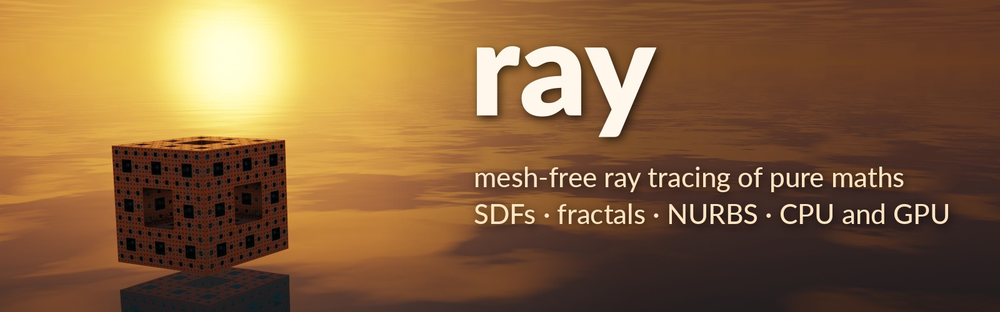</p>

An experiment in how complex a scene can get when it is made only of maths: signed-distance shapes, fractals, noise heightfields, NURBS surfaces and analytic primitives, with no meshes, ray traced in real time. A JSON file describes the scene; the editor flies through it and edits it:
- every object's parameters, editable on click;
- procedural materials from a library, each assignment editable on its own;
- add and delete objects;
- drag and drop with physics, including floating, sinking and ripples in water;
- lights that are glowing objects (any material with emission), with soft shadows sized by the object;
- a day sky with a time of day (sunrise, sunset, night with a moon and twinkling stars), a night sky of stars, or none;
- volume clouds (Add > Landscape > cloud), billowing and wispy, lit through (silver linings toward the sun, pink from below at sunset), casting soft shadows;
- NURBS surfaces (Add > Surfaces): free-form control nets and profiles turned about an axis (vases, glasses, an exact sphere or torus), hit exactly on their patches;
- the cost of every shape, and the CPU and GPU load over time;
- a settings panel for bounces, global illumination, anti-aliasing and the rest;
- a Reset scene button that puts everything back as it was opened (undoable), and Drop all, which lets every movable object fall and settle; with Edit > Physics on drop off (on at start), dropped and newly added objects stay where they are let go;
- handles on the selected object to move, rotate and scale it with the mouse;
- Open and Save as for scene files;
- an MCP server, so an AI assistant can build in the running viewer and look at the result (see [Driving the viewer from an AI assistant](#driving-the-viewer-from-an-ai-assistant-mcp)).

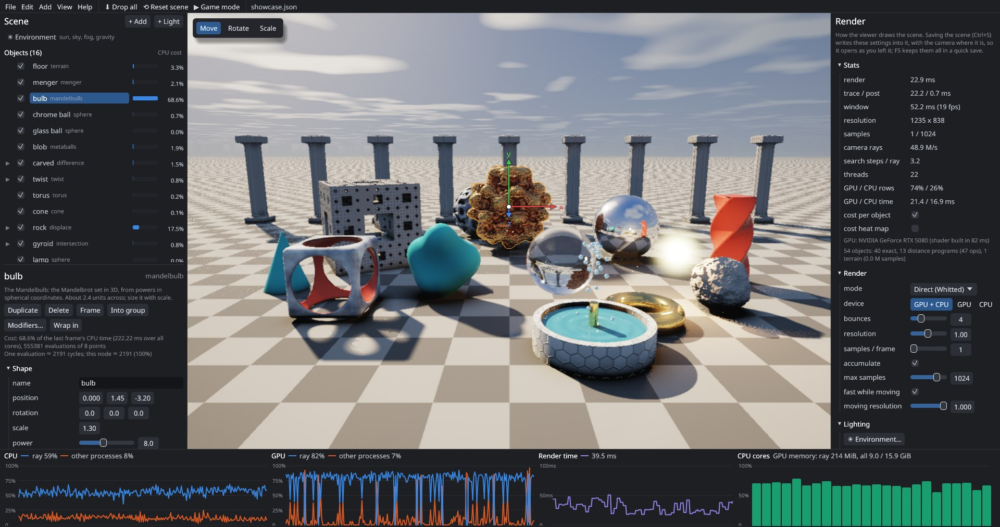

The renderer is the CPU ray marcher of [fraktal256-rs](../fraktal256-rs), generalised:

- **Taken over:**
  - the AVX2 8-lane SIMD types (`simd.rs`) and the octet-per-row tile pass;
  - the value noise with derivatives;
  - fraktal's eroded-fBm terrain (build, bilinear height and normal maps, cavity AO, the relaxed march with secant refinement, soft shadows, the rock / grass / snow / sand material);
  - the Menger distance estimator and the sphere tracing inside an object's bounds;
  - the water (waves, Fresnel, absorption, caustics);
  - the sky and fog;
  - the lighting model and the `trace2` reflection ray;
  - the bloom, edge AA and ACES composite;
  - the four palettes.
- **Left behind on purpose:** `no_std`, the hand-rolled runtime and thread pool, SDL, the 256 KB budget and the game. Those were the point of fraktal256-rs; this is an exploration tool, so it uses std, rayon, serde and eframe/egui.

The same renderer also runs on the GPU as a generated WGSL compute shader, and by default every frame is shared between the GPU and the CPU (see [GPU](#gpu)).

## Gallery

Every picture is ray traced from a scene in `saves/` with no meshes, rendered headless (`tools/readme-images.sh` makes them all again).

<table>
<tr><td width="50%">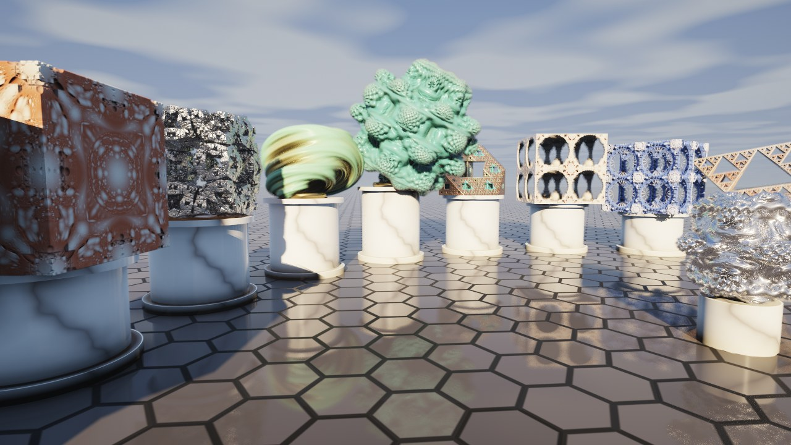<br><sub>The fractal gallery: Menger sponge, Mandelbox, KIFS, Julia set, Mandelbulb, a cut sponge, Apollonian, Kleinian and Sierpinski (<code>fractals.json</code>)</sub></td><td width="50%">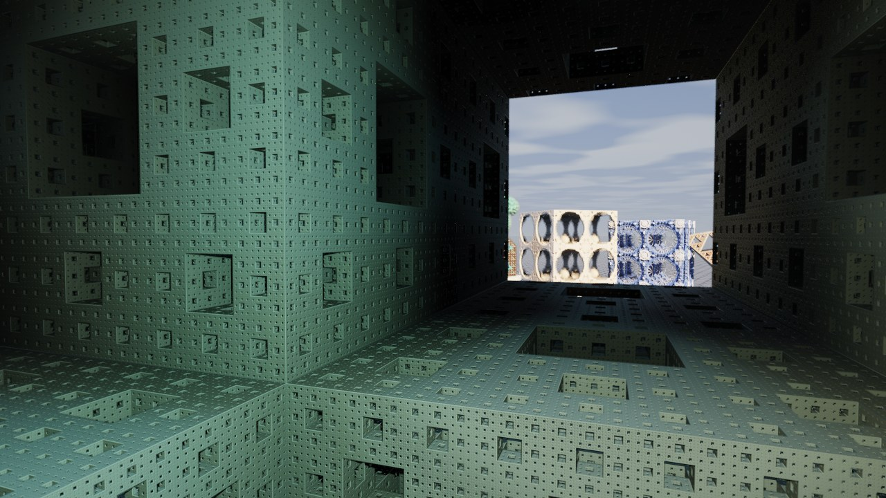<br><sub>Inside the Menger sponge, looking out of one of its windows at the gallery (<code>fractals3.json</code>)</sub></td></tr>
<tr><td width="50%">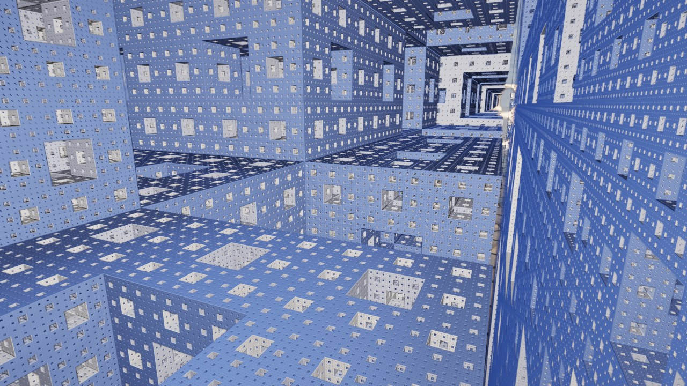<br><sub>Deeper in the sponge's corridors, with the headlight on</sub></td><td width="50%">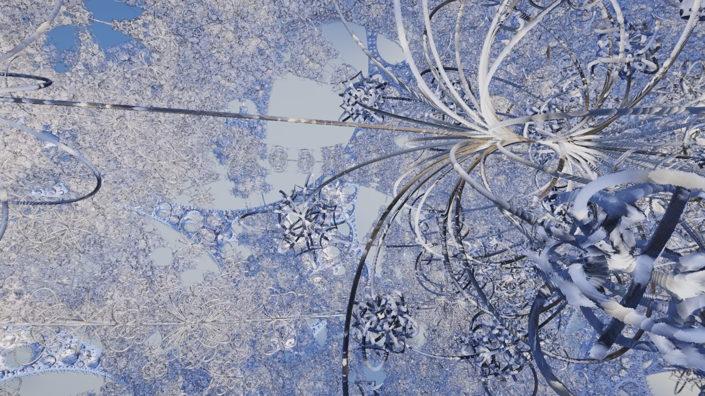<br><sub>Inside the Kleinian fractal, with the headlight on</sub></td></tr>
<tr><td width="50%">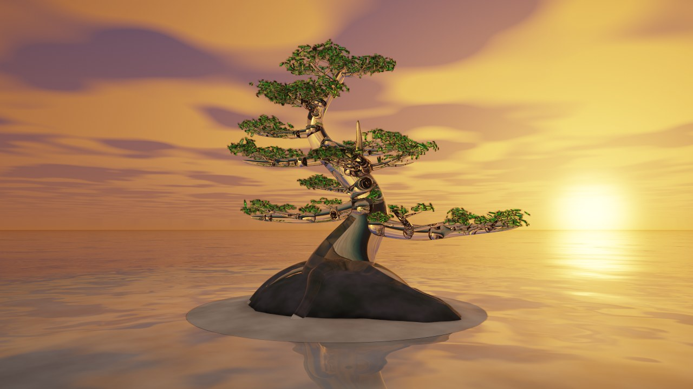<br><sub>A bonsai on a sandbank at sunset: 341 branches and 2,574 leaves (<code>bonsai.json</code>)</sub></td><td width="50%">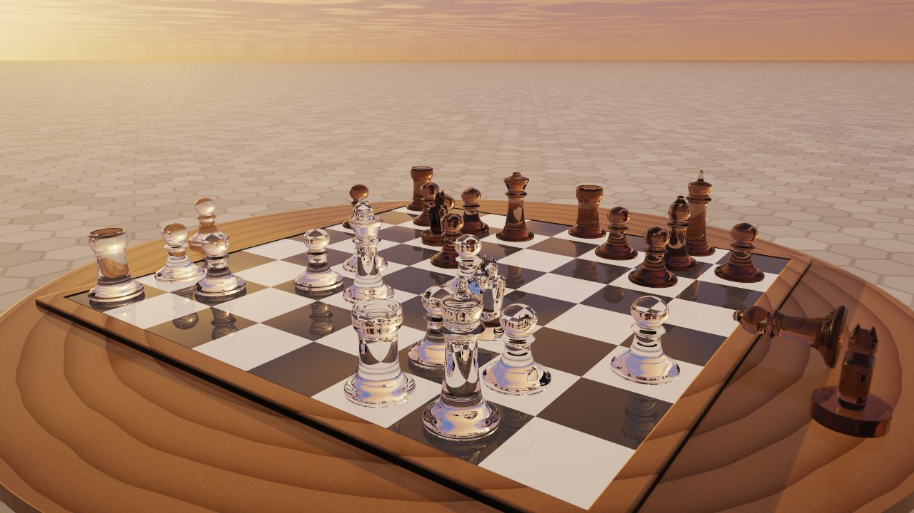<br><sub>A glass chess set on a walnut table at sunset: NURBS surfaces of revolution in clear and smoked glass (<code>glass.json</code>)</sub></td></tr>
<tr><td width="50%">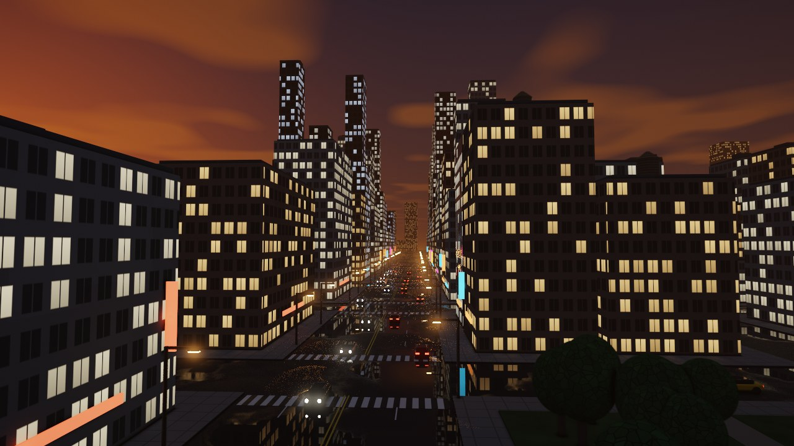<br><sub>A city at the blue hour, its windows lit: about 1,500 shapes in groups by block (<code>night-city.json</code>)</sub></td><td width="50%">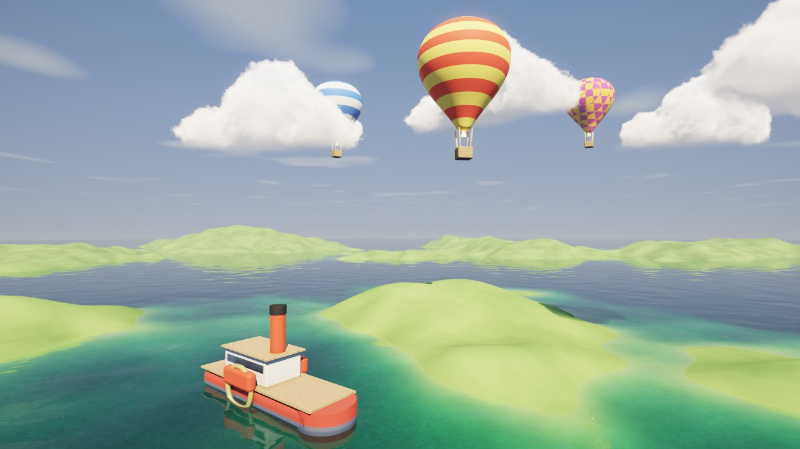<br><sub>Volume clouds over a valley, hot-air balloons with NURBS envelopes, and a paddle steamer (<code>clouds.json</code>)</sub></td></tr>
<tr><td width="50%">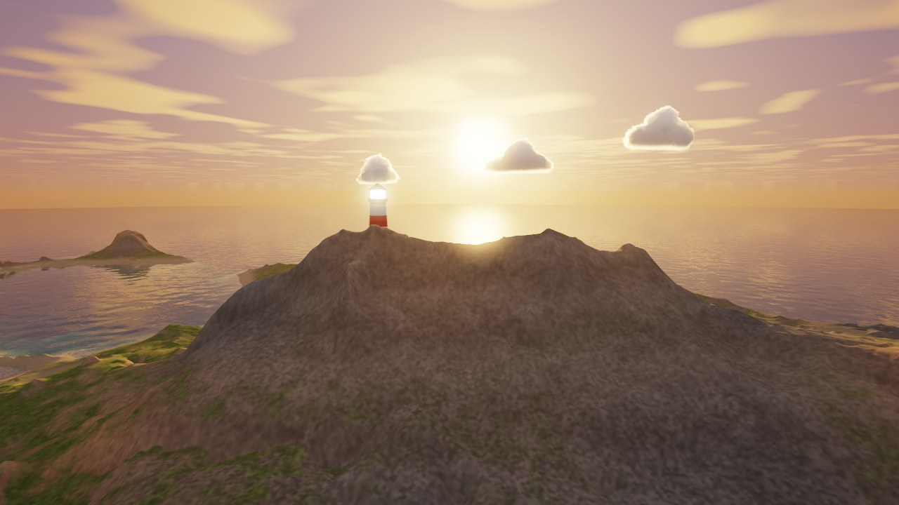<br><sub>A rocky island at sunset, with a lighthouse, a boat and clouds (<code>island.json</code>)</sub></td><td width="50%">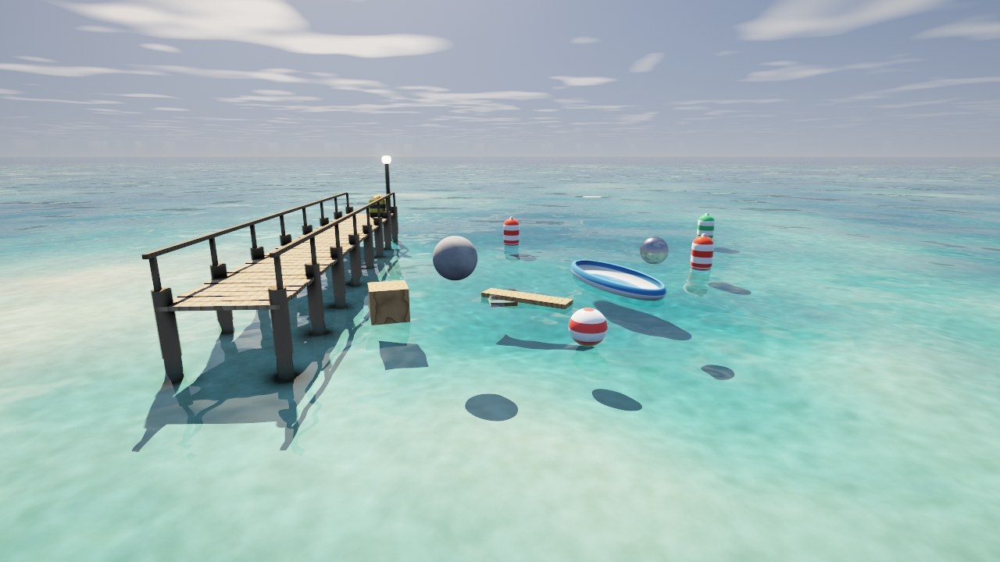<br><sub>The sea: waves, refraction and caustics, with a pier, a rowing boat and buoys afloat (<code>water.json</code>)</sub></td></tr>
<tr><td width="50%">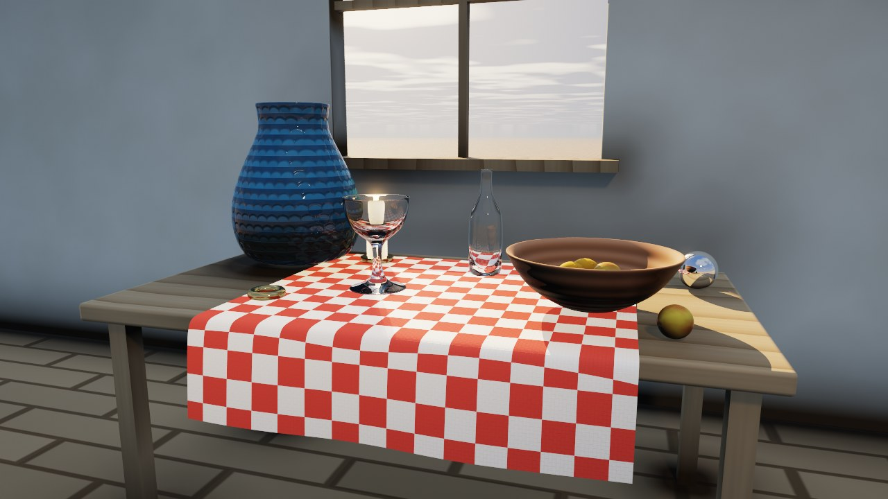<br><sub>A still life by a window, every curve a NURBS surface traced exactly: a draped tablecloth, a glazed vase, a glass goblet, a bottle and a bowl (<code>nurbs.json</code>)</sub></td><td width="50%">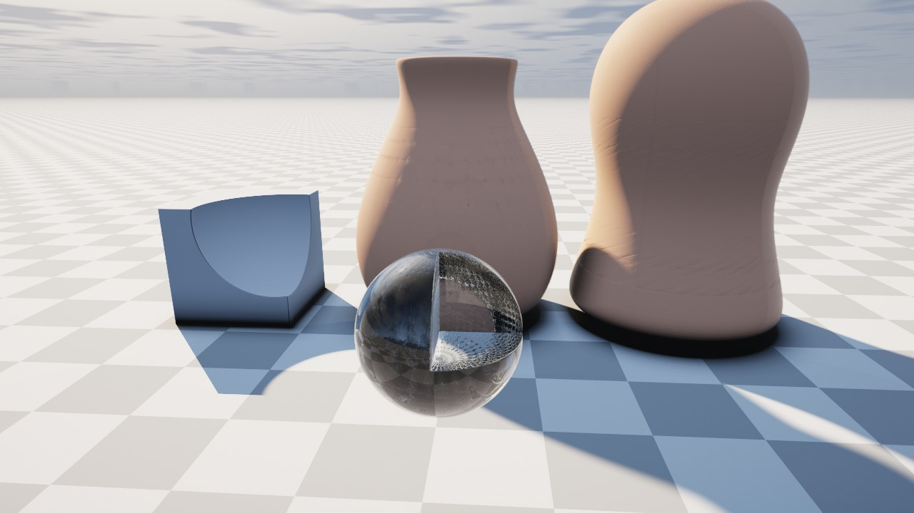<br><sub>NURBS surfaces in booleans: cut and blended like any other shape (<code>nurbs-booleans.json</code>)</sub></td></tr>
<tr><td width="50%">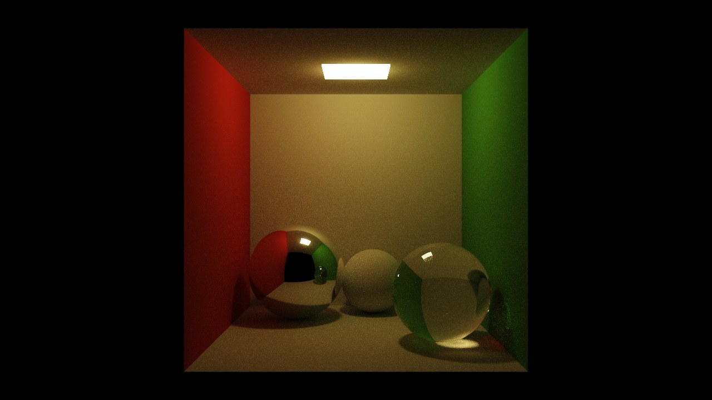<br><sub>The Cornell box, path traced: 400 samples a pixel (<code>cornell.json</code>)</sub></td><td width="50%">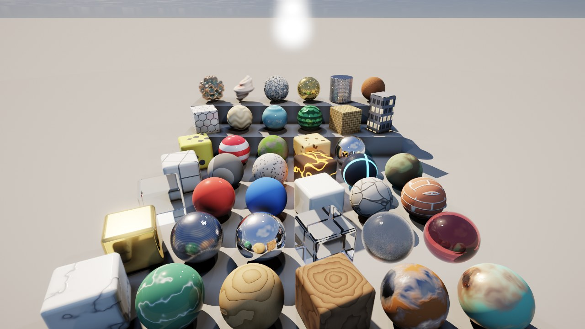<br><sub>The procedural material library (<code>materials.json</code>)</sub></td></tr>
</table>

## Build and run

```
cargo build --release
target/release/ray saves/showcase.json
```

It needs an x86-64 CPU with AVX2 and FMA (`.cargo/config.toml` builds for x86-64-v3; the binary checks at startup), Rust 1.90, and Vulkan or GL for the window.

`tools/install-desktop.sh` adds ray to the desktop's applications (`~/.local/share/applications/ray.desktop`, running this checkout's release build from the checkout). The desktop finds that entry by the window's app id, `ray`, for its name and icon; without it GNOME lists the window as "Unknown". The icon, `assets/icon.png`, is a render of `assets/icon.json`.

| scene | |
| --- | --- |
| `showcase` | every kind of shape on a checkerboard floor, a fountain whose jet is an emitter, relief-carved columns |
| `night-city` | a city at the blue hour: every block a `group` of buildings whose lit windows are the `windows` pattern, sodium lamps on a wet avenue, a park, traffic you can throw (`tools/scenes/city.py` regenerates it, with another seed if you like) |
| `fractals` | a gallery of nine fractals on plinths, each coloured by its orbit trap; a Menger sponge cut along its diagonal by `slice` |
| `glass` | a glass chess set mid-game at sunset: NURBS pieces in clear and smoked glass |
| `nurbs` | a still life by a window: a draped NURBS tablecloth, vase, goblet, bottle, bowl of fruit, a candle |
| `clouds` | hot-air balloons (groups of a NURBS envelope, basket and ropes) among cumulus clouds over a lake; a paddle steamer whose funnel emits small clouds as smoke |
| `night` | a campfire in a pine clearing under the moon: emitters send up sparks and smoke, a tent glows from the lantern inside |
| `water` | the sea with floating and sinking things, a pier (a group), a rowing boat, buoys, and a dispenser that tosses rubber ducks into the waves |
| `physics` | a crate pyramid, a ball stack, a ring of dominoes, a seesaw, a ramp, and a Galton board fed by an emitter |
| `playground` | crates, dominoes, balls and lamps, and a cannon (an emitter) that fires at the crates |
| `vehicles` | two cars, a pickup truck and a cart (each one `union`) in a car park, with cones and a ramp |
| `bonsai` | a glass bonsai on a rock in a lake at sunset: trunk, roots, 341 branches, twigs and sprigs and a frosted jin are 348 NURBS tubes of glass in one group, the leaves in another (the trunk twisted, with an oval section), 2,574 small leaves of translucent green glass in five shades fill 198 pads, a sandbank under the island lets game mode's walker wade out of the lake, and the water moves (`tools/scenes/bonsai.py` builds it; another seed grows another tree) |
| `cornell` | the Cornell box, the classic test of global illumination: red and green walls, a ceiling light panel, mirror, glass and matte balls; path traced, so the walls' colours bleed onto the white surfaces and the glass ball focuses a caustic onto the floor (up to 4096 samples) |
| `materials` | materials on spheres and boxes; at the back, on steps, the newer patterns, bump maps, orbit traps and relief |
| `island` | a raised island at sunset with a lighthouse, a boat and clouds |
| `landscape` | an eroded valley with a lake and fractals coloured by their orbit traps |
| `infinite`, `stress-1600` | infinite repetition (arches with a bricks bump, glass orbs); 1,600 objects |

## The editor

Every panel is built from the same rows: a property's name on the left and its editor on the right. A number with a natural range (a level, a radius of effect, a count) has a slider, an open-ended one (a position, a size) a box you drag or type in, a switch a checkbox, one of a few choices buttons side by side. Hovering a name or an editor says what it does. Scene values (objects, materials, the environment) are undoable and saved with the file; render settings belong to the viewer.

- **Scene panel (left):**
  - **Environment** (at the top; it opens in a window of its own, as do Render > Lighting's *Environment…* and View > Environment…): the sun and sky (preset, day / stars / off, time of day, azimuth and elevation, sun and ambient levels, fog, cloud cover), World: gravity (Earth, Mars, the Moon or none), their colours, and the water's waves when there is water.
  - **Objects:** every object with its type, a bar and a figure for its share of the last frame's CPU time in aligned columns, as a tree: ▶ opens a group to its members, and a boolean or modifier to its parts, nested as deep as they go (closed at first; selecting something, in the view too, opens what it is in). Tick to show or hide an object, a group's member or a boolean's part; a group's members have their own cost bars, and hovering a shape's part gives its estimated share of the shape's cost. + Add and + Light are in the panel's title.
  - **Inspector:** every parameter of the selection, with defaults filled in and a description on hover. It shows the measured cost (share of the frame, milliseconds over all cores, evaluations) and per-node estimates from timing each operation of the distance program. Actions: duplicate, delete, frame, wrap in a combinator or modifier, add a child; friction, bounce, lock, shadow, step and bound.
- **Material library (M, or Library… in the material section):** every library material and every scene material rendered on a sphere (in the background, on three cores). A click gives one to the selection: a library material as a copy of its own, a scene material shared by name. A right click renames, describes or deletes a library material, describes a scene one, or copies it to the library. Find filters by name or description. The material section shows the current material on a sphere, updated as you edit.
- **Modifier library (K, or Modifiers… in the inspector):** twist, bend, round, bumps, ripples, waves, grooves, bricks, hexagons, scales, weave, cells, cracks, grid and shell, each shown on a sample block; a click wraps the selection in it (its settings then show in the inspector; Ctrl+Z takes it off).
- **Materials:** *Assign…* copies a library material (`library/materials.json`, 30 presets) into the node, so every assignment can be changed on its own; scene materials are shared by name (*Make unique* copies one). 🎲 *Random* generates a procedural material. The editor covers the pattern, two sets of colour, roughness, metal and emission that the pattern blends between, scale, warp, sharpness, bump, object or world space, and transmission. *Save to library* and *Share in scene* keep a result; the library is read from and saved to `library/materials.json` relative to the directory ray was started in (the built-in copy is used when there is none). The patterns are checker, grid, noise, marble, wood, cells, cracks, spots, stripes, bricks, hexagons, waves, ripples, scales, weave, windows and orbit, plus terrain and water; the pattern picker shows each on a sphere. A material's relief (`bump`) follows its colour pattern unless `bump_pattern` and `bump_scale` name another one (a plain colour with a bricks relief). Materials take a `description` (shown in the library).
- **Render panel (right):** statistics and every render setting in sections (Render, Lighting, Quality, Post, Camera). Lighting holds the switches (shadows, AO, glowing objects, fog...); its *☀ Environment…* button opens the Environment. Camera shows the pose and copies it as a `--camera` argument.
- **Load panel (bottom):**
  - CPU and GPU utilisation over the last minute, each split into ray and other processes (GPU per process through NVML);
  - render time per frame;
  - every core's load now;
  - video memory.
- **Cost heat map (H):** CPU time per pixel instead of the image, with a legend.
- **Help (F1, or the Help menu):** every shape with its parameters, defaults and meanings; materials and patterns; the mouse, and every command with its keys.
- **Commands:** one table (`src/ui/actions.rs`) names every command, its keys and its description; the menus show the keys beside each entry, the keyboard runs the same commands, and the help lists them, so they cannot disagree. Esc closes the help, the file window, Preferences, the Environment window or a library, else clears the selection (in game mode it goes back to editing). Revert (Ctrl+R) asks a second time when there are unsaved edits.
- **Editing:** undo and redo; save (Ctrl+S) writes the JSON back in its original key order, with the camera exactly where it is (its `camera` block: position, yaw, pitch, field of view, fly speed) and every render setting (its `render` block), so the file opens as it was left, in the viewer and in a headless render alike. Quick save (F5) keeps the same, unsaved edits included, in one slot, the quick save file (Preferences; `saves/quicksave.json`, relative to where ray was started, by default); quick load (F9) brings it back, after a restart too: keep the view where a problem shows, restart with the fix, F9. Edits made in a text editor reload by themselves while there are no unsaved edits here.

Rendering runs on its own thread, so the panels stay smooth while a heavy scene renders.

## Controls

| input | action |
| --- | --- |
| left click | select the object, and the node of its tree, under the cursor |
| drag a handle of the selection | **Move** (x / y / z arrows): slide it along that axis, Ctrl on a 10 cm grid. **Rotate** (rings): turn it freely like a trackball; Shift turns it only about the grabbed ring's axis. **Scale** (cube-ended handles, along the object's own axes): resize it evenly; Shift stretches it only along the grabbed axis (box sizes, ellipsoid radii, a cloud's `stretch`, cylinder and cone height or radius, a NURBS surface's control points; a sphere becomes an ellipsoid; other shapes, such as unions and fractals, scale evenly). The tool bar in the view's corner, or T, picks the tool. An object placed with the handles stays put, in water too, until it is dropped |
| left drag on an object | carry it; let go to drop it: it falls, collides and settles with rigid-body physics (per-object mass, friction and bounce), knocking into whatever it hits |
| while carrying: ↑ / ↓ (or the wheel) | farther / nearer |
| while carrying: ← / → | tip it forward / turn it clockwise as seen from the camera (Shift: the other way) |
| while carrying: hold right button | charge a throw (full after 1.2 s, shown by a ring at the pointer); let go to throw along the view: up to 300 m/s for 5 kg or less, heavier objects slower |
| left drag elsewhere (or middle drag) | look around |
| right drag | pan: the grabbed point follows the cursor |
| mouse wheel | move toward or away from the point under the cursor: each notch takes 15% off the distance (or puts it back), finer the nearer, never through it |
| Shift + mouse wheel | a plain step forward or back (0.3 x the fly speed a notch), through walls |
| W A S D, R / F (Space / C) | fly; up / down. Flying slows toward whatever is ahead (at most 3 times its distance a second) and stops short of it, so a fractal's crevices can be explored |
| L | headlight: a light at the camera, for the inside of objects and a fractal's crevices (strength, reach and shadows in Render > Lighting; with shadows it hangs a thirtieth of its reach above the camera, so they show, or halfway to the nearest surface when that is closer) |
| M, K | the material library, the modifier library |
| Shift, Alt, [ ] | faster, slower, fly speed |
| Q / E, arrows | turn left / right; arrows also up and down (when not carrying) |
| . | frame the selection |
| Del, Ctrl+D | delete, duplicate |
| Ctrl+Z, Ctrl+Shift+Z / Ctrl+Y | undo, redo |
| Ctrl+S, Ctrl+Shift+S, Ctrl+O | save, save as, open (the open file's folder is listed, `saves/` by default, with each scene's description; *saves/* and *↑* go to other folders); saving stores the camera and every render setting |
| F5, F9 | quick save, quick load: the scene, the camera and every setting in one slot (the quick save file in Preferences; `saves/quicksave.json` by default) |
| T | handle tool: move, rotate, scale |
| 1-7 | modes: direct, path traced, normals, albedo, depth, search steps (a count of each camera ray's search steps, not time: the cost heat map, H, shows time), object cost (each object coloured by what one evaluation of its shape costs, with a ranked list of the kinds in the scene) |
| H | cost heat map |
| G | device: GPU + CPU, GPU only, CPU only |
| Ctrl+R | revert: load the file again (with unsaved edits, press twice) |
| Esc | close the help, the file window, Preferences, the Environment window or a library, else clear the selection; in game mode, back to editing |
| Ctrl+, | preferences: where recordings, screenshots and the quick save go, microphone, mouse look, interface size, CPU share |
| P or F12 | screenshot to the screenshots folder (Preferences; `~/Pictures` by default): the 3D view alone, or the whole window with File > Screenshots include the interface |
| F10 | record a video of the window to `~/Videos` (again to stop; the folder is in the preferences): the interface, the pointer, game mode; with the system's default microphone when File > Record the microphone is on (the default). The title bar shows the time while it records |
| Home | the view the scene was opened or last saved with |
| Tab (Esc back) | game mode: walk around inside the scene, first person, interface hidden (see below) |
| Shift+Tab | hide or show the panels |
| F1 | help |

## Game mode

Tab (or the ▶ Game mode button beside Drop all) turns the viewer into a first-person walker and back; the camera stays exactly where it is both ways. The viewer takes Tab and Shift+Tab before egui sees them (egui moves the keyboard focus with Tab, and took it), except while a text field is being typed in. The interface goes, the pointer is held, and:

| key | |
| --- | --- |
| mouse | look |
| W A S D, Shift | walk, run: hold Shift, or tap it while moving and you run on until you stop (in the air WASD steers a little) |
| Space | jump: a person's push, a metre on Earth, higher where gravity is weaker; with W, A, S or D held, a leap that way (about 4 m walking, 8 m running) |
| left mouse button | gravity gun: hold to charge (a ring round the crosshair fills over 1.5 s), let go to fire: whatever is under the crosshair within 30 m (more for a bigger walker) is sent off along the look, harder the longer it was held (a tap nudges; full charge: 40 m/s for 20 kg or less, heavier things slower), spun when hit off centre. The crosshair turns orange over something it can move; locked objects stay put; Ctrl+Z back in editing undoes a shot |
| right mouse button | rocket pack: hold to fire. It builds up over two seconds (the gauge, bottom right, fills; its tick is where it lifts you) and dies away when let go; at full power it pushes twice Earth's gravity. It is on your back, so it leans with the look: looking down tips the push forward, looking up back, never more than 40 degrees (past that you would tip over) |
| R / F | grow / shrink, feet where they are (Shift: faster); it grows only where it fits |
| in water | on a bottom you walk, however deep (slower the deeper); with nothing under you, you float chest deep with your eyes out, riding the waves: W A S D swim, Space kicks up, Space while looking down dives; under water you swim where you look (Space swims up), neither sinking nor rising, until your head comes out; swimming into a ledge up to a little over your height climbs out onto it. Looking down into deep water shows the water's own colour |
| L, P, F5 / F9, F10 | headlight, screenshot, quick save / load, record a video |
| Tab or Esc | back to editing |

The walker starts with its eye at the camera: a person's height, or standing on what is below when that is nearer, smaller still where the space around is tight (so in a fractal's tunnel it comes out micrometres tall). Its body is three spheres stacked into a capsule (`src/ui/game.rs`), pushed out of whatever it overlaps along the scene's distance, in steps of at most half a sphere's radius so it never passes through a wall or a floor; it slides along walls, hops onto ledges up to a third of its height, and stands still on a floor without creeping. It collides with the scene as the frame draws it: the fractals at the frame's detail and anchored at the camera (`render::view_query`), so the tunnels it walks into are the ones on the screen. Gravity is the scene's (Environment > World: Earth by default, Mars, the Moon or none); the jump and the rocket are a person's on Earth, so they carry further where it is weaker. Speed, gravity and the rocket's thrust scale with the walker's height, so a hop or a fall takes as long at any size; in the air it slows a little (drag), so leaning on the rocket gives a top speed. It can be 10 nm to 10 km tall. Its feet and the camera are kept in f64 (`Camera::fine` holds what f32 cannot of the camera's position; saves keep it), so it walks smoothly a micrometre tall six metres from the origin.

Not yet: it does not push objects, and there is no sound. Below a few micrometres only the Menger sponge and slices stay sharp; Sierpinski, the kaleidoscopic IFS and analytic shapes are f32 in world coordinates (planes and boxes resolve to about a micrometre).

## Preferences

File > Preferences (Ctrl+,) holds what goes for every scene, saved as it changes in `~/.config/ray/config.json` (`$XDG_CONFIG_HOME`); a scene's render settings stay in the Render panel and the scene. Recording: the videos folder (the desktop's Videos folder, `~/Videos`, by default), the microphone, frame rate and quality. Files: the screenshots folder (the desktop's Pictures folder, `~/Pictures`, by default) and whether screenshots include the interface, the quick save file (`saves/quicksave.json`), reloading a scene changed on disk. Mouse: look speed and inverted up and down (looking around and game mode). Interface: its size. Performance: the share of the CPU's cores the renderer uses (from the next start). `~` is the home folder; a relative path is from ray's folder. Back to the defaults is a button.

## Recording

F10 (File > Record video) records the window, everything it shows, to `~/Videos/ray-<date>.mp4` (the folder is in the preferences); F10 again stops it and the file is finished in the background (a message says when). Each frame the window draws is captured (egui's screenshot of it) and handed to ffmpeg on a thread, with the pointer drawn in where it is (the desktop draws its pointer above the window, so a capture has none; hidden while looking around and in game mode). ffmpeg encodes with NVIDIA's encoder when it has it (else x264) at 30 frames a second (the preferences set the rate and quality), and with File > Record the microphone on, takes in the system's default microphone (PulseAudio / PipeWire) for narration. Picture and sound are both stamped by the wall clock as they arrive, so they stay together whatever the frame rate (a slow frame is simply shown longer). The title bar shows the time and the file while it records; it is outside the window, so not in the video. When the file is finished, the menu bar (in game mode, the view's corner) says where it is for 20 seconds, with buttons to play it and open its folder; File > Play the last recording and File > Open the videos folder do the same later. It needs `ffmpeg` installed; what went wrong, if anything, is in a `.log` beside the video.

## Physics

Every object that is not locked can move. Planes, terrain, water and unbounded shapes are always locked. A moving object is a rigid body made of about 300 points sampled evenly on its own distance surface (closer together where that leaves too few, as on a long row of columns), plus points on every downward-facing surface from a grid of rays shot up from below, so whatever it stands on supports it:
- **Against the fixed scene,** its points query the scene's distance field, leaving out every moving body. Everything solid collides, glass and lamps too (AO's query leaves out what casts no shadow; physics' leaves out only the water plane, which floats things instead). No meshes anywhere.
- **Between two moving bodies,** each one's points are evaluated in the other's own distance program (or NURBS surface) at its exact current pose.
- **Waking:** a resting object that takes a real impact (more than 0.2 m/s at the contact) joins the simulation, so a thrown ball knocks down a stack or a row of dominoes. A body that has been still for half a second goes back to rest in the scene.
- **Contacts:** the touching points of each surface merge into up to four spread over the patch (the deepest, the farthest from it, and the farthest on either side of the line between them), so a standing domino or column is held at its corners rather than balanced on one point. Sequential impulses resolve them, weighted by the two masses, with Coulomb friction (the geometric mean of the two `friction` values), restitution for real impacts (`bounce`), friction against spinning in place, rolling resistance and positional correction.
- **Mass:** `mass` in kg, or automatic from the size (300 kg per cubic metre of the bounding box, half filled).
- **Carrying:** a carried object is infinitely heavy: it shoves what it touches.
- **Gravity:** `gravity: false` makes an object float where it is let go; a knock moves it only a little way (lights are made like this).
- **Fast objects** take smaller steps (none moves more than 30% of its radius per step, down to 1/7680 s), so a 300 m/s throw does not pass through a wall.
- **Hard hits** (over 1 m/s) also wake what the struck object rests against, within the same step, so a stack takes the blow as a whole rather than as a wall.
- **Water:**
  - It does not collide.
  - Buoyancy: each body is filled with up to 1000 points on a grid (the inside of its distance field). Each point under the surface is pushed by the weight of the water it displaces, at that point and along the surface's normal there. The surface is the rendered one, waves and ripples included, so a body lighter than water floats at its own depth, rights itself, bobs, and rides, rocks and drifts on moving waves; a heavier one sinks to the bed.
  - Mass: a material's `density` times the body's volume (ice 917 floats with 8% above the surface; stone 2600 sinks), unless the object has a `mass` of its own; without either, about 150-300 kg per cubic metre from its size, so it floats.
  - The water moved along with a body (added mass, half the water displaced) limits how fast buoyancy can speed it up, quadratic drag over the wetted cross-section slows it, and while it lies in the surface its bobbing is damped to settle in a few rises. A beach ball let go a metre down rises at about 4 m/s and leaps out of the water; sinkers fall at a few metres per second.
  - While the waves are animated, floating objects wake by themselves and stay awake. Changing an object's physics settings (friction, bounce, mass, gravity, lock, material density) sets it moving at once.
  - Anything moving through the surface sets off ripples (a carried object too): rings that spread at 0.9 m/s and fade within a few seconds, at most 32 at once. Each one bends the reflections and refraction and focuses the light on the bed.

`--drop N[,H]` (headless) drops object N from H metres and prints where it settles, and how many ripples it made. `RAY_DROP_VEL=x,y,z` throws it instead.

## GPU

`src/gpu/lib.wgsl` is the CPU renderer ported per pixel: the same distance functions and fractals, BVH traversal, terrain march, water, materials and patterns, lights and emitters, the Direct and path-traced integrators and the debug views. `src/gpu/codegen.rs` turns each object's distance program into a WGSL function. Programs with the same structure share one function and read their numbers from the scene buffer, so editing a value or dragging an object never rebuilds the shader; only a new kind of shape tree does. A build the driver has not seen takes several seconds (2.5 s for one small structure, 6 to 9 s for a full gallery on an RTX 5080), milliseconds once it has cached it (`~/.cache/nvidia`); a new build of ray changes the shader, so its first open builds afresh. The viewer builds on a thread and renders on the CPU meanwhile, so a scene shows in under a second and the GPU joins when its shader is ready (the Render panel says which); headless renders wait for it. The viewer logs its startup to stderr: when the window, the render device, the first frame and the GPU's shader were ready.

**Sharing a frame.**
- The frame is cut into 16-row bands. The GPU gets a share of them, spread evenly over the picture, and the CPU traces the rest at the same time.
- Afterwards the CPU adds the GPU's samples into the accumulation and runs the post pass (bloom, edge AA, tone mapping).
- The share is steered each frame so that both finish together. It is steered on finish times rather than rows per millisecond, because the GPU has a fixed cost per frame (submit, copy back). That cost would make rates undervalue it on small frames. Each side always keeps at least one band, so both stay measured.
- The CPU works in jobs of two rows of a 16x16 tile. A single costly tile, such as the Mandelbulb seen through the glass ball, takes 10 ms on one thread, so it is spread over several threads instead of holding up the frame.

**Its own device.** The renderer has its own wgpu device rather than the window's. Work on one queue runs in order, so a shared queue would hold every traced frame behind the window's wait for the display. Both devices ask wgpu for its small memory blocks (`MemoryHints::MemoryUsage`): by default it takes host-visible memory in 128 MB blocks and pins them, which made the viewer's resident memory about 820 MB instead of about 350 MB, for no measurable speed.

**Device setting.**
- Render panel buttons: GPU + CPU (the default), GPU only, CPU only. The G key cycles through them; `--device both|gpu|cpu` sets it headless.
- The cost heat map always uses the CPU, since it measures CPU cycles. The per-object cost bars are measured on the CPU's rows.
- Agreement with the CPU, as mean difference per channel out of 255:
  - Direct mode: 0.04-0.21;
  - debug views: 0.07 or less;
  - path tracing: the difference is noise only.

## Headless

```
target/release/ray SCENE.json --out shot.png [--size 1280x720] [--frames N] [--spp N]
    [--mode direct|path_trace|normals|albedo|depth|steps|cost] [--bounces N]
    [--camera x,y,z,yaw,pitch] [--set '{"ao": false}'] [--bench] [--device both|gpu|cpu]
```

This renders `N` frames (accumulating), writes the PNG and prints the median frame time. `--bench` prints every frame: how the rows were shared, the GPU's and the CPU's time, and post. Per-object profiling is on. `--drop N[,H]` first drops object N with the physics.

`tools/gui-test.sh [scene] [out.png] [frames]` runs the viewer inside a private headless GNOME Shell (its own D-Bus session, with settings in memory) and saves a capture of the whole window, panels included. That tests the GUI without opening anything on the desktop. `RAY_TEST_SELECT=n`, `RAY_TEST_HELP=1` and `RAY_TEST_HEAT=1` preset the selection, the help screen and the heat map; `RAY_TEST_DROP=n` drops object n at start; `RAY_TEST_SCREENSHOT=n` presses P at frame n; the script's header lists every hook (game mode, held keys, Tab, recording, the windows...).

`tools/test-all.sh` runs every check below in turn, a line each, and fails if any does (`--quick` leaves out the interface's, which take a few minutes). Nothing writes to `saves/` or the home folders: the scripts give the viewer preferences of its own in a temporary folder.

- `cargo test --release`: 52 unit tests, a second or two once the GPU's shaders are cached. The NURBS maths and its distance grid; the anchored sponge's precision; compiling groups, NURBS in booleans and modifiers, and every shape; surfaces built once across recompiles; every scene in `saves/` loading whole; the GPU's code (programs of one shape share a function; NURBS leaves bring the NURBS code); the renderer going idle when nothing changes; with a GPU, the GPU drawing what the CPU does in six small scenes (shapes, NURBS alone and in glass, NURBS in booleans and twisted, terrain, under water, a fractal); physics (a box comes to rest on the floor, the scene's gravity, floating and sinking by density, throws and the gravity gun's speeds and spin); the game-mode walker (walking, jumping, the rocket, growing, ledges, tunnels, floating, swimming, diving, wading, climbing out, shrinking in flight); recording (frames cropped and padded, the pointer drawn, a real recording through ffmpeg with both encoders, file names); preferences (saved and read back, a bad file kept aside, the desktop's folders); screenshot names; the object list's tree; document versions; the commands' and the MCP tools' names and schemas.
- `tools/parity.sh out-dir [baseline-dir]`: every saved scene on CPU and GPU (320 x 180, 8 frames, about 10 seconds); fails when more than 1% of a scene's pixels differ visibly between them (5% path traced); with a baseline folder it lists what a change did to every scene: run it into a folder before a change and into another after.
- `tools/generators-check.sh`: every generator in `tools/scenes` (the bonsai with another seed too, the ones that add to a scene onto a copy, settling) into a temporary folder, and every scene they write loading whole.
- `tools/mcp-check.sh`: the MCP server driving a headless viewer: opening, adding, updating, undoing, a refused edit, commands by name (and ones that cannot run), the quick save, a screenshot, saving and failing to save, game mode.
- `tools/gui-check.sh`: the interface, headless: both kinds of screenshot, a recording, the Open, Preferences and Help windows, the object list's tree, game mode floating in deep water, the gravity gun sending a crate off.

Not covered: real mouse and keyboard input on a real desktop (the checks inject keys and buttons), the egui layout itself (looked at, not asserted), the microphone, NVENC on other hardware.

`RAY_DROP_ALL=1` with `--drop N` lets every movable object fall too (Drop all), printing when each comes to rest; `RAY_DROP_FPS` sets the frame rate the physics steps at (default 60). `--time T` sets the water's clock (its waves as at T seconds) and the stars' twinkle, and `RAY_TEST_RIPPLES="x,z,age,height;..."` adds ripples, to test moving water headless.

## Profiling

```
cargo build --profile profiling --features profile
RAY_PROFILE=out.svg target/profiling/ray saves/showcase.json --out shot.png --device cpu --frames 20 --bench
```

The `profile` feature adds a sampling profiler (pprof, driven by SIGPROF, so it needs no perf permissions) and an allocation counter in place of the global allocator. The `profiling` build profile is release plus line tables, so inlined functions keep their names. It works for headless renders and for the viewer; the report is printed when the program ends.

| variable | |
| --- | --- |
| `RAY_PROFILE=out.svg` | write a flame graph, and print the time per thread, per function (self and total) and per source line. Time in the SIMD and vector helpers (`simd.rs`, `math.rs`) is charged to their callers; library code is named with its nearest caller in ray |
| `RAY_PROFILE_ALLOCS=N` | record the call stack of every Nth allocation and print the places that allocate most. The stacks stay in memory until the end, so the live heap climbs while it records |
| `RAY_PROFILE_THREAD=T` | report only the threads whose names start with T: in the viewer `ray` (the UI), `render` and `trace N` (the workers) |
| `RAY_PROFILE_TOP=N` | rows per table (default 25) |

With the feature, `--bench` also prints each frame's allocations and the live heap, and the viewer's `RAY_TEST_SHOT` log does the same every five frames. Heap figures leave out the profiler's own tables (about 140 MB).

## Measured (Core Ultra 9 285K, 24 threads, 1280x720, Direct mode, 2 bounces, idle machine)

| scene | what | frame |
| --- | --- | --- |
| `showcase` | 14 objects: CSG, metaballs, twist, displacement, gyroid, Menger, Mandelbulb, glass, chrome | 16-18 ms |
| `landscape` | 512 m eroded terrain (1M samples), water, Menger structures, crystals | 17 ms |
| `fractals` | Mandelbulb, Mandelbox, Julia, Sierpinski, Menger | 55 ms |
| `stress-1600` | 1,600 objects (spheres, boxes, tori, blended SDF figures) through the BVH | 16 ms |
| `infinite` | infinitely repeated CSG arches and glass orbs | 17 ms |

GPU (RTX 5080) beside the CPU, `showcase`, Direct, 4 bounces, 1 spp. The machine was busy: load average about 18 on 24 threads, and another program using about 20% of the GPU. Times are medians and swing by ±30%.

| size | GPU + CPU | GPU only | CPU only |
| --- | --- | --- | --- |
| 640x360 | 4.3 ms | 3.9 ms | 8.4 ms |
| 1280x720 | 9.9 ms (GPU 91% of rows) | 11.9 ms | 33 ms |
| 2560x1440 | 43 ms | 45 ms | 134 ms |

Below about 640x360 the GPU's fixed cost per frame leaves little to share.

How many objects hold 30 fps, at 1300x1152 (the render size of the viewer as it was open on this desktop), Direct, GPU + CPU, every object in view (scattered over a 32 x 42 m patch of floor in front of the camera). Another program was using about 7 cores and part of the GPU, so frame times are the faster quartile of 32 frames (the medians were 3 to 5 ms higher):

| objects | 30 fps holds at | fails at |
| --- | --- | --- |
| spheres and boxes (exact) | 11,200 (32.3 ms) | 12,000 (34.5 ms) |
| rounded boxes, tori, capsules, cylinders, blended pairs (marched) | 4,400 (32.3 ms) | 4,800 (36.3 ms) |
| cars of 6 parts (rounded boxes and cylinders in one union) | 550 (31.8 ms) | 600 (34.6 ms) |

What costs is what is on screen: the same 12,000 primitives spread over four times the area took 27.6 ms, and 600 cars 22.7 ms. Doubling the objects adds 3 to 8 ms, and the GPU's share of the rows falls from about 90% to 35% as they grow, so the CPU carries more of the frame.

`nurbs` (7 surfaces, 184 patches, two of them glass) at 1300x1152 on the same busy machine: 26 ms with GPU + CPU (fastest quartile; median 33 ms), 58 ms CPU only.

## Scene format

Every field has a default. The shortest scene is `{"objects": [{"type": "sphere"}]}`. The `saves/` files show most features.

```jsonc
{
  "camera": { "position": [0, 2, 8], "look_at": [0, 1, 0], "fov": 60, "speed": 5 },  // or "yaw"/"pitch" in degrees
  "environment": { "preset": "golden", "sun_azimuth": -40, "sun_elevation": 35, "fog_density": 0.002, "clouds": 0.3, "gravity": 9.81 },
  "render": { "mode": "path_trace", "bounces": 4, "exposure": 0.8 },                   // any panel setting
  "materials": { "gold": { "color": [1, 0.76, 0.33], "metallic": 1, "roughness": 0.15 } },
  "lights": [ { "position": [3, 1, 2], "color": [1, 0.6, 0.3], "intensity": 6, "range": 6 } ],
  "objects": [ { "type": "sphere", "radius": 1, "position": [0, 1, 0], "material": "gold" } ]
}
```

### Objects

Each entry of `objects` is one top-level object with its own bounds. Objects never blend into each other; shapes that should blend go into one object's tree (a `union` with `smooth`). An object that does not compile (a bad edit) is left out and named in the error banner; the rest of the scene goes on working, and Ctrl+Z undoes the edit. Changing a NURBS profile's points or degree resets knots that no longer fit.

A plain sphere, unrounded box or plane at the top level is intersected exactly, as are NURBS surfaces (`nurbs`, `revolve`). Any other tree compiles to a signed-distance program that is sphere-traced inside its bounding box.

Fields that every node takes:
- `position`, `rotation` (Euler degrees, applied x, then y, then z) and uniform `scale`;
- `material` (a name, or an inline material);
- `name`;
- `disabled`.

Fields for top-level objects only:
- `shadow` (whether it casts shadows; glass and water default to false);
- `step` (a march step multiplier below 1 for shapes whose distance estimate overshoots);
- `bound` (a bounding radius);
- `friction` (0.5), `bounce` (0.15), `locked` (false), `gravity` (true) and `mass` (automatic: the material's `density` times the volume, else from the size), for drag and drop.

| type | fields (defaults) |
| --- | --- |
| `sphere` | `radius` (1) |
| `box` | `size` ([1,1,1], full size), `rounding` (0) |
| `plane` | `normal` ([0,1,0]), `offset` (0) |
| `torus` | `radius` (1), `thickness` (0.25) |
| `cylinder` | `radius` (0.5), `height` (1) |
| `cone` | `radius` (0.5, bottom), `top_radius` (0), `height` (1) |
| `capsule` | `a`, `b` (the ends), `radius` (0.25) |
| `ellipsoid` | `radii` ([1, 0.5, 0.75]) |
| `octahedron` | `size` (1) |
| `gyroid` | `frequency` (1), `thickness` (0.1): infinite, so intersect it with something |
| `menger` | `iterations` (4): fills [-1, 1]^3; use `scale` |
| `mandelbulb` | `power` (8), `iterations` (8) |
| `mandelbox` | `fold_scale` (2; negative values work), `iterations` (12), `min_radius` (0.5) |
| `julia` | `c` ([-0.2, 0.6, 0.2, 0.2], a quaternion), `iterations` (10) |
| `sierpinski` | `iterations` (8) |
| `metaballs` | `balls` ([{`center`, `radius`}]), `blend` (0.5) |
| `union`, `intersection`, `difference` | `children`, `smooth` (0 = sharp; otherwise the blend radius). `difference` is the first child minus the rest. |
| `repeat` | `period` ([x, y, z]; 0 = not repeated on that axis), `count` (optional [x, y, z]: limited to +-count cells, otherwise infinite), `child` |
| `mirror` | `axes` ("x", "xz", ...), `child` |
| `twist` | `amount` (radians per unit of height), `child` |
| `bend` | `amount` (radians per unit along x), `child` |
| `round` | `radius`, `child` |
| `shell` | `thickness`, `child` |
| `displace` | `amplitude` (0.1), `frequency` (1), `octaves` (3), `child`: Perlin fBm on the surface |
| `relief` | `pattern` ("ripples"; any material pattern), `frequency` (4 cells per metre), `depth` (0.03; negative carves), `warp`, `sharpness` (1), `child`: the surface moved by the pattern, so the outline changes too. Steep patterns (bricks, grid) march more slowly. |
| `slice` | `normal` ([0, 0, 1]), `offset` (0), `thickness` (0), `child`: the child cut by a plane; what lies beyond `offset` along `normal` is gone (with a `thickness`, only a slab that thick is kept). For seeing inside a fractal. |
| `apollonian` | `fold` (1.1), `iterations` (8): an Apollonian packing of spheres; infinite, so intersect it with a box (Add gives it one) |
| `kifs` | `fold_scale` (3), `offset` ([1, 1, 1]), `angles` ([0, 0, 0]: a rotation inside each fold), `iterations` (6): a kaleidoscopic IFS |
| `kleinian` | `fold_box` ([0.8, 0.95, 0.8]), `inversion` (1), `iterations` (8): a pseudo-Kleinian; infinite, intersect it with a box |
| `group` | `children`: whole objects kept together (a building of several parts, a city block, a balloon). Each member is an object of its own (any kind, NURBS and clouds too; it renders as fast as on its own), placed in the group's frame; the group's `material`, `shadow`, `friction` and `bounce` are its members' where they have none. Unless `locked`, the group falls, is carried and is thrown as one body, its members colliding as one shape (when every member is a distance shape: a NURBS surface, cloud, terrain or water member keeps the group where it is; a member's own `locked` is ignored). Groups nest. Click a member in the view to select it; the inspector's *Into group* / *Out of group* move objects in and out where they stand, and *Wrap in > group* makes one. |
| `emitter` | `rate` (2 a second), `lifespan` (8 s; 0 = for ever, up to `max`), `grow` (0.3 s), `fade` (0.6 s), `speed` (2.5 m/s), `spread` (20 degrees around its +y), `physics` (true: the copies are bodies that bounce, pile up and float; false: they fly through everything), `max` (40), `visible` (true: a small glowing nozzle), `seed`, `emit` (the object to send out, any shape with its own material; `gravity: false` makes copies rise or fly straight): sends out copies of `emit` (smoke as small clouds, sparks, fountains, balls). Top level only. The copies are not saved and are on the physics' clock. |
| `terrain` | `size` (512 m), `resolution` (1024), `noise` ("eroded", "perlin", "ridged", "billow", or "flat": level ground at `base`, e.g. the checkerboard floor), `height` (70), `base` (18), `frequency` (0.0075), `octaves` (8), `seed`, `rim` (bowl radius, 0 = none), `cap` (max height), `relax` (0.65), the colours `rock` / `grass` / `snow` / `sand`, `snow_line`, `sand_line`. Top level only. |
| `water` | `level` (0), `waves` (1: wave height, 0 = mirror-flat), `wave_speed` (1): an infinite plane with waves, refraction, absorption and caustics. Top level only. With the render setting `animate_water` its waves move. The Lighting panel has sliders for both. |
| `nurbs` | `points` (rows along u of [x, y, z] or [x, y, z, weight]; default a 2 m sheet with a bump and a dip), `degree` ([3, 3]; 1 to 3 each way), `knots_u`, `knots_v` (clamped; default even), `solid` (false: an open sheet, seen from both sides). Alone it is traced exactly; in a boolean or under a modifier it is a distance leaf (see NURBS below). |
| `revolve` | `profile` ([radius, height] or [radius, height, weight] control points, bottom to top; default a vase with 3 cm walls), `degree` (3), `knots` (clamped; default even), `angle` (360), `solid` (default: when the profile ends on the axis at both ends or loops). The profile turned about the y axis with the exact rational circle. Alone it is traced exactly; in a boolean or under a modifier it is a distance leaf (see NURBS below). |

### Materials

| field | default | |
| --- | --- | --- |
| `color` | 0.7 | albedo, `[r, g, b]` or a grey value |
| `roughness` | 0.6 | 0 = mirror |
| `metallic` | 0 | |
| `emission` | 0 | makes it a light: each glowing part is a sphere light of its size, sampled at a random point of its disk, so its shadows are as soft as it is big (they smooth out as samples accumulate) |
| `transmission` | 0 | 1 = clear dielectric |
| `ior` | 1.5 | |
| `absorption` | 1 | how fast transmissive material absorbs the complement of `color`, per metre |
| `texture` (or `pattern`) | none | "checker", "grid", "noise", "marble", "wood", "cells", "cracks", "spots", "stripes", "bricks", "hexagons", "waves", "ripples", "scales", "weave", "windows" (facades: a window per 1 x 1.4 cell, a share of them lit, more on some floors; roofs plain; use world space), "orbit" (fractals: colours by the orbit trap), "terrain", "water" |
| `bump_pattern`, `bump_scale` | the colour pattern | a relief of another pattern than the colours' (and its own scale) |
| `color2`, `roughness2`, `metallic2`, `emission2` | | the values the pattern blends to (default: the first ones; `color2` a darker `color`) |
| `texture_scale` (or `scale`) | 1 | pattern frequency |
| `warp` | 0 | noise distortion of the pattern |
| `sharpness` | 1 | contrast of the blend |
| `bump` | 0 | relief from the pattern (negative raises the second phase) |
| `space` | object | "world" fixes the pattern in space |
| `density` | none | kg per cubic metre: an object's mass is this times its volume unless it has a `mass`; under 1000 it floats (the library's materials all have one) |
| `light_range` | automatic | metres the light of its emission reaches: it fades smoothly to nothing there |

### Environment

- `preset`: one of fraktal256's palettes, "golden", "dusk", "frozen" or "storm".
- `sun_direction`, or `sun_azimuth` and `sun_elevation`.
- `sun_color`, `ambient`, `sky_zenith`, `sky_horizon`, `fog_color`.
- `fog_density` (per metre) and `clouds` (cover, 0 to 1).
- `gravity`: m/s² straight down, Earth's 9.81 when not given (Mars 3.71, the Moon 1.62, 0 for none): what dropped objects, emitted copies, floating in water and game mode's walker feel.
- `sun_level` and `ambient_level` (multipliers, 1).
- `time_of_day` (hours, 0 to 24; the Lighting panel's slider): the sun rises at 6 in the east, is highest at 12 and sets at 18 in the west. With it, `sun_azimuth` and `sun_elevation` give the noon position (default 180, toward +z, and 60). Low down, the sunlight crosses more air, so the light and the sky near the sun redden; after sunset the glow lingers, the sky darkens and the stars come out; the full moon, opposite the sun, is drawn and lights the night (its shadows too). The palette's colours are its noon.
- `sky`: "day" (the default), "stars" (a night sky) or "off" (black). The sky also lends its light to the fog's own colour and to the water's deep colour, so with `sky` off and both levels at 0, glowing objects are the only light: without any, the image is exactly black.

Stars twinkle a little (Render panel, *twinkling stars*). The twinkle is added in the post pass to the sky that shows, so the traced image keeps accumulating underneath.

A **cloud** (`"type": "cloud"`, Add > Landscape > cloud) is a volume, as Blender makes them with a Principled Volume and a noise texture on a domain mesh. Its domain is a smooth union of `puffs` (balls in the cloud's own metres; left out, a cumulus about 13 m across, flat underneath). Turbulence noise (`turbulence` 0 to 4, default 0.75: 0 smooth puffs, 2 to 4 torn and ragged; `frequency`; `detail`, 1 to 8 octaves, default 5; `seed`) pushes the domain's surface in and out into billows and thins the edges into wisps. `wisps` (0 to 1) carves the inside into filaments with a finer noise, so the cloud's inner structure shows; with a low `density` (0.3 to 0.6) the cloud turns smoky and see-through. Each finer octave keeps 70% of the last one's strength (Blender's roughness), so `detail` adds visible finer billows. The density fades in over `softness` metres (default 0.25: larger is hazier, and blurs the fine detail) and is scaled by `density` (default 1.5). `stretch` [x, y, z] makes it longer or flatter along its own axes, on top of `scale` (Scale handles with Shift). Both renderers march through it: 40 steps along the view ray, and from each a 4-step march toward the light for its self-shadowing; scattering with a forward and a back lobe (the silver lining when looking toward the sun), a lift for light scattered many times, and the sky's fill light. After sunset it is lit by the sun's lingering glow while that is brighter than the moon, so high clouds turn pink from below. Shadow rays march through clouds too (more coarsely), so they cast soft, partial shadows. Clouds are not objects: rays pass through them, physics ignores them, and they have no outline when selected (their handles show; click one to select it). The material setting `translucency` is a cheaper, surface stand-in for leaves or paper.

Terrain gets fine detail close up: grit in the colour at 25, 7 and 2.5 cm and small bumps in the shading, from noise on the three axis planes (so it is not stretched down slopes), each layer fading out as it shrinks below a couple of pixels.

A **NURBS surface** (`nurbs`, or `revolve` for a profile turned about the y axis) is traced exactly, without a mesh. When the scene is compiled, knot insertion cuts it into rational Bézier patches (raised to bicubic, so one evaluator serves degrees 1 to 3), and each patch is halved until its pieces are nearly flat (no control point more than 2% of the piece's size off the straight lines through its corners; a sphere has 8 patches and about 1,700 pieces). With positive weights a patch stays inside its control points, so their boxes bound the pieces in a small BVH of their own. A ray that crosses a piece's box before its nearest hit so far is written as two planes and Newton's method solves for (u, v) where the surface meets both, from the piece's centre (the GPU reads the patch's 16 control points as 16 vec4 loads); a hit at a grazing angle tries four more starts, since a grazing ray can cross one piece twice. The normal comes from the patch's two tangents (at a pole, where a profile touches the axis, from a point just beside it). Shadow rays stop at the first hit. AO and physics need distances: Gauss-Newton projects the point onto each nearby piece; AO lets a small, far box stand in for what it holds. A closed surface (`solid`) has an inside, so glass refracts through it and its distance is signed; an open one shows both sides. Weights make exact conics: `revolve` builds its circles that way, and a profile of two quarter circles (weights √½ on the corners, knots [0,0,0,0.5,0.5,1,1,1]) makes an exact sphere; `saves/nurbs.json` has a torus too. In a `union`, `intersection` or `difference`, or under a modifier (`twist`, `shell`, `round`, `displace`...), a NURBS surface is a leaf of the shape's distance program instead, so it blends (`smooth`), cuts and bends like any other shape: its signed distance comes from a 48 x 48 x 48 grid of samples over its box (built once, in a few milliseconds, kept with the surface), within half a cell of the truth, and near the surface from the pieces within the grid's estimate (exact). A solid surface has an inside, so a difference cuts it properly; an open sheet acts as a surface of no thickness. It is several times slower than the same surface alone (the march evaluates it at every step); fine for a few objects. The Scale handles with Shift stretch the control points (a revolve's heights, or its radii all round).

### Lights

A light is any object whose material has emission. The scene panel's **+ Light** (or Add > light) adds a ready-made one: a small glowing sphere with `gravity: false`, so it can be dragged anywhere and stays there. Older scenes' `lights` (point lights) load as such spheres, 0.12 m across, as bright a couple of metres away as the old light was.

## Driving the viewer from an AI assistant (MCP)

`ray mcp` is an MCP server (stdin / stdout) that drives the running viewer through a control socket (`$XDG_RUNTIME_DIR/ray-viewer.sock`, or `RAY_SOCKET`; `RAY_NO_SOCKET=1` turns it off). The viewer applies each command on its next frame; every edit is first compiled, so a bad node is refused with the reason and the scene stays as it was, and every edit can be undone. `.mcp.json` registers it for Claude Code started in this folder; elsewhere, `claude mcp add ray -- <path>/target/release/ray mcp`. A screenshot waits for the image to show the latest changes and gather `samples`, except while water moves or objects fall (the image restarts every frame), when a current image is returned at once.

| tool | |
| --- | --- |
| `viewer_status`, `launch_viewer` | is a viewer running (scene, unsaved edits, samples); start one (detached) with a scene |
| `describe_scene_format` | conventions (metres, y up, rotation order, compound objects as `union`), every shape with its fields and an example, the object and material fields |
| `list_materials`, `get_scene`, `list_objects` | the materials (scene and library), the whole document with camera and settings, the objects with their world bounds |
| `add_object`, `update_object`, `delete_object`, `select_object` | edit objects (by index or name); `drop: true` lets it fall and settle |
| `set_material`, `set_environment`, `set_render_settings`, `set_camera` | named materials, sky and lights (`time_of_day`...), the render panel, the view (`position` + `look_at`) |
| `raycast` | the ground's height at (x, z), or a ray's hit: to place things on the land |
| `screenshot` | the view as a PNG (default 800 wide), once it shows the latest changes and has `samples` samples |
| `add_objects` | many objects in one edit (one compile, one undo step) |
| `run_command` | any command of the menus and keys by name (`game_mode`, `record_video`, `reset_scene`, `headlight`, `screenshot`...); one that cannot run now says why |
| `drop_all`, `undo`, `save_scene`, `open_scene`, `quick_save`, `quick_load` | physics, undo / redo, save (as), open, the quick save slot (F5 / F9) |

## Layout

| file | |
| --- | --- |
| `src/scene/json.rs` | the file format (serde) |
| `src/scene/mod.rs` | compiling it: materials, environment, objects, the BVH |
| `src/scene/sdf.rs` | shape trees to register programs, with bounds and step safety |
| `src/scene/terrain.rs` | heightmap generation and sampling |
| `src/scene/nurbs.rs`, `src/render/nurbs.rs` | NURBS surfaces to bicubic patches and flat pieces with a BVH; Newton ray hits and distances on eight lanes |
| `src/render/vm.rs` | the 8-lane distance-program interpreter (all primitives and fractals) |
| `src/render/trace.rs` | BVH packet traversal, exact shapes, the SDF and terrain marches, shadows, distance queries for AO |
| `src/render/shade.rs` | surfaces, textures, lighting, and the Direct, path-traced and debug integrators |
| `src/render/mod.rs` | frames, accumulation, the tile pass |
| `src/render/post.rs` | bloom, edge AA, tone mapping |
| `src/render/atmos.rs` | sky and fog |
| `src/render/pattern.rs` | procedural patterns (Voronoi, marble, wood, bricks, ...) and bump |
| `src/ui/mod.rs` | the editor: state, view controls, drag and drop, menus |
| `src/ui/inspector.rs` | outliner, inspector, material section |
| `src/ui/materials.rs` | the material library, editor and randomiser |
| `src/ui/physics.rs` | rigid bodies against distance fields |
| `src/ui/game.rs` | game mode's walker: a capsule of spheres against the scene as drawn, jump, leaning rocket pack, growing and shrinking, floating and swimming |
| `src/ui/record.rs` | recording the window to a video through ffmpeg, with the microphone |
| `src/ui/config.rs` | the preferences (`~/.config/ray/config.json`) and their window |
| `src/ui/perf.rs` | CPU and GPU load sampling (/proc, NVML) and the charts |
| `src/ui/panel.rs`, `help.rs`, `schema.rs` | render settings, help screen, the parameter descriptions |
| `src/ui/style.rs`, `actions.rs` | the theme and the property rows every panel uses; the commands with their keys |
| `src/ui/doc.rs`, `render_thread.rs` | the edited document with undo; the background renderer |
| `src/gpu/mod.rs` | the GPU device, buffers, dispatch and read-back |
| `src/gpu/codegen.rs`, `lib.wgsl` | distance programs to WGSL; the renderer as a compute shader |
| `src/main.rs` | the command line and the headless renderer |
| `src/prof.rs` | the sampling profiler and allocation counter (`--features profile`) |
| `src/mcp.rs` | the MCP server (`ray mcp`) |
| `src/ui/remote.rs`, `control.rs` | the viewer's control socket, and the commands it carries out |
| `src/ui/emitter.rs`, `library.rs`, `previews.rs` | emitters and their copies; the material and modifier libraries; their preview renders |
| `tools/readme-images.sh`, `logo.py` | the README's pictures in `docs/images` (the banner is `assets/banner.json` with the name set on it) |
| `tools/scenes/*.py` | the generators of most default scenes (`city.py` writes night-city and `bonsai.py` the bonsai, each with any seed; see `common.py` for how to run them) |

## Limitations and next steps

- **CPU hot spots (profiled, not yet addressed):**
  - `showcase` spends 54% of its CPU time in shadow rays, 43% inside the Mandelbulb. A whole-power Mandelbulb (multiplications instead of exp2(log2)) measured 5-8% slower, and was dropped.
  - `landscape` spends 37% sampling the terrain's heightfield (bilinear heights at 16 march steps a ray).
  - In the viewer, when the GPU takes about 90% of the rows, the idle trace workers spend some 15-20% of their samples spinning for work between frames.

- **GPU:**
  - The shader is one large kernel for every mode. Building it per mode and lighting flags measured 12-15% faster, but a new combination took a 6-second build, so it is left as a single kernel.
  - A wavefront design, which sorts rays by what they hit, would be the larger win.
  - A shader build (a new kind of shape tree) blocks the render thread for about a second.
- **NURBS:** surfaces are top-level objects only (not inside a `union`), untrimmed, of degree 3 at most. Newton can still miss a ray that only grazes a silhouette, which leaves an odd pixel along the edge until the image accumulates. The GPU's share of a NURBS scene is costlier than for the other shapes (each piece a ray reaches is a Newton solve); the GPU's NURBS code is compiled only into scenes that have a surface.
- Per-object profiling (on by default in the viewer) slows rendering by about 10-15%; untick it in Stats for clean speed numbers.
- Physics uses the scene as compiled at the start of each frame for the fixed parts, and up to 64 glowing parts light the scene (the brightest; lit windows glow but light nothing).
- A group with a NURBS surface, cloud, terrain or water among its members cannot move under the physics (handles still move it). Handles move a whole group; a member is placed with the inspector's numbers.
- Close up, the Menger sponge, the Sierpinski tetrahedron and the kaleidoscopic IFS iterate further as the pixels shrink (each level adds smaller copies without moving the larger ones; never fewer than their `iterations`, at most 12 to 24 (the Menger sponge 20 near the camera, see below); Render > Quality > fractal detail turns it off). The escape-time and inversion fractals (Mandelbulb, Julia, Mandelbox, Apollonian, Kleinian) keep their own counts: more iterations reshape them, and close up they turned to smears and dust. How much detail they get is decided once a frame, for each fractal, from the camera's distance to its nearest surface (iterations that changed along a ray made walls across the tunnels the camera was in). The marches, normals and shadows resolve to the pixel's footprint, down to four f32 steps of the point's distance from the object's position: half a micrometre a metre from a fractal's centre. Each distance program works in metres from its own object's position (the march's points are taken relative to it before they are rounded), so that is the camera's distance from the object's centre, not from the world's origin; a fractal 7 m out used to blur into blocks below a tenth of a millimetre. A fixed 4 µm floor came before that, and close up inside a sponge it rounded off holes a few micrometres wide, and drew arcs on the walls where it took over from the pixel footprint. Below about a micrometre at a metre out (a Menger sponge's 12th level, for one 1.5 m across) the floats run out, so the Menger sponge and `slice` go further: they are evaluated from an anchor at the camera. Once a frame, each level's fold at the camera is worked out in f64 (the sponge's frame as an f64 map of the object's, `sdf::Xf`; `render/mod.rs` `anchors`), and every sample adds only its offset from the camera times the fold's slope while it stays on the camera's straight stretch of the fold (past it, the anchor's residue plus the offset: plain f32's precision, where the pixels are coarse anyway). A fold near a wall is a small number, and the offset from the camera is small near it, so f32 holds both finely: within 0.01 nm of an f64 sponge near its surface, where plain f32 was 60 nm off (`render::tests::anchored_menger_matches_f64`), and up to 20 levels. Rays and surfaces carry their offset from the camera (`Ray.od`, `Surf.dp`) so that shadows, reflections, AO and the headlight start from exact points too. An object is anchored when the camera is in its box; when every leaf and slice of it is, its marches' floor follows the offset from the camera instead of the position. Not yet: Sierpinski and the kaleidoscopic IFS (their folds are not a residue), and the camera's own position is f32 in world coordinates (half a micrometre at 6 m from the origin), so moving gets coarse deep inside. Shadow marches stop after 160 steps.
- An emitter that sends out clouds or many glowing copies recompiles the scene as they move; in a scene of a thousand objects (the city) that costs about 20 ms a change, so keep such emitters to small scenes.
- Glowing objects' soft shadows come from sampling a random point of each light per sample: noisy while the view moves, smooth once it is still.
- With `animate_water` the picture changes every frame and never settles into a smooth accumulated image.
- Volume clouds take light from the sun or moon and the sky only (glowing objects do not light them), single scattering plus an approximation of the rest; the debug views (normals, albedo...) leave them out. Their march has a fixed number of steps, so a very large cloud looks softer than a small one.
- Opaque surfaces whose shading normal (smoothed terrain, bumps) faces away from a grazing ray keep it, tilted toward the ray; it used to be flipped into the surface, which left black blotches on terrain seen low over its slopes.
- Transmissive fractals look dark: inside them the negated distance estimate is not a distance.
- The path tracer has no denoiser. It caps the light one bounce may add to a path that has already bounced off a diffuse surface (8 in the brightest channel): rare paths that find the sun through a glass ball (caustics) or a small lamp were fireflies that more samples hardly averaged out, so the image speckled more as it accumulated. The cap makes such light a little dimmer than it should be; what the camera sees directly, and in mirrors and glass, is not capped.
- Direct mode ignores dispersion. Rough reflections and refraction (frosted glass, brushed metal) blur by scattering each bounce about the mirror or refracted direction (by roughness², as in path tracing): smooth once samples accumulate, grainy while the view moves.
