# Fractals

Every kind of fractal ray draws: what it is, its formula and distance estimate, where it came from, and its parameters. Each is a shape type: `{"type": "mandalay", "scale": 0.6}` in a scene, or Add > Fractals in the editor (the families are submenus there). `saves/fractal-catalog.json` shows them all, a family to a row; the screenshots below are from `ray SCENE --out` renders.

All of them take the common fields (`position`, `rotation`, `scale`, `material`...). A fractal colored by the `orbit` material pattern shows its orbit trap: where its iteration came closest to its center, or which level of it the surface belongs to.

Most of the catalog's formulas come from the 3D fractal community of Fractal Forums (2009 onward), many by way of [Mandelbulber 2](https://github.com/buddhi1980/mandelbulber2) (GPL-3, as ray is), whose authors collected and coded them. Each entry credits its formula's authors. Where ray's version differs (a different distance estimate, defaults or orientation), the entry says so.

The fractals by family; each links to its own page.

## Contents

- [The classics](#the-classics): [Menger Sponge](fractals/menger.md), [Mandelbulb](fractals/mandelbulb.md), [Mandelbox](fractals/mandelbox.md), [Quaternion Julia](fractals/julia.md), [Sierpinski Tetrahedron](fractals/sierpinski.md), [Apollonian](fractals/apollonian.md), [Kaleidoscopic IFS](fractals/kifs.md), [Pseudo-Kleinian](fractals/kleinian.md)
- [Box folds](#box-folds): [Amazing Surf](fractals/amazing_surf.md), [Kalibox](fractals/kalibox.md), [Mandalay](fractals/mandalay.md), [Kaliset](fractals/kaliset.md), [Bulb Box](fractals/bulbbox.md)
- [Bulbs](#bulbs): [Juliabulb](fractals/juliabulb.md), [Mandelbar](fractals/mandelbar.md), [Burning Ship](fractals/burning_ship.md), [Quadratic Mandelbulb](fractals/power2_bulb.md), [Benesi](fractals/benesi.md), [Kosalos](fractals/kosalos.md), [Lambdabulb](fractals/lambda_bulb.md), [Sine/cosine bulb](fractals/sincos_bulb.md), [Riemann Sphere](fractals/riemann_sphere.md), [Hobold Riemann Bulb](fractals/riemann_hobold.md), [Hopfbrot](fractals/hopfbrot.md)
- [Algebras](#algebras): [Quaternion Mandelbrot](fractals/quaternion.md), [Tetrabrot](fractals/tetrabrot.md), [Hypercomplex Mandelbrot](fractals/hypercomplex.md), [Aexion](fractals/aexion.md), [Bristorbrot](fractals/bristorbrot.md), [Buffalo](fractals/buffalo.md), [Mandelcup](fractals/mandelcup.md), [Quick Dudley](fractals/quick_dudley.md), [Collatz](fractals/collatz.md), [Collatz Mod](fractals/collatz_mod.md), [Newton](fractals/newton.md)
- [Spheres and tori](#spheres-and-tori): [Msltoe Donut](fractals/msltoe_donut.md), [Mandeltorus](fractals/mandeltorus.md), [Sphere Tree](fractals/spheretree.md), [Sphere Cluster](fractals/sphere_cluster.md), [Jos Leys's Kleinian](fractals/jos_kleinian.md), [Schottky group](fractals/schottky.md), [Pseudo-Kleinian Mod 3](fractals/kleinian_mod.md)
- [Geometric](#geometric): [Mosely Snowflake](fractals/mosely.md), [Vicsek Fractal](fractals/vicsek.md), [Cantor Dust](fractals/cantor_dust.md), [Jerusalem Cube](fractals/jerusalem.md), [Polyhedral IFS](fractals/polyhedral.md), [Koch Delta](fractals/koch.md), [Knotted Rope](fractals/knot.md)
- [4D slices](#4d-slices): [Menger 4D](fractals/menger4d.md), [Sierpinski 4D](fractals/sierpinski4d.md), [Mandelbox 4D](fractals/mandelbox4d.md), [Kleinian 4D](fractals/kleinian4d.md)
- [More](#more): [Xenodreambuie](fractals/xenodreambuie.md), [Pine Tree](fractals/pine_tree.md), [Makin](fractals/makin.md), [Ides](fractals/ides.md), [Distance IFS](fractals/difs.md), [msltoe Sym4](fractals/msltoe_sym.md), [eiffie's bulb](fractals/eiffie.md), [Mandelnest](fractals/mandelnest.md)
- [Originals](#originals): [Seifert Gasket](fractals/seifert_gasket.md), [Indra's Cells](fractals/indra_cells.md), [Zorich Pagodas](fractals/zorich_pagodas.md), [Labyrinth Sponge](fractals/labyrinth_sponge.md), [Nil Staircase](fractals/nil_stair.md), [Quasicrystal Rooms](fractals/quasicrystal_rooms.md), [Mayer Julia](fractals/mayer_julia.md), [Screw Sponge](fractals/screw_sponge.md), [Möbius Cathedral](fractals/cathedral.md), [Dirac Frost](fractals/dirac_frost.md), [Cusp Vaults](fractals/cusp_vaults.md), [Alexander's Horned Sphere](fractals/horned_sphere.md), [Octet Truss of Trusses](fractals/octet_truss.md)

## The classics

The eight fractals ray has always had, built into its renderer.

| | Fractal |
| --- | --- |
| [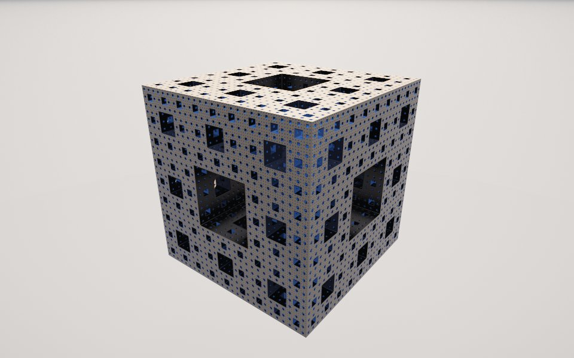](fractals/menger.md) | **[Menger Sponge](fractals/menger.md)** (`menger`) The Menger sponge: a cube with holes punched through it recursively. Fills [-1, 1] on every axis; size it with scale. |
| [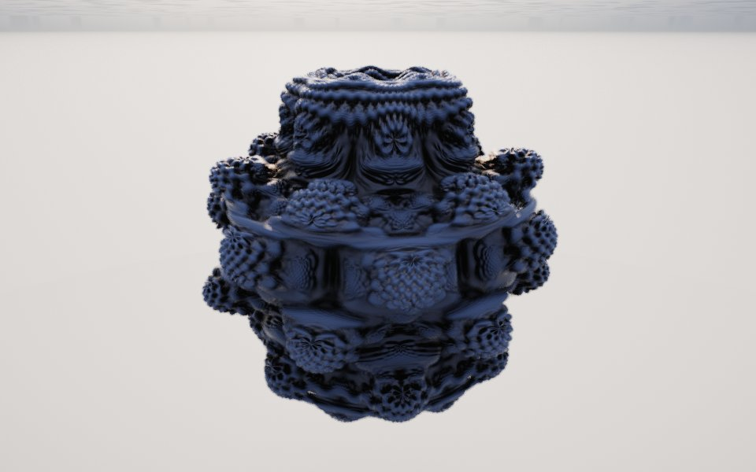](fractals/mandelbulb.md) | **[Mandelbulb](fractals/mandelbulb.md)** (`mandelbulb`) The Mandelbulb: the Mandelbrot set in 3D, from powers in spherical coordinates. About 2.4 units across; size it with scale. |
| [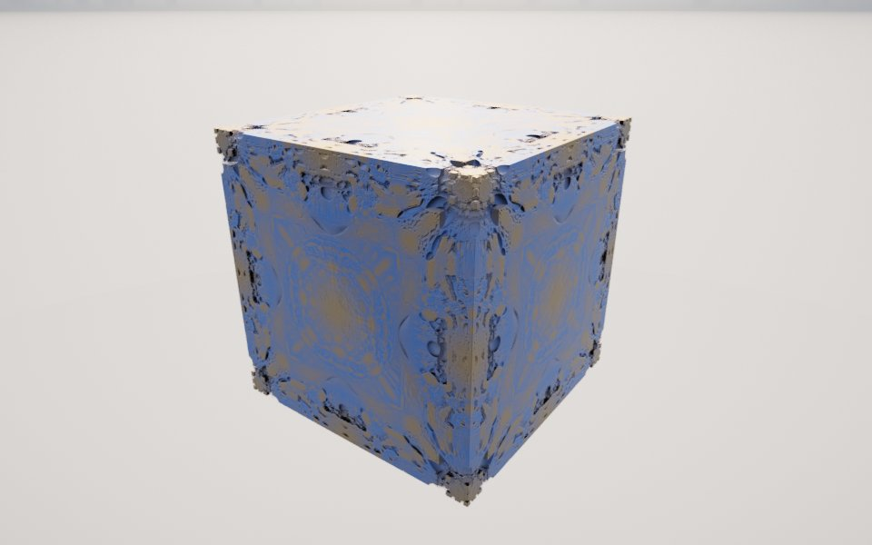](fractals/mandelbox.md) | **[Mandelbox](fractals/mandelbox.md)** (`mandelbox`) The Mandelbox: box folds and sphere folds repeated. Negative fold scales give crumpled cubes, positive ones (2 to 3) boxy cities. |
| [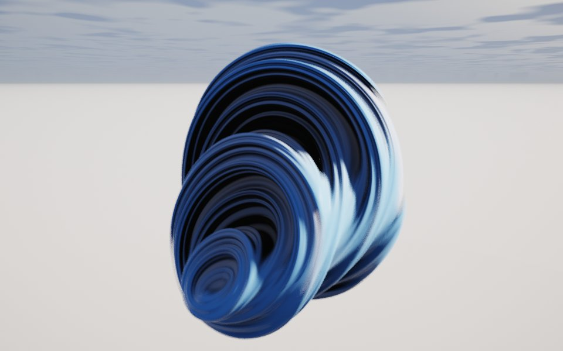](fractals/julia.md) | **[Quaternion Julia](fractals/julia.md)** (`julia`) A quaternion Julia set: a smooth, organic 4D fractal sliced in 3D. |
| [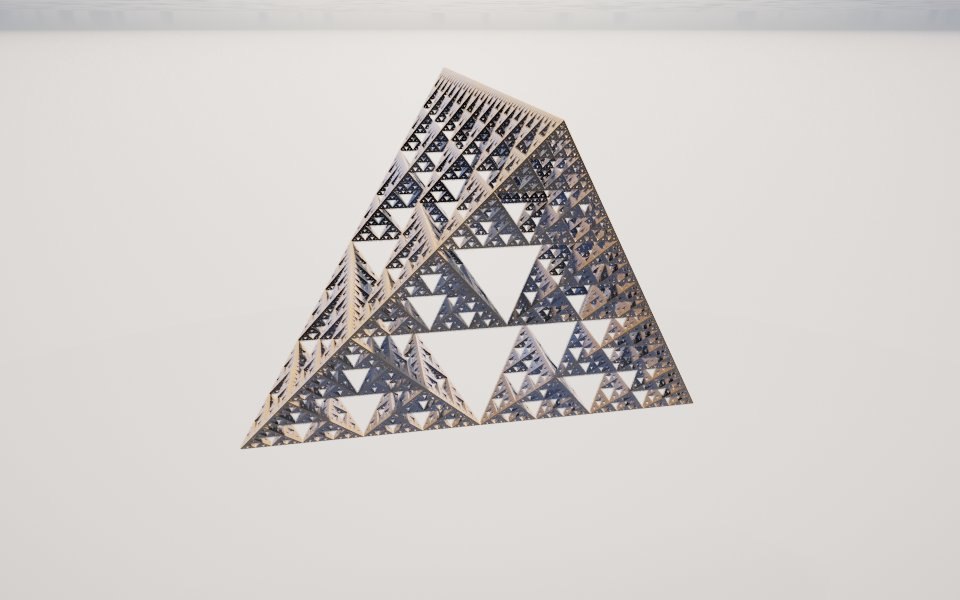](fractals/sierpinski.md) | **[Sierpinski Tetrahedron](fractals/sierpinski.md)** (`sierpinski`) The Sierpinski tetrahedron, built by folding space. |
| [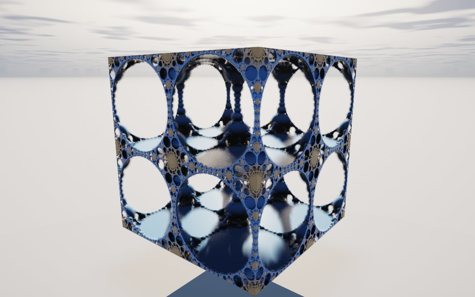](fractals/apollonian.md) | **[Apollonian](fractals/apollonian.md)** (`apollonian`) An Apollonian packing (iq's): spheres within spheres, packed by repeated inversion, like foam or coral. It fills all of space in a lattice, so it is cut to a box here; try the orbit pattern on it. |
| [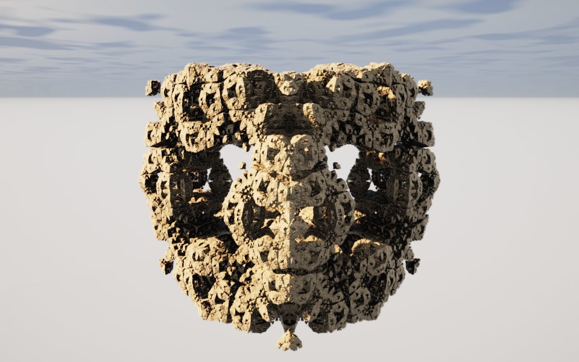](fractals/kifs.md) | **[Kaleidoscopic IFS](fractals/kifs.md)** (`kifs`) A kaleidoscopic IFS (Knighty's): space folded into a mirror octant, its axes sorted, turned, then scaled away from the offset, again and again. |
| [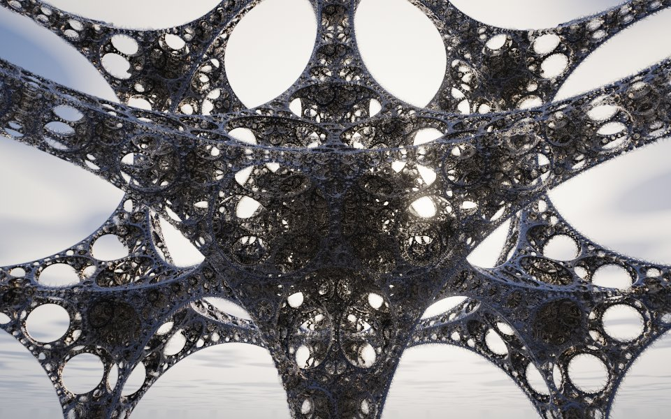](fractals/kleinian.md) | **[Pseudo-Kleinian](fractals/kleinian.md)** (`kleinian`) The pseudo-Kleinian (Knighty's): box folds and sphere inversions that build a limit set of rings and tunnels, like a cathedral of coral. |

## Box folds

Mandelbox relatives: space folded back into a box and inverted in a sphere, again and again. The best of them for walking through: halls, vaults and corridors.

| | Fractal |
| --- | --- |
|  | **[Amazing Surf](fractals/amazing_surf.md)** (`amazing_surf`) Amazing Surf: a Mandelbox whose box fold works on x and y only, so z is never folded back and on its own the set is a flat fractal sheet. |
| [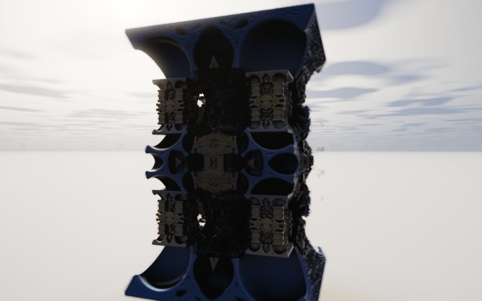](fractals/kalibox.md) | **[Kalibox](fractals/kalibox.md)** (`kalibox`) Kali's Kalibox: a Julia-set Mandelbox whose box fold is an abs fold and a shift, so each step mirrors space into one octant and moves it before the sphere fold and scale. |
| [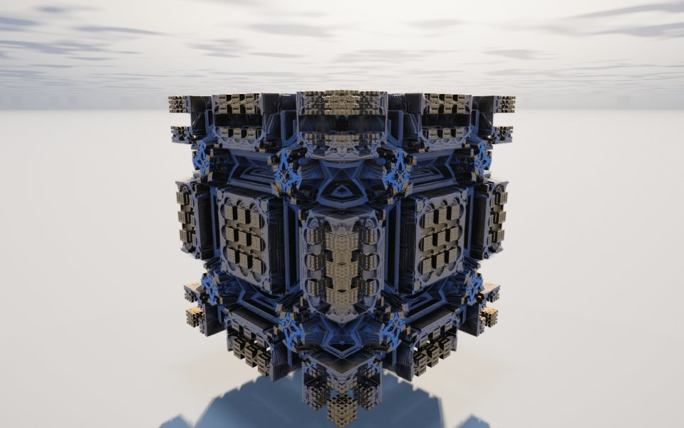](fractals/mandalay.md) | **[Mandalay](fractals/mandalay.md)** (`mandalay`) The Mandalay box: a Mandelbox whose box fold is DarkBeam's Mandalay fold, which carves each face into stepped frames, so the set grows into a cathedral: ornamented panels outside, vaults and arches in chambers within. |
| [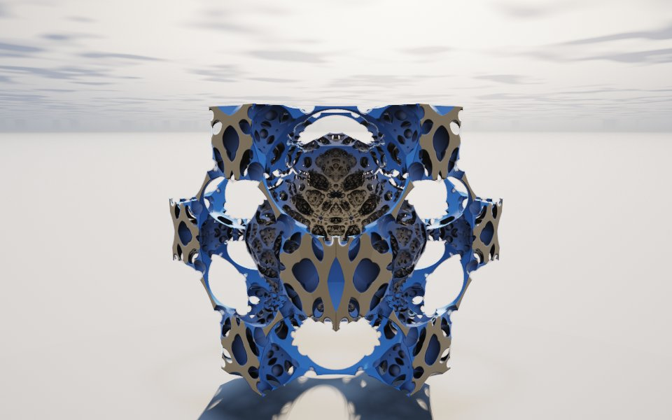](fractals/kaliset.md) | **[Kaliset](fractals/kaliset.md)** (`kaliset`) Kali's Kaliset in 3D: mirror space into one octant with abs, invert it in the unit sphere, add a constant, again and again. |
| [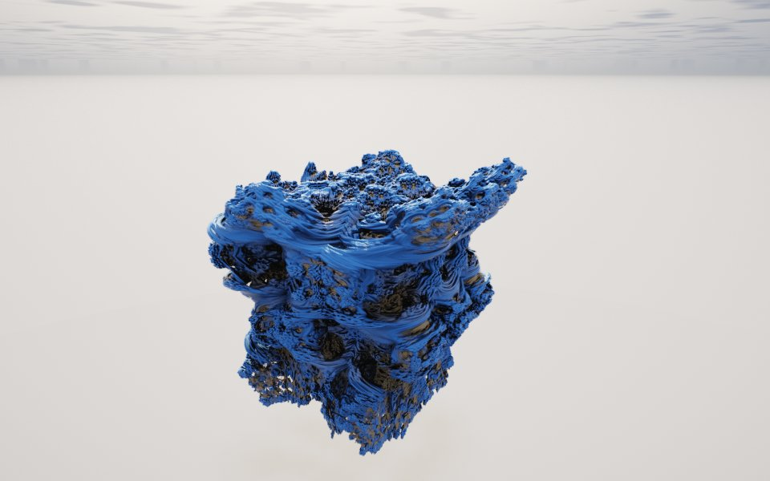](fractals/bulbbox.md) | **[Bulb Box](fractals/bulbbox.md)** (`bulbbox`) A Mandelbox and Mandelbulb hybrid in one step: the Mandelbox's box and sphere folds and a scale, then the power 2 Mandelbulb's squaring, plus the point. |

## Bulbs

The Mandelbulb's family: power maps in spherical coordinates, with other constants, signs, projections and twists.

| | Fractal |
| --- | --- |
| [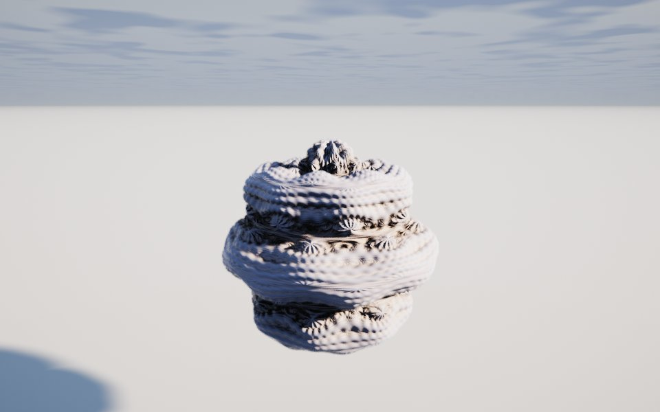](fractals/juliabulb.md) | **[Juliabulb](fractals/juliabulb.md)** (`juliabulb`) The Mandelbulb's Julia set: the same power map in spherical coordinates, with a fixed constant added at every step instead of the point itself. |
| [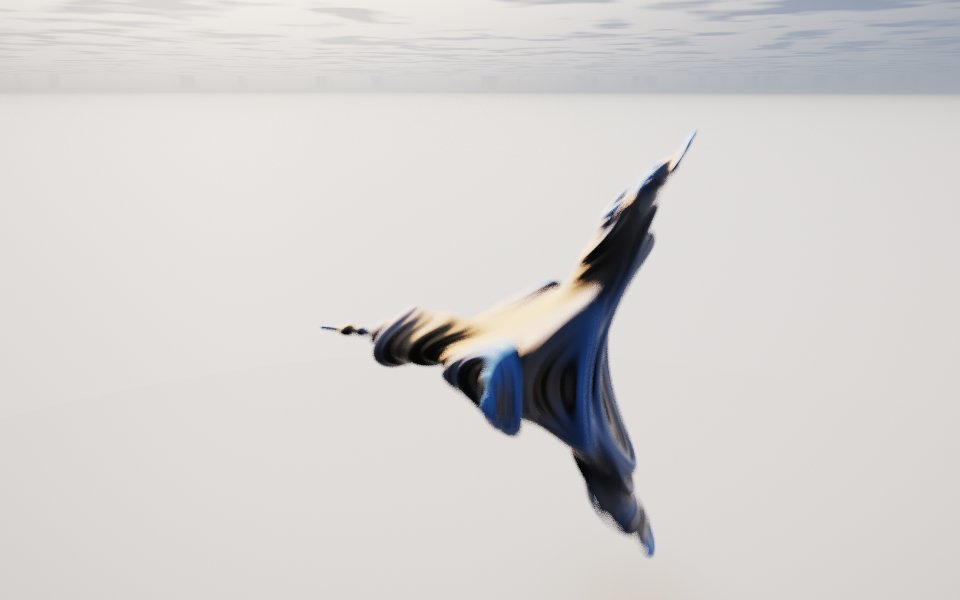](fractals/mandelbar.md) | **[Mandelbar](fractals/mandelbar.md)** (`mandelbar`) The 3D Mandelbar, or Tricorn bulb: z is conjugated before it is squared, so the slice facing you is the three-cornered Tricorn and the level slice is the Mandelbrot set, joined by smooth, swirling folds. |
| [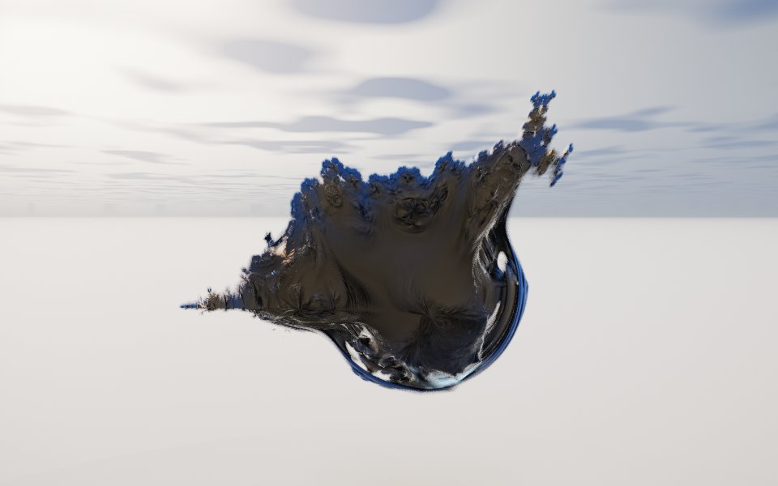](fractals/burning_ship.md) | **[Burning Ship](fractals/burning_ship.md)** (`burning_ship`) The Burning Ship in 3D: the Mandelbulb's power map with every component made positive first, so the slice facing you is Michelitsch and Rössler's Burning Ship (1992), masts up, and in depth it grows into a jagged hull. |
| [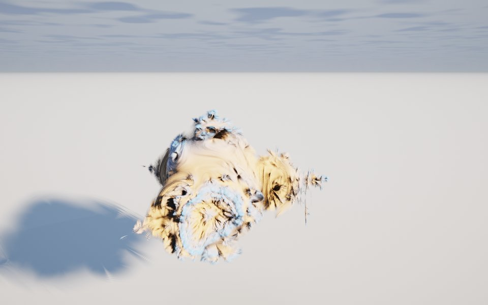](fractals/power2_bulb.md) | **[Quadratic Mandelbulb](fractals/power2_bulb.md)** (`power2_bulb`) The first 3D Mandelbulb: Daniel White's 2007 triplex square, the quadratic bulb Paul Nylander rendered in July 2009 before higher powers made the Mandelbulb famous. |
| [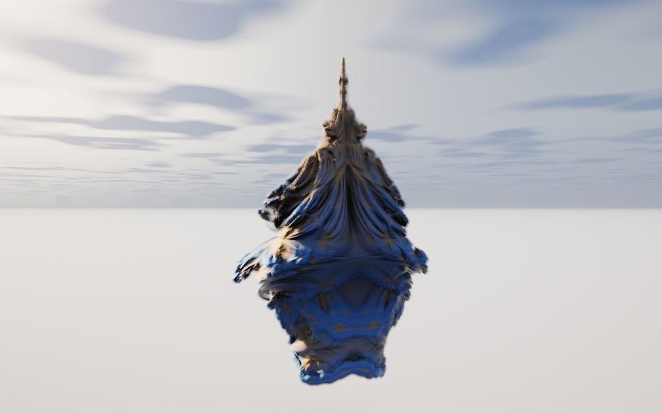](fractals/benesi.md) | **[Benesi](fractals/benesi.md)** (`benesi`) Matt Benesi's power-2 bulb: the Mandelbrot set spun about its real axis, the plane across the axis squared like a complex number, and x's sign flipped where it outgrows that plane's radius. |
| [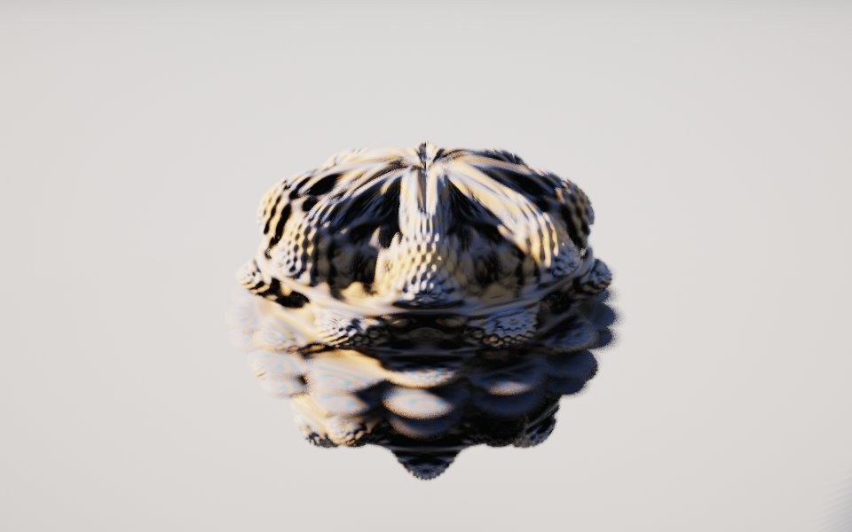](fractals/kosalos.md) | **[Kosalos](fractals/kosalos.md)** (`kosalos`) Kosalos's bulb (fractalforums.org; in Mandelbulber 2 since 2019): a power-9 bulb whose polar angle is squashed the more, the less the orbit moved on its last step. |
| [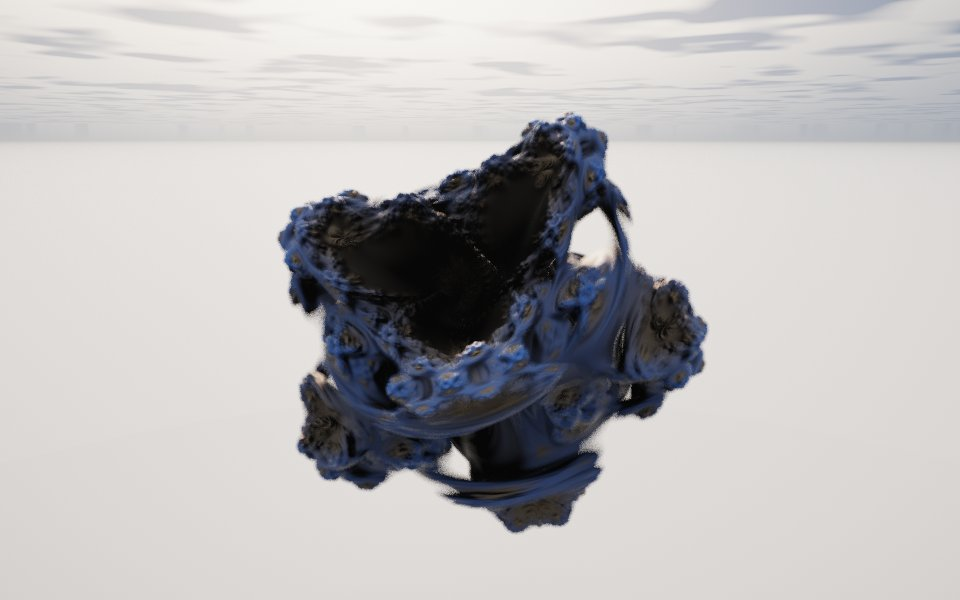](fractals/lambda_bulb.md) | **[Lambdabulb](fractals/lambda_bulb.md)** (`lambda_bulb`) The Lambdabulb: the logistic map's Julia set made 3D, z = c(z - z^n) in Paul Nylander's triplex numbers, Ron Barnett's idea (Fractal Forums, 2009). |
| [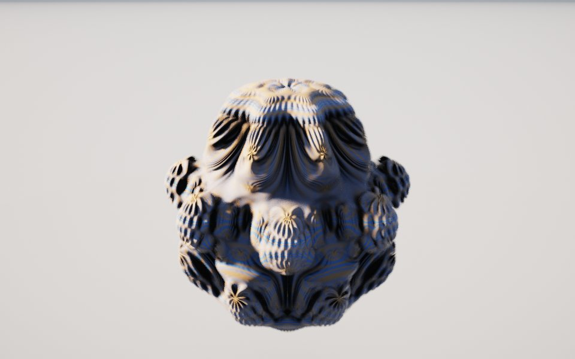](fractals/sincos_bulb.md) | **[Sine/cosine bulb](fractals/sincos_bulb.md)** (`sincos_bulb`) A Mandelbulb whose polar angle is taken by acos, asin or a blend of the two and put back as a latitude, so sine and cosine trade places. |
| [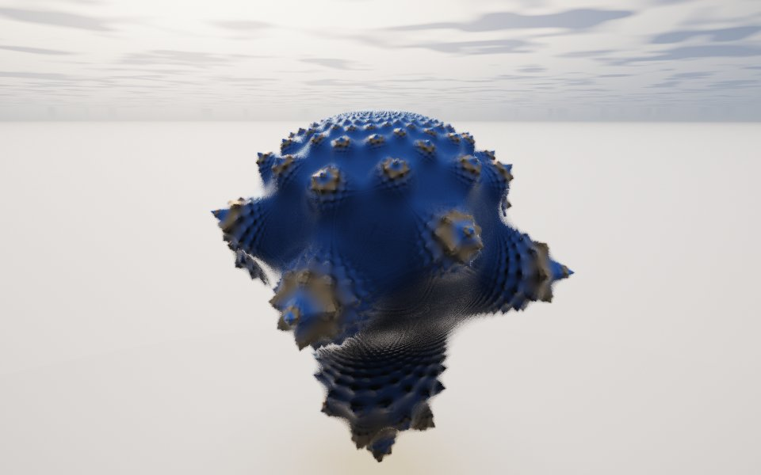](fractals/riemann_sphere.md) | **[Riemann Sphere](fractals/riemann_sphere.md)** (`riemann_sphere`) msltoe's Riemann sphere fractal: each step projects the point's direction stereographically onto a plane, folds the plane into a grid of cells with \|sin\|, projects back, and raises the radius to a power that grows towards the projection's pole. |
| [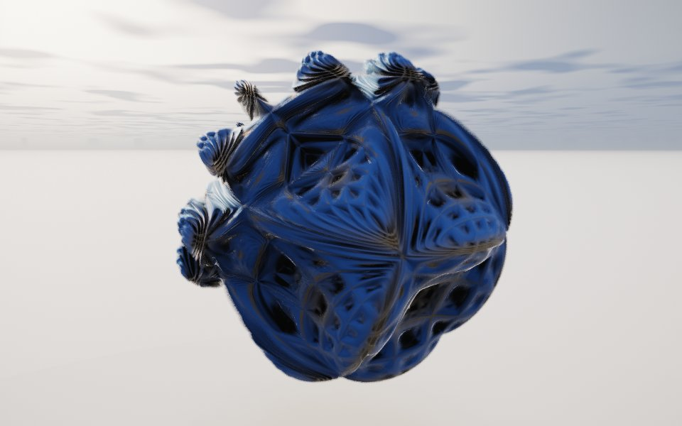](fractals/riemann_hobold.md) | **[Hobold Riemann Bulb](fractals/riemann_hobold.md)** (`riemann_hobold`) Hobold's Riemann sphere bulb, done without trigonometry: the direction is projected from the sphere's pole onto two great circles, each projected point's angle is doubled by complex squaring, and the two planes through the pole that the doubled points define meet the sphere at the new direction. |
| [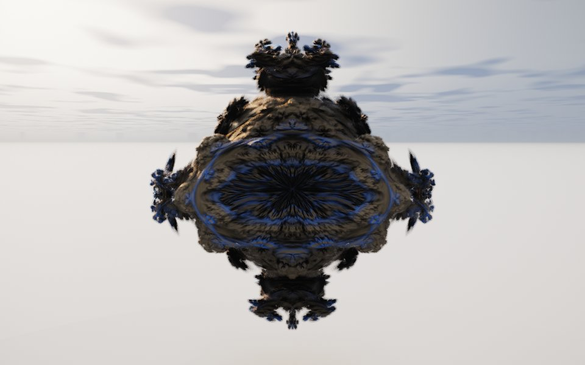](fractals/hopfbrot.md) | **[Hopfbrot](fractals/hopfbrot.md)** (`hopfbrot`) The Hopfbrot: the Mandelbulb's power map in four dimensions, with the 3-sphere in Hopf coordinates (two circles' angles and the angle between the circles each multiplied by the power), cut by a 3D slice. |

## Algebras

The Mandelbrot iteration in other number systems (quaternions, bicomplex numbers, hypercomplex numbers) and other polynomial and analytic maps in 3D.

| | Fractal |
| --- | --- |
| [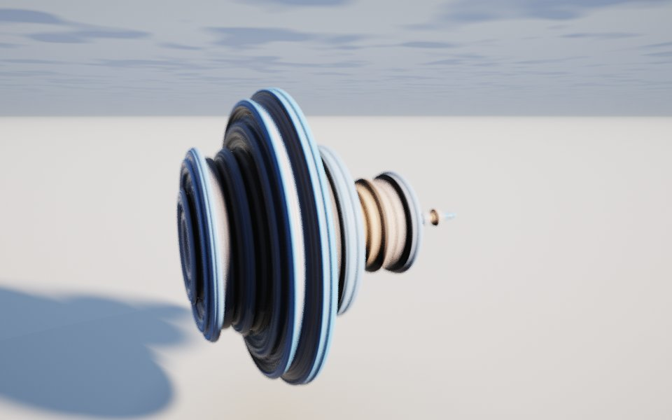](fractals/quaternion.md) | **[Quaternion Mandelbrot](fractals/quaternion.md)** (`quaternion`) The quaternion Mandelbrot set (Gomatam et al. and Bedding and Briggs, 1995): z² + c with quaternions, sliced in 3D. Squaring a quaternion keeps it in the plane of the real axis and its own imaginary part, so the set is the Mandelbrot set spun about its real axis: a lathe-turned ornament of discs and rings with the antenna for a spire. |
| [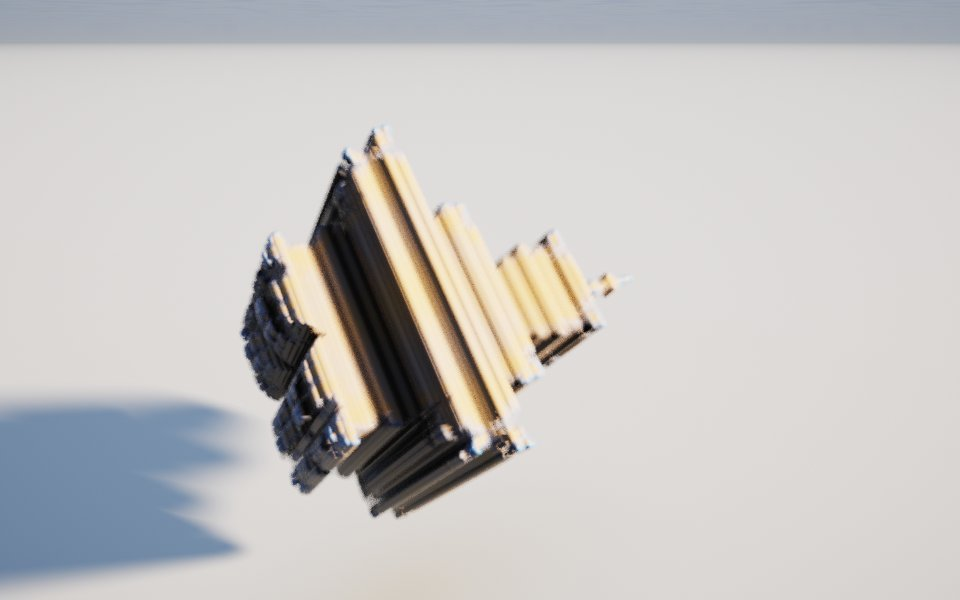](fractals/tetrabrot.md) | **[Tetrabrot](fractals/tetrabrot.md)** (`tetrabrot`) Dominic Rochon's Tetrabrot (2000): the bicomplex Mandelbrot set's slice through 1, i1 and i2. A bicomplex number is two complex numbers squared independently, so the shape is two Mandelbrot sets drawn out along the diagonals and intersected: a faceted, cubist Mandelbrot with diamond cross-sections and box-like bulbs. |
|  | **[Hypercomplex Mandelbrot](fractals/hypercomplex.md)** (`hypercomplex`) Clyde Davenport's hypercomplex Mandelbrot set: z² + c with commutative quaternions (i² = j² = -1, k² = +1), sliced through 1, i and k. |
| [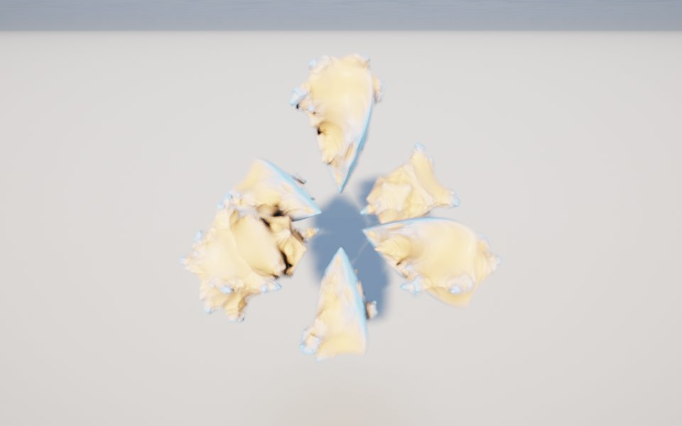](fractals/aexion.md) | **[Aexion](fractals/aexion.md)** (`aexion`) Aexion's quadray Mandelbrot set: the point in four tetrahedral (quadray) coordinates, folded by abs and shifted, squared in four dimensions as two complex squares that trade imaginary parts. |
| [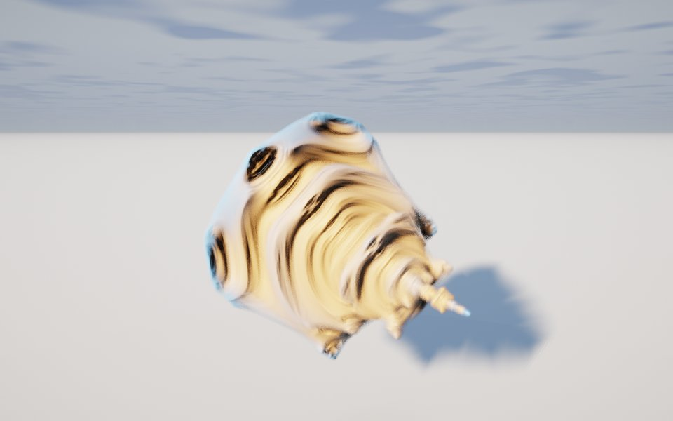](fractals/bristorbrot.md) | **[Bristorbrot](fractals/bristorbrot.md)** (`bristorbrot`) Doug Bristor's 3D Mandelbrot set, squared in his 'rotational' algebra of two imaginary units whose products depend on their order, so the two imaginary axes mix: the Mandelbrot set's outline along x, swept into a swirled, lopsided solid with a long antenna. |
| [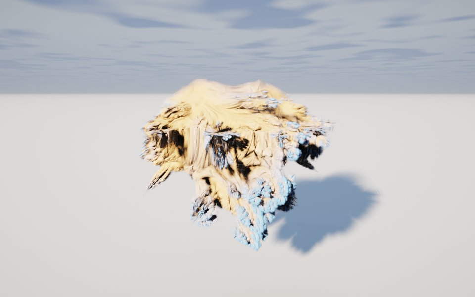](fractals/buffalo.md) | **[Buffalo](fractals/buffalo.md)** (`buffalo`) The 3D Buffalo: the power 2 Mandelbulb's squaring with some of its components made positive (abs) before or after, a shaggy 3D cousin of the 2D Buffalo and Burning Ship (the default holds the 2D Buffalo in its xy plane, facing the camera). |
| [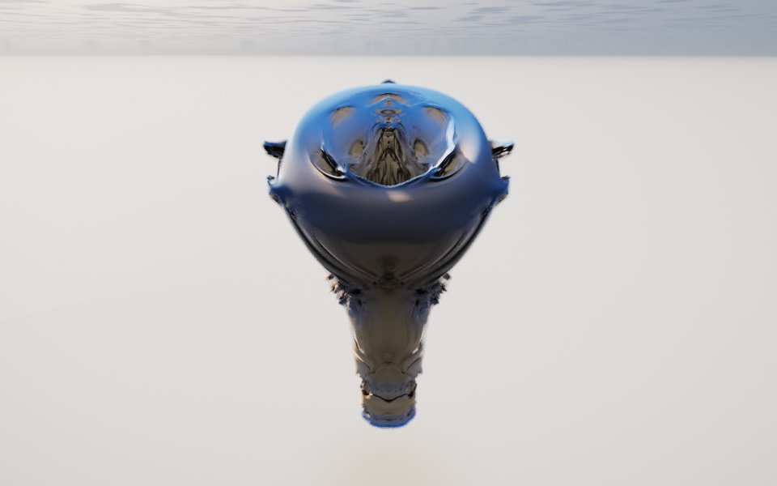](fractals/mandelcup.md) | **[Mandelcup](fractals/mandelcup.md)** (`mandelcup`) The Mandelcup: each point's direction projected onto a plane, squared there as a complex number and wrapped back onto the sphere, its distance squared. |
| [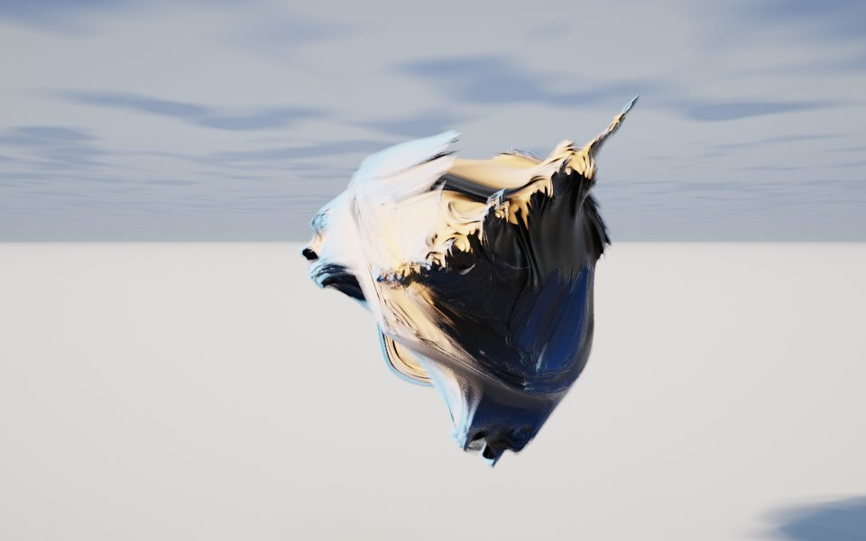](fractals/quick_dudley.md) | **[Quick Dudley](fractals/quick_dudley.md)** (`quick_dudley`) Dudley's quadratic: z squared in a three-dimensional algebra whose two imaginary units obey m² = n, n² = m and mn = −1, plus the point, as for the Mandelbrot set. |
|  | **[Collatz](fractals/collatz.md)** (`collatz`) Mandelbulber's 3D Collatz fractal: the map (1 + 4z − (1 + 2z) cos πz) / 4, which carries the Collatz rule over to complex numbers, lifted into 3D with cos πz replaced by a half turn of z about (1, 1, 1) whose axis is left unnormalised (so it also stretches along the diagonal). |
| [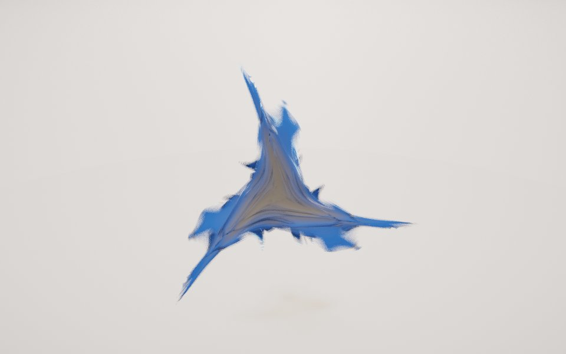](fractals/collatz_mod.md) | **[Collatz Mod](fractals/collatz_mod.md)** (`collatz_mod`) Mandelbulber's Collatz Mod: the 3D Collatz map with its turn, axis, offset and scale opened up, and the point optionally added as for a Mandelbrot set. |
| [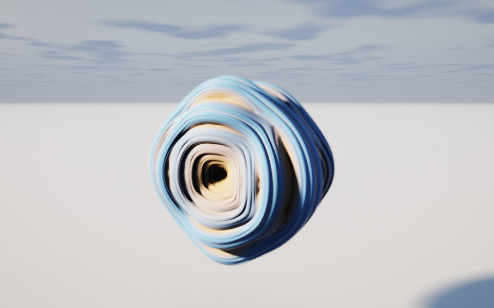](fractals/newton.md) | **[Newton](fractals/newton.md)** (`newton`) A Newton fractal in 3D: Newton's method for z³ = 1 in the triplex (Mandelbulb) algebra, turned inside out so that the basin of the root 1 escapes and the basins of the other two roots make the solid. |

## Spheres and tori

Sphere packings, sphere inversions and Kleinian groups, and fractals built on the torus.

| | Fractal |
| --- | --- |
| [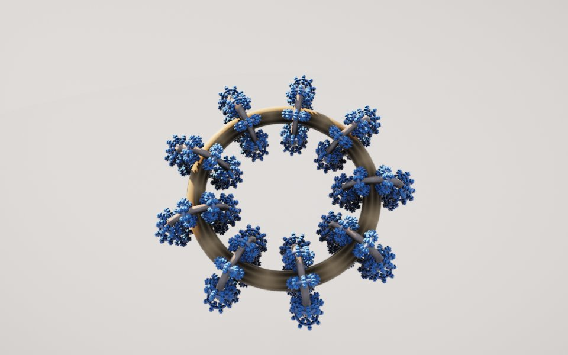](fractals/msltoe_donut.md) | **[Msltoe Donut](fractals/msltoe_donut.md)** (`msltoe_donut`) A torus with smaller tori looped around its tube like chain links, each looped with smaller ones in turn, so the ring sprouts bushy clusters of links. msltoe's escape-time donut (Fractal Forums, 2016); ported from Mandelbulber 2. |
|  | **[Mandeltorus](fractals/mandeltorus.md)** (`mandeltorus`) A Mandelbulb wrapped around a ring: the bulb's power map measured from a circle instead of a point, so its lobes and ridges grow on a doughnut. |
| [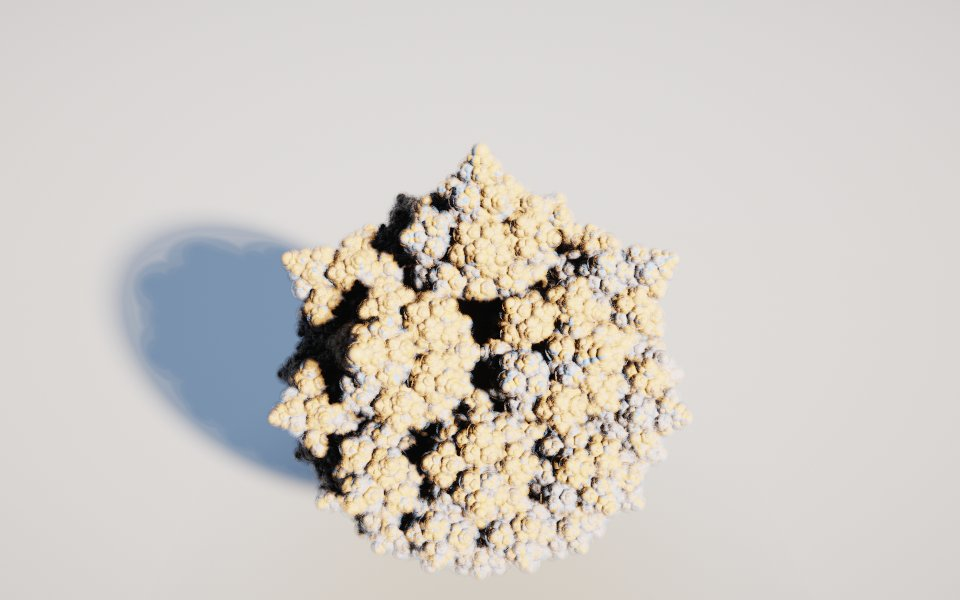](fractals/spheretree.md) | **[Sphere Tree](fractals/spheretree.md)** (`spheretree`) A dome of spheres within spheres: every ball is lined inside with a hexagonal layer of smaller balls, and they with smaller still, so it grows like a cauliflower. |
| [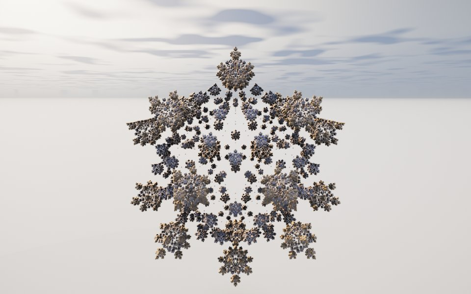](fractals/sphere_cluster.md) | **[Sphere Cluster](fractals/sphere_cluster.md)** (`sphere_cluster`) A hollow ball of sphere clusters with icosahedral symmetry, spiked like a snowflake: each cluster crowds toward the centre in ever smaller copies, and each of its balls is a cluster in turn. |
| [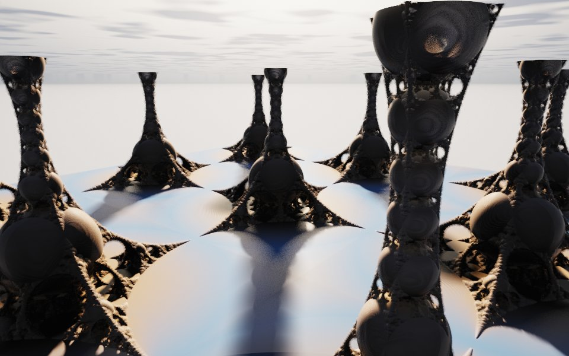](fractals/jos_kleinian.md) | **[Jos Leys's Kleinian](fractals/jos_kleinian.md)** (`jos_kleinian`) A true Kleinian group's limit set: Jos Leys's escape-time algorithm for Maskit's slice with Knighty's distance estimate (Fractal Forums, 2016-17; ported from Mandelbulber 2). |
|  | **[Schottky group](fractals/schottky.md)** (`schottky`) A Schottky group's limit set in 3D, in the manner of Indra's Pearls (Mumford, Series and Wright): kissing spheres at the corners of a regular solid, each holding the others' images under inversion in it, and so on down, so that necklaces of pearls within pearls gather on the limit set. |
| [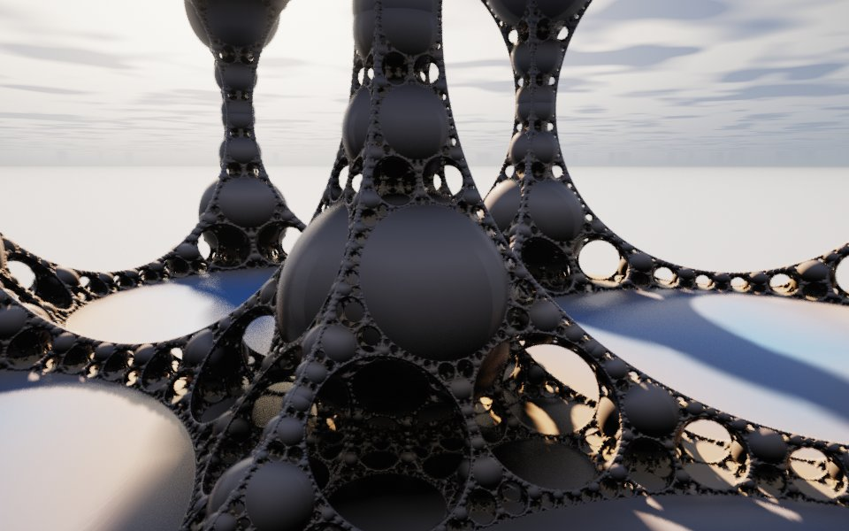](fractals/kleinian_mod.md) | **[Pseudo-Kleinian Mod 3](fractals/kleinian_mod.md)** (`kleinian_mod`) Pseudo-Kleinian Mod 3 (mclarekin, Mandelbulber 2, 2020), a variant of Knighty and Theli-at's pseudo-Kleinian: the same box folds and inversions, but measured to a floor plate and struts along the axes rather than to rings, so it grows into storeys of domed floors held up by columns of beads, an endless arcade. |

## Geometric

Exact self-similar solids: cubes kept and cut by rule, polyhedral kaleidoscopes, the Koch surface and a knotted rope of ropes.

| | Fractal |
| --- | --- |
| [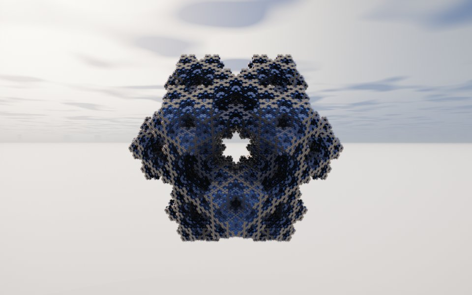](fractals/mosely.md) | **[Mosely Snowflake](fractals/mosely.md)** (`mosely`) The Mosely snowflake (Jeannine Mosely's): a cube cut into 27 with the eight corner cubes taken away, again and again, leaving 19 of 27. |
| [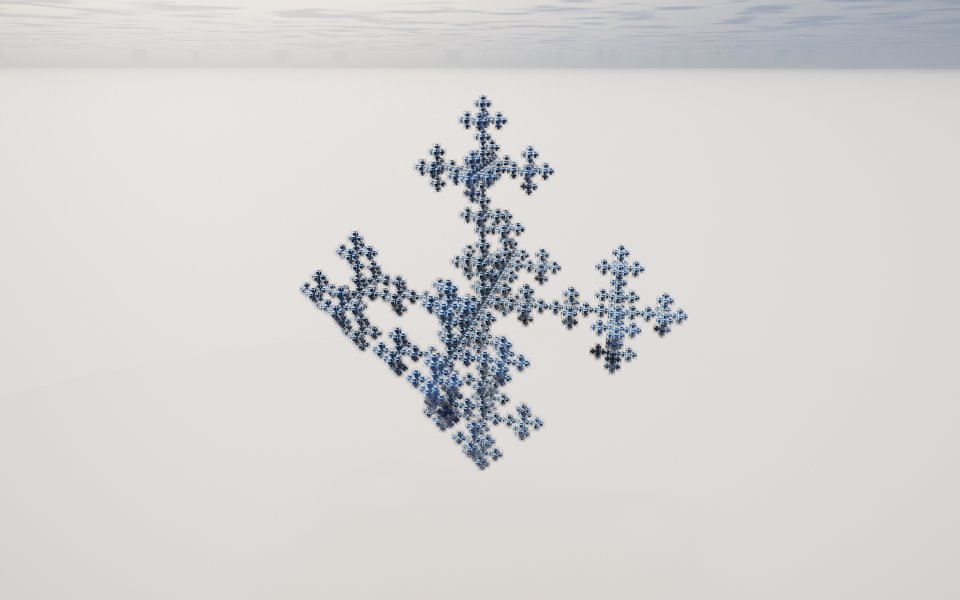](fractals/vicsek.md) | **[Vicsek Fractal](fractals/vicsek.md)** (`vicsek`) The Vicsek fractal in 3D (after Tamás Vicsek, 1983): of a cube's 27 parts only the centre and the six face cubes are kept, a 3D cross, and so on in every arm: a branching tree of crosses with no loops. |
| [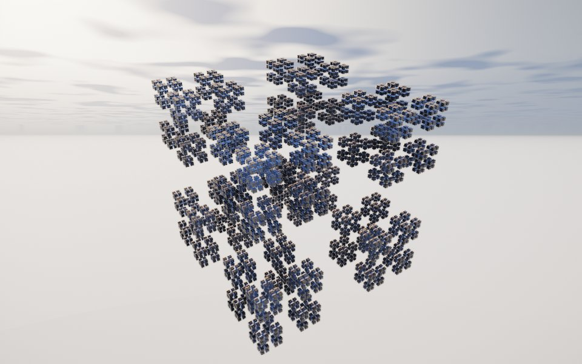](fractals/cantor_dust.md) | **[Cantor Dust](fractals/cantor_dust.md)** (`cantor_dust`) Cantor dust in 3D (Georg Cantor's middle-thirds set on every axis): a cube's eight corner cubes are kept and the rest thrown away, over and over, until it is a cloud of ever smaller cubes, none touching. |
| [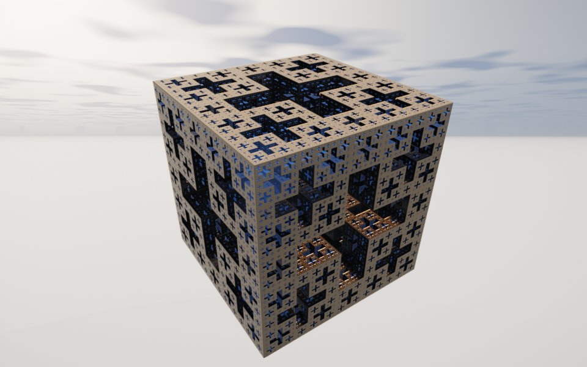](fractals/jerusalem.md) | **[Jerusalem Cube](fractals/jerusalem.md)** (`jerusalem`) The Jerusalem cube (Eric Baird, 2011): a cube with a Greek cross drilled through every face, leaving eight corner cubes (ratio √2 - 1) and twelve smaller edge cubes (its square) between them, each drilled the same way. |
|  | **[Polyhedral IFS](fractals/polyhedral.md)** (`polyhedral`) Knighty's polyhedral kaleidoscopic IFS: space folded into one cell of the tetrahedral, octahedral or icosahedral mirror group, then scaled away from a vertex of the cell's choosing, again and again. |
| [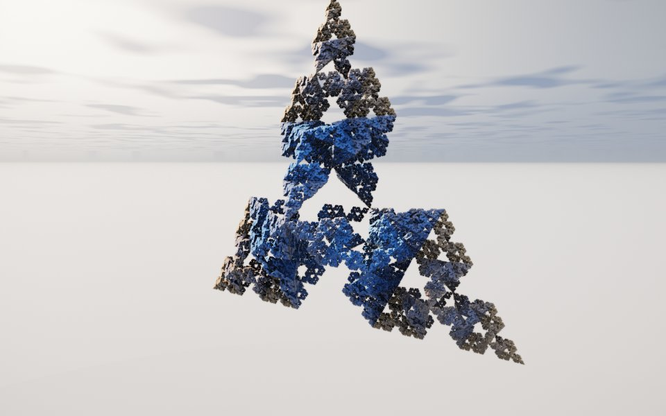](fractals/koch.md) | **[Koch Delta](fractals/koch.md)** (`koch`) Eric Baird's Koch curve in three dimensions, the "delta" fractal: a triangular body whose copies hinge up out of its plane at the Koch angle, again and again, so that its edges and profile are Koch curves and its body a crumpled crystal. |
|  | **[Knotted Rope](fractals/knot.md)** (`knot`) A torus knot whose tube is a rope: strands twisted about its core, each of them a rope of finer strands twisted the other way, and so on down, as rope is laid. |

## 4D slices

Four-dimensional fractals cut by a 3D slice. Each takes `w`, where the slice is, so a scene can slide it to animate the shape.

| | Fractal |
| --- | --- |
|  | **[Menger 4D](fractals/menger4d.md)** (`menger4d`) A slice through a four-dimensional Menger sponge: mirror folds sort its four axes, then the two largest and the smallest are pushed toward the corners and the third is folded about its middle, so the holes cross the slice at angles. |
| [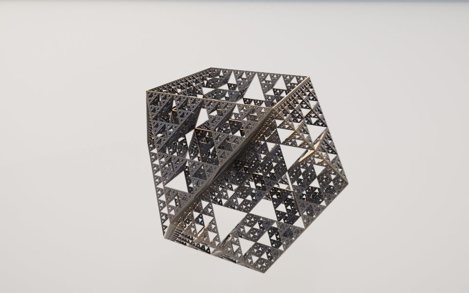](fractals/sierpinski4d.md) | **[Sierpinski 4D](fractals/sierpinski4d.md)** (`sierpinski4d`) A slice through a four-dimensional Sierpinski solid: six mirror folds and a halving about a corner, so eight half-size copies sit on the corners of a 16-cell. |
| [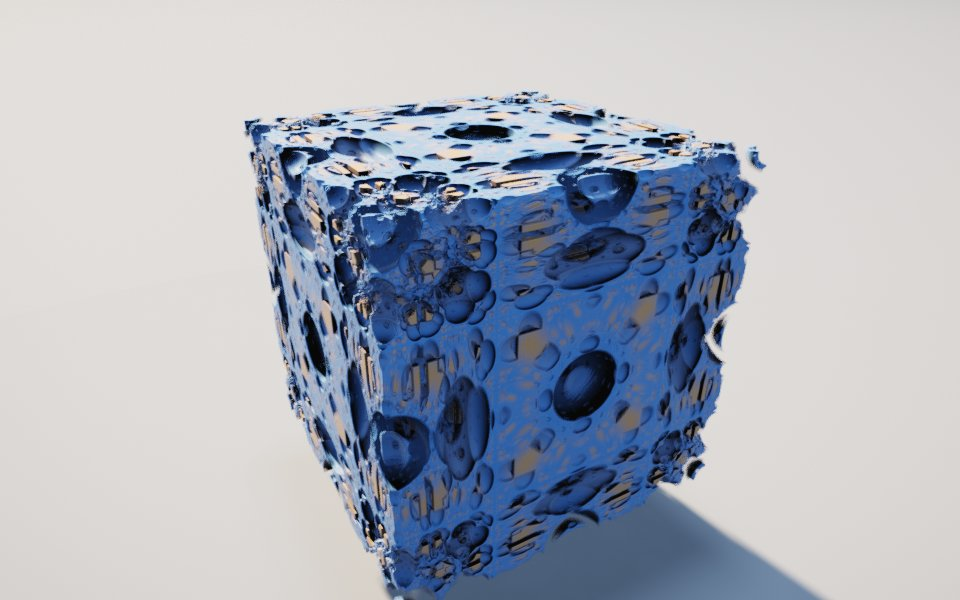](fractals/mandelbox4d.md) | **[Mandelbox 4D](fractals/mandelbox4d.md)** (`mandelbox4d`) A slice through the four-dimensional Mandelbox: box folds on all four axes, a sphere fold in 4D, scale and add the point. |
|  | **[Kleinian 4D](fractals/kleinian4d.md)** (`kleinian4d`) A slice through a four-dimensional pseudo-Kleinian: box folds and a 4D sphere inversion, drawn around a pillar (the vertical axis) and a floor (the y = 0 plane), so the slice is a hall of floors, columns, domes and arches. |

## More

Named formulas from the 3D fractal community that fit no family.

| | Fractal |
| --- | --- |
| [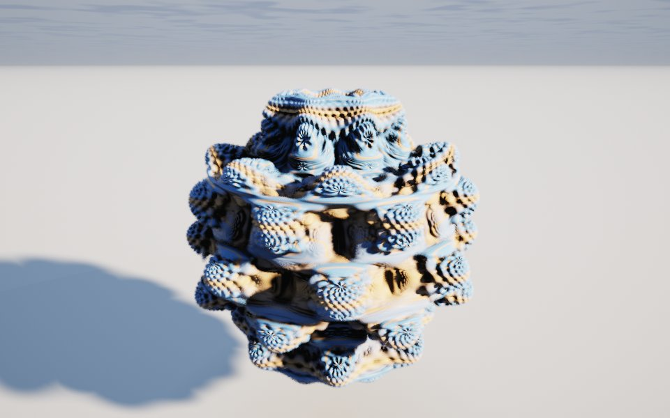](fractals/xenodreambuie.md) | **[Xenodreambuie](fractals/xenodreambuie.md)** (`xenodreambuie`) Xenodreambuie's Mandelbulb: the power map in true spherical coordinates, its polar angle folded into the upper hemisphere before it is multiplied, so the bulb comes out mirrored top to bottom and set with stacked, petal-like domes. |
| [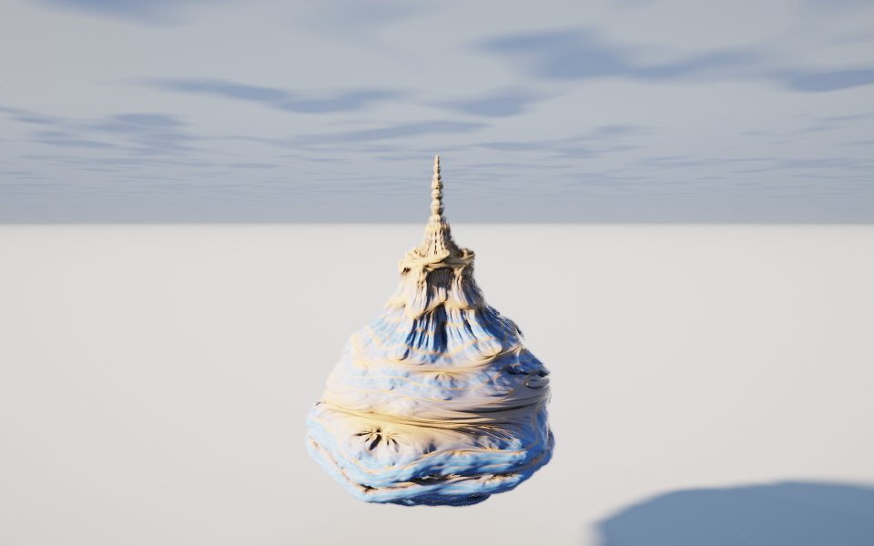](fractals/pine_tree.md) | **[Pine Tree](fractals/pine_tree.md)** (`pine_tree`) Benesi's pine tree: a quadratic Mandelbrot spun about its needle, the angle around it doubled and the two cross axes swapped at every step; stood on its needle it is a tiered, drooping conifer topped by a spire of minibrots. |
| [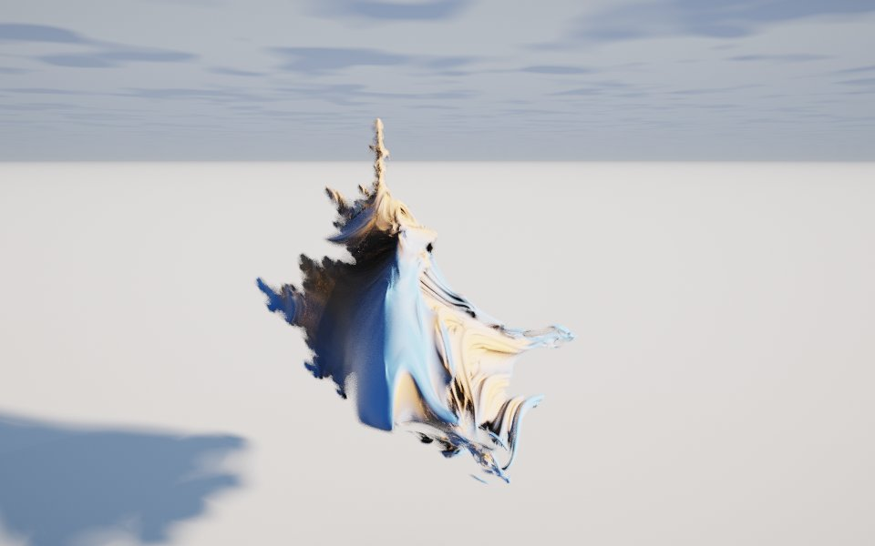](fractals/makin.md) | **[Makin](fractals/makin.md)** (`makin`) Makin's quadratic: (x² + 2yz, -y² - 2xz, -z² + 2xy) plus the point, a 3D squaring that comes out as a swept, three-cornered sail under a spire, its edges frayed into spikes. |
| [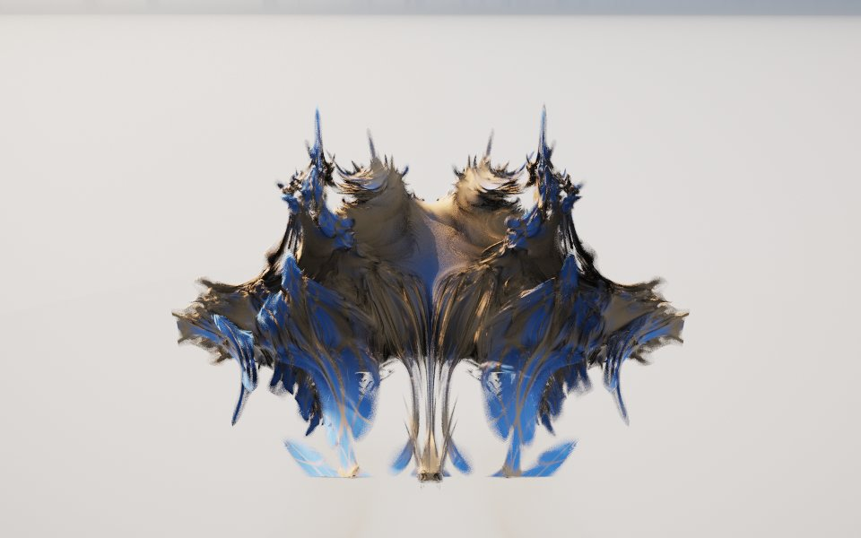](fractals/ides.md) | **[Ides](fractals/ides.md)** (`ides`) Ide's formula: (x² - (y² + z²)/2, 2xyz, z² - (x² + y²)/2) plus the point, x and z first shrunk by a tenth: a mirror-symmetric, moth-like body of hollow wings, ribs and hair-fine spikes. |
| [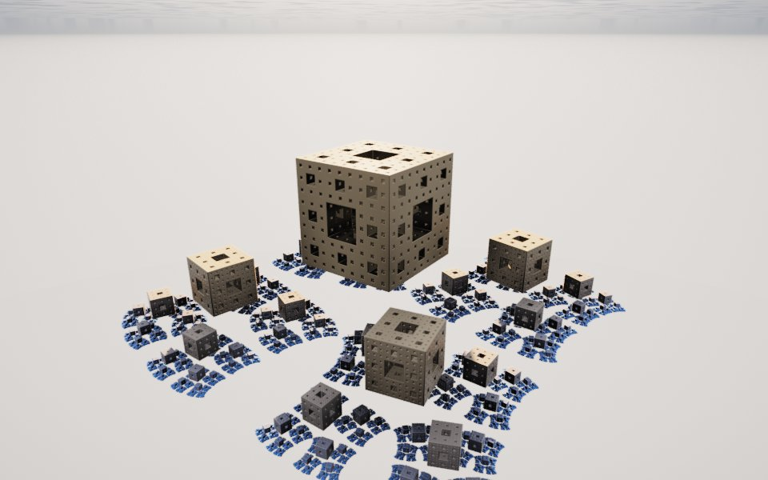](fractals/difs.md) | **[Distance IFS](fractals/difs.md)** (`difs`) A distance IFS: a Menger sponge copied smaller and folded outward ring after ring, so a big sponge stands on a twisting skirt of ever smaller ones that thins to a carpet. |
| [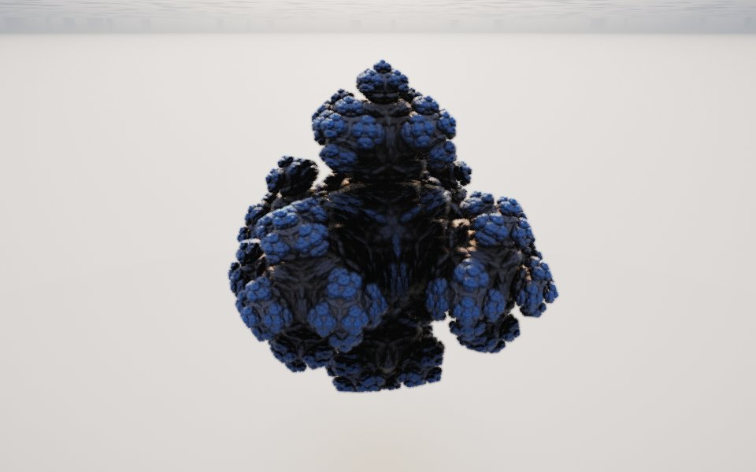](fractals/msltoe_sym.md) | **[msltoe Sym4](fractals/msltoe_sym.md)** (`msltoe_sym`) msltoe's Sym4 bulb: before each squaring the point's coordinates are sorted by size and given one sign, so the bulb grows with the cube's symmetry. |
|  | **[eiffie's bulb](fractals/eiffie.md)** (`eiffie`) eiffie's bulb: msltoe's squaring with the point first folded into a one-sixteenth wedge about the vertical axis, so it grows eight-fold, like a fluted stone vase on a spike. |
|  | **[Mandelnest](fractals/mandelnest.md)** (`mandelnest`) Jeannot's Mandelnest: the angle of each coordinate to its own axis is multiplied by the power, so the bulb has a cube's symmetry instead of the Mandelbulb's poles: a ball of nested, pinched lobes with a porthole on each axis. |

## Originals

Fractals invented for ray by Claude (Anthropic's Claude Opus 5.5), October 2026: new constructions, not new parameters for old ones. Each was designed, derived (its distance estimate included), coded for the CPU and the GPU, tested and documented by Claude, with a search for prior art; the entries say what was searched and what comes nearest.

| | Fractal |
| --- | --- |
|  | **[Seifert Gasket](fractals/seifert_gasket.md)** (`seifert_gasket`) A ring of knotted strands of every size, packed like the circles of an Apollonian gasket: the gasket on the orbit sphere of the 3-sphere's fibration by torus knots, lifted back along the fibres and projected into space. |
|  | **[Indra's Cells](fractals/indra_cells.md)** (`indra_cells`) Rooms of the 120-cell, the 4D polytope of 120 dodecahedra, seen in our space by stereographic projection: pentagon-framed rooms that grow toward the edge, each holding a pearl, a small inside-out copy of the whole, and each room in it a pearl of its own. |
|  | **[Zorich Pagodas](fractals/zorich_pagodas.md)** (`zorich_pagodas`) A floor of domed pagodas crowned with tiers of spiky pinnacles, each ringed by smaller ones, in a lattice that runs on for ever: the points that escape upward under a scaled Zorich map, the three-dimensional analogue of the exponential function (V. |
|  | **[Labyrinth Sponge](fractals/labyrinth_sponge.md)** (`labyrinth_sponge`) Labyrinths within labyrinths: the sheet around a triply periodic minimal surface, whose walls are drilled through by both labyrinths of a minimal surface a few times smaller, whose walls are drilled by smaller ones again, the levels alternating between two surfaces (by default a gyroid whose walls are a lattice of Schwarz P rooms, whose walls are pierced by gyroids again). |
|  | **[Nil Staircase](fractals/nil_stair.md)** (`nil_stair`) A square tower of spiral stairs in Thurston's Nil geometry (the Heisenberg group): every step, and every stone of the central post, is a smaller copy of the whole tower, squashed by the group's dilation (about a third as wide, a ninth as high) and sheared along its contact planes, so the copies flatten from blocks to louvres to tiles. |
|  | **[Quasicrystal Rooms](fractals/quasicrystal_rooms.md)** (`quasicrystal_rooms`) Rooms of an icosahedral quasicrystal, never repeating: dodecahedral rooms (or triacontahedral, or icosahedral) whose walls are pierced by rooms τ³ ≈ 4.24 times smaller, and theirs by smaller still, so every wall is a five-fold rose window. |
|  | **[Mayer Julia](fractals/mayer_julia.md)** (`mayer_julia`) Julia sets of z² + c in three dimensions done the quasiregular way: a degree-two power map of space built on Zorich's map, whose iterates keep bounded distortion (V. |
|  | **[Screw Sponge](fractals/screw_sponge.md)** (`screw_sponge`) A sponge of spiral ramps, all of one hand, at every scale: shafts along the right-handed 4₁ screw axes of the chiral cubic space group P4₁32, running three ways, each with a ramp winding around a pillar, drilled level after level through the solid at a fifth of the size (the ratio at which the group maps into itself). |
|  | **[Möbius Cathedral](fractals/cathedral.md)** (`cathedral`) A Gothic cathedral (nave, aisles, a tribune gallery over them, rib and groin vaults, a tiled floor) whose side chapels each hold the whole cathedral turned inside out: the chapel is a circle in the plan, and inside it lies the cathedral inverted in that circle, its nave bent into a crescent and smaller, with chapels of its own, and so on inward. |
|  | **[Dirac Frost](fractals/dirac_frost.md)** (`dirac_frost`) Frost crystals grown by the Cauchy–Riemann equations of three dimensions: z ← ∇h(z) + c with h a harmonic polynomial with a polyhedron's symmetry, so that the map is monogenic (the Dirac operator of Clifford analysis kills it), the 3D counterpart of a holomorphic polynomial. |
|  | **[Cusp Vaults](fractals/cusp_vaults.md)** (`cusp_vaults`) Gothic vaults from a hyperbolic honeycomb with ideal vertices ({3,4,4} by default), in the upper half-space model turned over so that infinity is the ceiling: ribs fan out into ever finer tracery, and at every cusp, where the ribs meet, hangs a cage of the cusp's own lattice. |
|  | **[Alexander's Horned Sphere](fractals/horned_sphere.md)** (`horned_sphere`) Alexander's horned sphere (J. W. |
|  | **[Octet Truss of Trusses](fractals/octet_truss.md)** (`octet_truss`) A space frame of space frames: Buckminster Fuller's octet truss, every strut of which is stiffened by a cage of the same truss several times finer, every strut of that cage by a finer cage, and so on down. |
