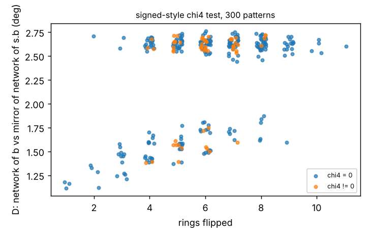
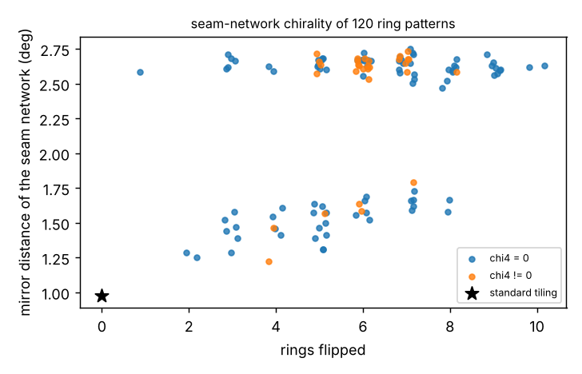
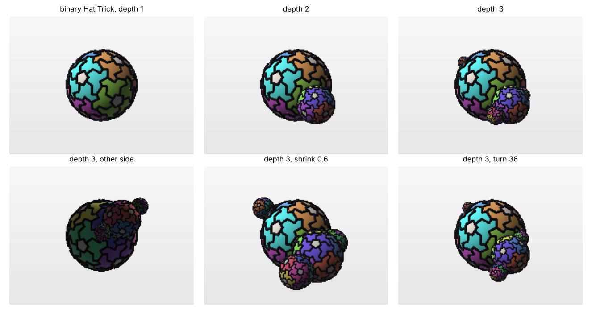
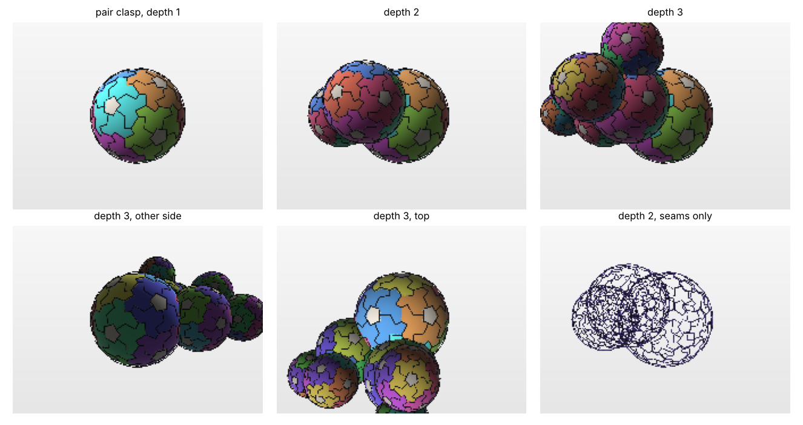

# The Hat Trick ball's 12 sites, seen as horn sites and as Bloch points

The Hat Trick ball of [hexasphere](https://github.com/brentharts/hexasphere) has 12 pentagons. In [qwla](https://github.com/brentharts/qwla) they are the 12 cone points: one ring bit and one spin-1/2 puncture each (`HAT_TIME.md`). In this repository (`fractalkit/hattrick_horned.py`) the same 12 points are where copies of the ball are hung to make a horned sphere. This note puts the two readings side by side and measures what can be measured.

Labels follow qwla: **Exact** (an identity or exhaustive count, checked here), **Counted** (a sample), **Known** (a standard result used, not derived here), **Definition**, **Not done**.

## 1. The sites are a regular icosahedron

**Exact** (computed from `load_hattrick()`; run the snippet at the end). The 12 pentagon centres on the unit sphere have exactly three distinct pairwise angles:

| angle | pairs | role |
|---|---|---|
| 63.435 degrees | 30 | icosahedron edges (each site has 5 neighbours) |
| 116.565 degrees | 30 | second neighbours |
| 180 degrees | 6 | antipodal pairs |

The 30 edge pairs are the 30 edges of qwla's Heisenberg model `sum S_i.S_j`. The rotation group I (order 60) acts on the sites; it is the group the horned tree uses to place children (60 maps, 5-fold at each site) and the group qwla's `ring_bits.py` finds permuting the ring bits without flipping any.

## 2. Read as Bloch points, the three angles are three overlaps

**Known.** For two points of the sphere at angle theta, the Hopf fibres over them have Moebius invariants `s1 = s2 = |cos(theta/2)| = |<a|b>|`, the overlap of the two spin-1/2 states. qwla's roadmap (Stage 4i) says the fibre pair is a *Hopf clasp* exactly when the states are orthogonal (s = 0), which is the horned-sphere clasp at kappa = 1 + 1/sqrt 2. All fibres of one Hopf fibration link each other once whatever the points, so linking alone cannot tell the pairs apart; the invariants can.

**Exact.** On the 12 sites:

| pair type | theta | overlap s | cos(theta) (= 4 <S_i.S_j> in a product of coherent states) |
|---|---|---|---|
| neighbours | 63.435 | 0.8507 | +0.4472 |
| second neighbours | 116.565 | 0.5257 | -0.4472 |
| antipodal | 180 | 0 | -1 |

So of the 66 pairs, exactly 6 are Hopf clasps (the antipodal ones), and these 6 are disjoint: they pair the 12 sites completely. The product state of coherent states at the 12 sites has `sum over edges of <S_i.S_j> = 30 * 0.4472 / 4 = 3.354`, against the exact lowest level of -6.1879 in the singlet sector (qwla). The two are not close, which is expected: that level is entangled, not a product state. The number is here only to fix the sign convention.

**Not done.** Whether the 6 antipodal clasp pairs play any role in the ring-bit model. Nothing in qwla singles out antipodal pairs; the Heisenberg model uses edges only.

## 3. What the horned tree does with the same 12 sites

**Counted** (`examples/compare_seamtrees.py`, defaults `shrink` 0.3, `sink` 0.4, `turn` 10, `tube` 0.025):

- 12 children on the root and 11 on every later ball (the parent's own site is used up), so networks per generation are 1, 12, 132. The similarity dimension is log(11)/log(1/0.3) = 1.99, and box counting of the seams gives 1.93 over three generations.
- None of the 144 pentagon-loop pairs between a parent and a child is linked, and 60 pairs of tubes fuse at depth 2. **This used the 12 pentagon loops only.** Section 4 shows that the hat loops do link a child to its parent, so the 0 of 144 should not be read as "the Hat Trick tree does not clasp".
- As a seam network the ball is nearly mirror symmetric: 0.96 degrees to its mirror image, even though every hat is chiral. qwla finds the same thing from the other side: the vertex count and all small-neighbourhood counts of the tilings are mirror symmetric, and a mirror-odd part appears only from third neighbours on, as a polynomial of degree 4 in the ring bits (`chi4`).

**Counted** (`tools/chi4_comparison.py`, `figures/chi4_comparison.png`). The 0.96 degrees belongs to the standard tiling only. For 120 random ring patterns (qwla's ring flips; the seam network is the outline of every hat plus the 12 pentagon loops, mirror distance with 8 random starts) the mirror distance is 1.2 to 2.7 degrees, mean 2.26, against 0.98 for the standard tiling. One flipped ring already gives 2.58. So the network is nearly mirror symmetric only at the symmetric tiling; once rings are flipped the seams are clearly chiral, whatever `chi4` says.

Against `chi4` the unsigned measure shows a weak hint: `chi4` takes the values -1, 0 and +1 on this sample (11, 91 and 19 patterns) and can be non-zero only with at least 4 rings flipped. Spearman correlation of |`chi4`| with the mirror distance is 0.18 (p = 0.047); the number of flipped rings correlates better (0.31).

**Counted, signed-style test** (`tools/chi4_signed.py`, `figures/chi4_signed.png`, 300 random patterns). The unsigned measure mixes the pattern's hand with the network's own breaking of symmetry, so I compared each pattern b with its reflected pattern s.b (qwla's reflection of the 12 bits): D(b) is the smallest mean distance from the mirror image of the network of s.b to the network of b, over rotations. D = 0 would mean the tiling of s.b is exactly the mirror image of the tiling of b; D is even under b <-> s.b, as |`chi4`| is. Checks that pass: `chi4(s.b) = -chi4(b)` on all 300 patterns, and `chi4` is non-zero only on chiral patterns (58 of the 82 chiral ones, 0 of the 218 achiral ones). The result is negative:

- Spearman correlation of D with |`chi4`| is 0.04 (p = 0.52), and 0.07 (p = 0.23) after removing the mean for each flip count. Among patterns with 4 to 8 flipped rings, D averages 2.37 where `chi4` is non-zero and 2.35 where it is zero (Mann-Whitney p = 0.92).
- D follows the number of flipped rings (Spearman 0.35, p < 1e-9), not the pattern's hand: chiral and achiral patterns have the same mean D (2.35 against 2.29).
- The earlier hint (p = 0.057 on 120 patterns) is not reproduced.

So this measure of the seam network does not see `chi4`. That does not show that `chi4` is invisible in the geometry: the mean nearest-point distance between two networks is dominated by the large-scale shape, and `chi4` is a small local effect (third neighbours and beyond). A local measure (counts of panel shapes around each pentagon, compared with their mirror counts) would be the fairer test. **Not done.**

## 4. The Hat Trick as a binary horned tree

The classic horned sphere hangs two children on the two ends of a ring. `AntipodalHatTrick` (`fractalkit/hattrick_horned.py`) is the analogue on the Hat Trick ball: two children per ball, on an antipodal pair of pentagons, which is a Hopf clasp pair in the sense of section 2. The sites are `[p, b, -b]`: `p` carries the parent and is never used by a child, and `b` is a neighbour of `p`, so the pair avoids `p`. The five such pairs are equivalent under the turns about `p`. Every ball, root included, has exactly 2 children (1, 2, 4, 8 balls per generation; checked), and the similarity dimension is log 2 / log(1/shrink), 0.58 at `shrink` 0.3 and 1.94 at 0.7. `SeamTree` got one flag, `root_site0`, so the root can leave `p` free as well.

**Counted** (`tools/antipodal_scan.py`, 72 settings of `shrink` 0.3 to 0.8, `sink` 0 to 0.6, `turn` 0, 10, 36):

- **Siblings never link.** 0 of 72 settings link the two children of the root, by pentagon loops, and 0 of 8 by all 72 panel loops. This is geometry: the children sit at antipodal sites, about 2 units apart, and are far smaller than that. The Hopf clasp of the antipodal points is a statement about fibres in S^3; it does not make two balls in space interlock.
- **Parent and child do link, through the hats.** With the pentagon loops, 0 of 72. With all 72 panel loops, at `turn` 10, every one of the 8 settings tried (`shrink` 0.3, 0.45, 0.6, 0.75; `sink` 0 and 0.4) has linked loop pairs: 10 per child at `shrink` 0.3 and 0.45, 20 at 0.6 with `sink` 0, and 30 at 0.75 with `sink` 0.4 (the scan adds both children). This is the same effect as for the Trionda: a child sunk into the parent has loops that pass through the parent's surface.
- **Clearance at depth 2.** 3 of 72 settings have no fused tubes (all at `shrink` 0.3, `turn` 36; best clearance +0.025 at `sink` 0, with the tube radius 0.025). The other 69 fuse 2 pairs or more.

So the binary Hat Trick tree has parent-child links but no sibling clasp, and it is nowhere close to the ring horned sphere, whose two children link each other. A sibling clasp needs children that sit close, which the antipodal placement rules out; section 5 places the pair on adjacent pentagons instead.

## 5. Neighbouring pentagons: the sibling clasp

The antipodal placement keeps siblings apart. `PairHatTrick` (`fractalkit/hattrick_horned.py`) puts the two children on a pair of *adjacent* pentagons, 63 degrees apart. The parent's pentagon `p` can sit in four ways relative to the pair (kinds A to D, in `_site_triples`: adjacent to both, adjacent to one, 117 degrees from both, antipodal to one). Every ball has two children, as before.

**Counted** (`tools/pair_scan.py`: 128 settings of `shrink` 0.5 to 0.8, `sink` 0 to 0.6, `turn` 0 and 36, four kinds; linking by all 72 panel loops of each child, then re-checked at fine resolution):

- **Siblings link from `shrink` about 0.6 up.** 18 of 32 settings per kind have linked loop pairs between the two root children (up to 22 pairs), in the same `shrink` and `sink` pattern for every kind: 0.6 with `sink` up to 0.2, 0.7 with `sink` up to 0.4, 0.8 with `sink` up to 0.6; none at 0.5. The four kinds give identical depth-1 results, as they must: the sibling pair is the same pair of adjacent pentagons whatever `p` is. The kinds differ only below the root.
- **With the default tube (0.025) no linked setting has clear tubes.** All linked pairs of children have fused tubes (sibling gap -0.02 to -0.03).
- **With thin tubes some do.** `tools/pair_thin.py` re-ran every linked setting with tube 0.004 and 0.008, for all four kinds (144 runs). 9 runs have no fused pair at depth 2 and a positive sibling gap, all of them kinds C and D (none of 72 for A and B): `shrink` 0.6 with `sink` 0, and `shrink` 0.7 with `sink` 0.4 (`turn` 0 and 36). In all 9 the two children link at every generation to depth 2 (the root, and both of its children). The best is kind D, `shrink` 0.7, `sink` 0.4, `turn` 0, tube 0.004: sibling gap +0.010, depth-2 clearance +0.005. Parent-child tubes have a positive gap in 4 of the 9 and touch in the other 5, as in the other trees. `PairHatTrick.clasp()` is this setting.
- **The linking numbers are real.** For three of these settings I recomputed the linked loop pairs at a finer step (0.02, up to 10 refinements): the Gauss integrals come out at +1 or -1 to within 0.001 for every pair checked (the first 6 of 6 to 12 pairs per setting), the same at all three parents.

Margins are thin (0.0009 to 0.010 against a tube of 0.004), the coarse scan used 2 refinements, and only the first 6 linked loop pairs of each setting were re-checked at fine resolution. The similarity dimension is log 2 / log(1/0.7) = 1.94, so at depth 2 and 3 the copies do not yet crowd each other, but the dimension is below 3 only because there are 2 children; I did not test depth 3 for clearance (the gallery shows it, and it looks crowded).

So the question from section 4 has an answer: on the Hat Trick ball a binary horned tree whose siblings clasp exists, to depth 2, with thin tubes, when the children hang on adjacent pentagons and not on antipodal ones.

## Reproduce

    cd ray
    python - <<'PY'
    import numpy as np, fractalkit as fk
    P = np.asarray(fk.hattrick_horned.load_hattrick()[2]); P /= np.linalg.norm(P, axis=1, keepdims=True)
    th = np.degrees(np.arccos(np.clip(P @ P.T, -1, 1)))
    v, c = np.unique(np.round(th[np.triu_indices(12, 1)], 3), return_counts=True)
    print(dict(zip(v, c)))              # {63.435: 30, 116.565: 30, 180.0: 6}
    PY
