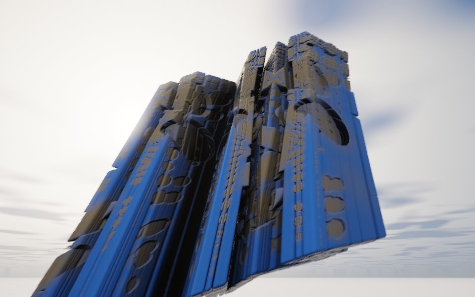

[All fractals](../FRACTALS.md#box-folds) · [Kalibox →](kalibox.md)

# Amazing Surf (`amazing_surf`)

*Box folds*



A Mandelbox that box-folds only x and y, so z is never folded back: unturned, the set is a flat fractal sheet with the 2D Mandelbox's pattern of holes. A quarter turn about y at every step folds that sheet into a leaning tower of thin plates pierced with round windows, with narrow slots and corridors between the plates.

**Formula.** Start from $`z = p`$ and repeat:

```math
z \leftarrow R\,m\,\mathrm{boxFold}_{xy}(z) + (p_y,\ p_x,\ p_z), \qquad m = \frac{s}{\mathrm{clamp}(r^2,\ r_{\min}^2,\ 1)}
```

with the box fold $`f(x) = |x+F| - |x-F| - x`$ on $`x`$ and $`y`$ only ($`z`$ passes through), $`r^2`$ the folded point's squared length ($`x^2 + y^2`$ only with `cylinder`), $`R`$ the turn by `angles`, and the point added with $`x`$ and $`y`$ swapped, as Mandelbulb 3D does. Orbits stop past radius 100.
Distance estimate: $`d = |z| / \partial z - t`$ with $`\partial z \leftarrow |m|\,\partial z + 1`$, where $`t`$ is `thickness`: the bare set is a surface, and the thickness turns it into plates.

**Origin.** Proposed by Kali on Fractal Forums around 2011, when he was exploring 2D Mandelboxes and a rotated "Mandelbox surface" (the forum's board for these is named [Amazing Box, Amazing Surf and variations](https://www.fractalforums.com/amazing-box-amazing-surf-and-variations/)). DarkBeam added features for it as a Mandelbulb 3D formula ([custom formulas thread](http://www.fractalforums.com/mandelbulb-3d/custom-formulas-and-transforms-release-t17106/)), and Mandelbulber 2 adopted it from there, with variants by mclarekin (Graeme McLaren). Ported from Mandelbulber 2's [amazing_surf.cl](https://github.com/buddhi1980/mandelbulber2/blob/master/mandelbulber2/formula/opencl/amazing_surf.cl), with its x/y swap of the added point. The thickness is this port's addition.

**Parameters.** `fold` (1, 1): where the box fold turns back on x and y; larger widens the plates and the tower, and unequal values stretch it. `fold_scale` (2): the scale after each fold; 1.6 to 2.5 is typical, lower spreads the plates apart and grows the tower, negative values crumple it (avoid -1 to 1). `min_radius` (0.84): radius of the sphere fold's inner sphere; smaller cuts deeper round windows (Mandelbulber's minimum radius of 0.5 is 0.84 here, since it compares that value's square root with $`r^2`$). `angles` (0, 90, 0): degrees turned about x, y and z at every step, which is what lifts the sheet into 3D; quarter turns stack plates, 0 leaves the flat sheet, and odd angles give rocky lumps. `cylinder` (0): 1 measures the sphere fold's radius on x and y only (Mandelbulber's cylinder fold), turning round windows into slots. `thickness` (0.02): thickens the sheets, in the shape's units; 0 leaves the bare surface, which renders as fuzz, and 0.01 to 0.05 gives solid plates. `iterations` (10): more gives finer plates and windows; past about 14 the plates break into dust unless the thickness grows.

---

[All fractals](../FRACTALS.md#box-folds) · [Kalibox →](kalibox.md)
