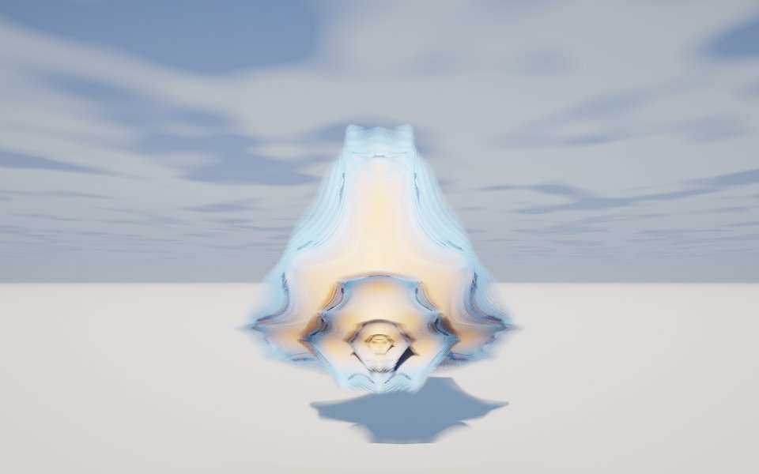

[← Quick Dudley](quick_dudley.md) · [All fractals](../FRACTALS.md#algebras) · [Collatz Mod →](collatz_mod.md)

# Collatz (`collatz`)

*Algebras*



A curved, three-cornered shell with layered ridges and fine fringed edges, symmetric under any swap of the axes; from behind it is a lantern of nested rims. It is Mandelbulber 2's 3D lift of the Collatz fractal, the escape-time picture of the Collatz rule carried over to complex numbers.

**Formula.** Start from $`z = p`$ (scaled 4.4 times and moved to $`(2.69, 2.69, 2.69)`$ to center the set) and repeat:

```math
z \leftarrow \tfrac14\left(1 + 4z - (1 + 2z) \odot R(z)\right), \qquad R(z) = 2\,(n \cdot z)\,n - z, \quad n = (1, 1, 1)
```

where $`\odot`$ multiplies component by component. In 2D the map is $`\tfrac14(1 + 4z - (1 + 2z)\cos \pi z)`$, which gives $`n/2`$ for even integers and $`(3n+1)/2`$ for odd ones; Mandelbulber replaces $`\cos \pi z`$ by the half turn of $`z`$ about $`(1, 1, 1)`$, written with the axis unnormalized, so $`R`$ also stretches $`z`$ five times along the diagonal. Bailout $`|z| \gt  100`$. Distance estimate as for Quick Dudley: $`d = \tfrac12 r \ln r / \lVert J \rVert_F`$ with $`J \leftarrow f'(z)\,J`$, blended across escape bands.

**Origin.** The complex Collatz map is an old extension of the conjecture (see [Wikipedia](https://en.wikipedia.org/wiki/Collatz_conjecture#Iterating_on_real_or_complex_numbers)); Claude Heiland-Allen rendered its fractal with a distance estimate in [The Collatz fractal](https://mathr.co.uk/blog/2016-04-10_collatz_fractal.html) (mathr.co.uk, April 2016). Mandelbulber 2's Collatz (2017) is the 3D lift ported here.

**Parameters.** `iterations` (16): more makes the ridges and fringes finer; past about 10 the shape barely changes.

---

[← Quick Dudley](quick_dudley.md) · [All fractals](../FRACTALS.md#algebras) · [Collatz Mod →](collatz_mod.md)
