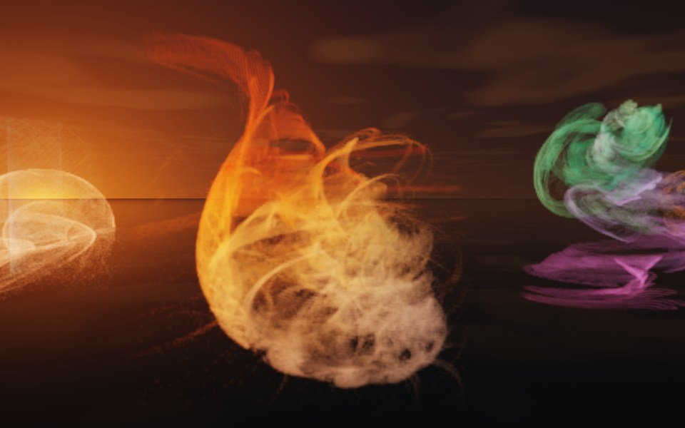
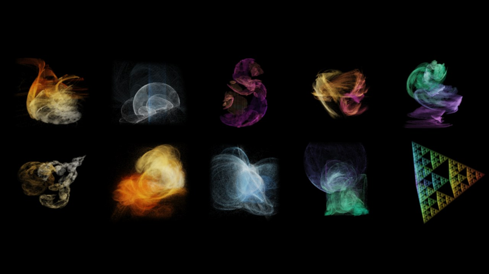

[All fractals](../FRACTALS.md#fractal-flames)

# Fractal Flame (`flame`)

*Fractal flames*



A fractal flame in three dimensions: a few affine maps, each bent by nonlinear functions (variations), applied one after another in random order. The points the orbit visits pile up on the system's attractor: threads, ribbons, shells and smoke, coloured by which maps made them. Unlike every other fractal here it is not a surface with a distance estimate. The points are counted into a grid of voxels, and the grid is rendered as a volume, like a cloud: it glows in its palette's colours, scatters the sun and casts a soft shadow. Above: the `wildfire` preset at sunset (`saves/flames.json`).



The presets (`assets/flame-presets.json`), top row: `wildfire`, `jellyfish`, `seahorse`, `rosebud`, `spiral`; bottom row: `nautilus`, `bloom`, `dandelion`, `veil`, `sierpinski`.

**Formula.** A flame of $`n`$ maps. Map $`i`$ has a weight $`w_i`$, a colour coordinate $`c_i \in [0, 1]`$, an affine part (a 3 x 3 matrix $`A_i`$ and an offset $`b_i`$) and variation weights $`v_{ij}`$:

```math
F_i(p) = \sum_j v_{ij}\, V_j(A_i p + b_i)
```

The chaos game starts from a random point $`p_0`$ in $`[-1, 1]^3`$ and a random colour $`c_0`$, and repeats

```math
p_{k+1} = F_{i_k}(p_k), \qquad c_{k+1} = \tfrac12\,(c_k + c_{i_k})
```

with $`i_k`$ chosen at random, map $`i`$ with probability $`w_i / \sum w`$. The first 24 points of each run are thrown away (the orbit has not reached the attractor yet); a point that flies off to infinity starts the run again. A `final` map, if any, is applied to each point drawn (not to the orbit). `symmetry` $`m`$ adds $`m - 1`$ maps that turn about the y axis by $`2\pi k / m`$, linear and leaving the colour alone, each weighing the mean of the others, which makes the attractor $`m`$-fold symmetric.

The variations, for $`t = (x, y, z)`$ and $`r = |t|`$:

| variation | $`V(t)`$ |
| --- | --- |
| `linear` | $`t`$ |
| `sinusoidal` | $`(\sin x, \sin y, \sin z)`$ |
| `spherical` | $`t / r^2`$ |
| `swirl` | a turn about y by $`r^2`$: $`(x \cos r^2 - z \sin r^2,\ y,\ x \sin r^2 + z \cos r^2)`$ |
| `horseshoe` | $`\bigl((x - z)(x + z) / \rho,\ y,\ 2xz / \rho\bigr)`$, $`\rho = \sqrt{x^2 + z^2}`$ |
| `eyefish` | $`2t / (r + 1)`$ |
| `cylinder` | $`(\sin x,\ y,\ \cos x)`$ |
| `bent` | $`x`$ and $`z`$ doubled where negative, $`y`$ halved where negative |
| `julia3d` | with power $`P`$: $`\theta = (\operatorname{atan2}(y, x) + 2\pi k) / P`$ for a random $`k \in \{0, \dots, \lvert P \rvert - 1\}`$, $`z' = z / \lvert P \rvert`$, $`s = (x^2 + y^2 + z'^2)^{(1/P - 1)/2}`$: $`\bigl(s\sqrt{x^2 + y^2} \cos\theta,\ s\sqrt{x^2 + y^2} \sin\theta,\ s z'\bigr)`$ |
| `blur` | a random point in the unit ball |

**Drawing.** A first sample of 131,072 points sets the box: between the 0.1st and the 99.9th percentile on each axis (so stray points do not stretch it), with a margin of 8% on every side. Its longest side gets `resolution` voxels, the others as many as their length needs, plus an empty voxel all round. Then `points` million points are drawn on all cores, each counted into its voxel with the palette's colour at its $`c`$. A voxel hit $`N`$ times gets the density

```math
\rho = \left( \frac{\ln(1 + N)}{\ln(1 + N_{99.5})} \right)^{1/\gamma}, \quad \text{at most } 1
```

where $`N_{99.5}`$ is the 99.5th percentile of the counts of the voxels hit (the log brings out the faint parts, as in a 2D flame), and the average colour of its hits. Toward the box's faces the density fades out (a smoothstep over the outer 8% of each side, about the margin), so the sparse spray beyond the attractor's bulk ends softly instead of in flat sides. Each voxel is one 32-bit word: the density in 16 bits and the colour as RGB 5:6:5. The grid is drawn once and kept: moving the flame, or changing its `glow` or `density`, does not draw it again.

**Rendering.** The renderers march through the grid as through a cloud (64 steps along a view ray, 16 along a shadow ray, each from a random offset, so samples accumulate smooth), sampling it trilinearly; the colour is interpolated premultiplied by the density, so an empty voxel does not darken its neighbours. With $`s`$ the flame's longest side in metres, the extinction is $`\rho \cdot \text{density} / s`$ per metre and the emitted light $`\rho\, C \cdot \text{glow} / s`$ ($`C`$ the colour), so a flame looks the same at any size. The sun (or the moon) reaching each step is found by four samples toward it through the grid; with the same phase function, multiple-scattering term and sky light as the clouds, the colour is the scattering albedo. On the GPU the grid sits in the terrain buffer after the heightmaps, uploaded again only when a grid changes.

**Origin.** Scott Draves invented fractal flames in 1992, and with Erik Reckase described the algorithm in [*The Fractal Flame Algorithm*](https://flam3.com/flame_draves.pdf): nonlinear variations on an iterated function system, the log-density display, and colour by the maps' colour coordinates; his flames are the [Electric Sheep](https://electricsheep.org/) screen saver's. 3D flames came later, in Apophysis's 3D hack and in JWildfire, whose [version 3.00](https://blog.overwhale.com/?p=4883) (2016) renders them as solids with lighting and shadows; Mettle's FLUX renders volumetric 3D flames in After Effects. Here the classic variations are written for three dimensions; `julia3d` is JWildfire's julia3D. Drawing into a voxel grid and rendering it as a lit, shadowed volume in a real-time ray tracer was made for ray by Claude (Anthropic's Claude Opus 5.5), October 2026, as were the presets: random systems from the generator below, picked by eye.

**Parameters.**
- `preset` ("wildfire"): a ready-made flame (the pictures above), or `random`: a random system of 2 to 4 maps, each a random turn, a squash of 0.3 to 0.9 along each axis and an offset, bent by one or two variations; a seed whose system flies off, collapses to a point or a line, or is a speck or a fog filling its box is skipped for the next of its attempts, deterministically. Ignored when `transforms` are given.
- `seed` (0): which random flame, with `random`.
- `transforms`: the flame's own maps, a list of `{"weight", "color", "matrix", "offset", "variations", "power"}`: `weight` (1), `color` (0), `matrix` (rows; identity), `offset` ([0, 0, 0]), `variations` (`{"name": weight}`; `{"linear": 1}`), `power` (2: julia3d's). At most 200.
- `final`: a map applied to each point drawn, as one of `transforms`.
- `symmetry` (1): copies turned about the flame's y axis, 1 to 12.
- `palette` ("fire"): `fire`, `ice`, `nebula`, `aurora`, `sunset`, `gold`, `rainbow` or `white`; `colors` (colour stops, `[[r, g, b], ...]`) instead.
- `points` (16): millions of points drawn, 0.5 to 400. The drawing time grows with them: 16 million take about a second on two cores.
- `resolution` (128): voxels along the longest side, 32 to 256 (256 is about 67 MB).
- `size` (2): the longest side in metres, before `scale`.
- `density` (16): the optical depth across the whole flame where it is dense; 0 for glow only (no shadow, no scattering).
- `glow` (3): how brightly it shines in its own colours. At night it is all there is: try 6 to 10.
- `gamma` (1.5): the density curve; higher brings out the faint parts.

A flame is a top-level object (or a group's member). Rays, the physics and the walker pass through it, like a cloud's; its glow lights nothing else.

---

[All fractals](../FRACTALS.md#fractal-flames)
