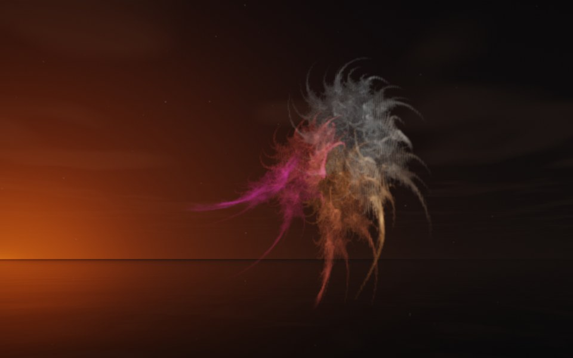

[← Cobra](flame_cobra.md) · [All fractals](../FRACTALS.md#fractal-flames) · [Starfish →](flame_starfish.md)

# Anemone (`flame`, preset `anemone`)

*Fractal flames*



A sea anemone's crown of feathery tentacles, streaming out to one side: dozens of fine, curling tendrils from a tufted base, the longest swept out as if by a current. Above: palette `nebula`, over a lake just after sunset.

**Maps.** Two maps, chosen at random with the probability of their weights. Each is an affine map (written out in the JSON below) bent by its variations; its color is the place in the palette that it pulls its points toward.

| map | weight | color | variations |
| --- | --- | --- | --- |
| 1 | 0.3 | 0 | 0.501 `eyefish` + 0.499 `horseshoe` |
| 2 | 0.78 | 1 | 0.773 `spherical` + 0.227 `swirl` |

**Node.** The preset as a node (the picture draws it at `size` 3.2, `glow` 8, `density` 3, `resolution` 192 and 24 million `points`; see `tools/flame-images.py`):

```json
{"type": "flame", "preset": "anemone", "palette": "nebula"}
```

and the same flame with its maps written out, to change them (`transforms` stand in for the preset):

```json
{"type": "flame", "palette": "nebula", "transforms": [
    {"weight": 0.3, "color": 0, "matrix": [[0.546, 0.316, -0.298], [-0.041, 0.594, 0.362], [0.465, -0.318, 0.381]], "offset": [0.197, 0.565, -0.732], "variations": {"eyefish": 0.501, "horseshoe": 0.499}},
    {"weight": 0.78, "color": 1, "matrix": [[0.328, -0.571, -0.066], [0.545, 0.35, -0.061], [0.108, -0.032, 0.504]], "offset": [0.571, -0.253, -0.179], "variations": {"swirl": 0.227, "spherical": 0.773}}
]}
```

**Palette.** `nebula`: violet at 0, through magenta, coral and amber, to pale blue at 1. Any of the eight palettes, or `colors` of your own, will do: the palette only colors the flame, it does not change its shape.

**Origin.** Made for ray by Claude (Anthropic's Claude Opus 5.5), October 2026: seed 398 of ray's random flame generator (`"preset": "random", "seed": 398`), picked by eye from many random flames and frozen as these maps, rounded to three decimals. For how a flame is drawn into voxels and rendered as a volume, its variations and its parameters, see [Fractal Flame](flame.md).

---

[← Cobra](flame_cobra.md) · [All fractals](../FRACTALS.md#fractal-flames) · [Starfish →](flame_starfish.md)
