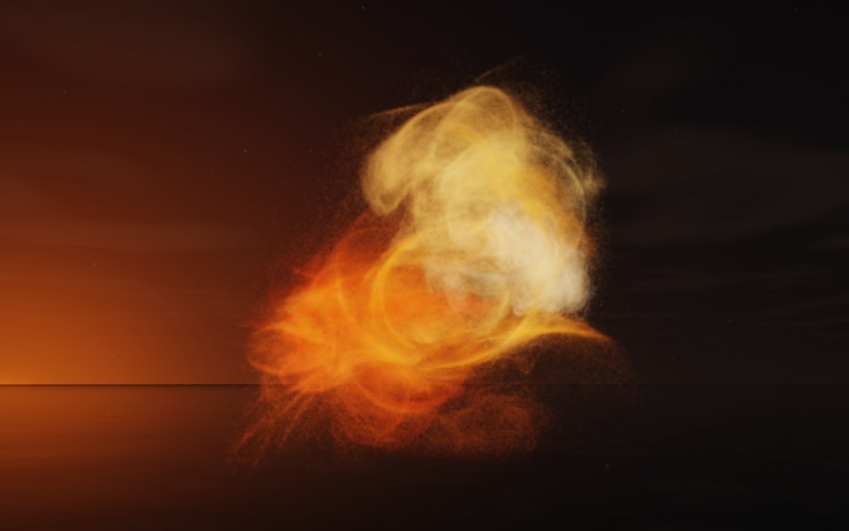

[← Nautilus](flame_nautilus.md) · [All fractals](../FRACTALS.md#fractal-flames) · [Dandelion →](flame_dandelion.md)

# Bloom (`flame`, preset `bloom`)

*Fractal flames*



A billowing bloom of fire, like a firework's burst: soft lobes of glowing thread billowing out from a bright heart. Above: palette `fire`, over a lake just after sunset.

**Maps.** Four maps, chosen at random with the probability of their weights. Each is an affine map (written out in the JSON below) bent by its variations; its color is the place in the palette that it pulls its points toward.

| map | weight | color | variations |
| --- | --- | --- | --- |
| 1 | 0.94 | 0 | `linear` |
| 2 | 0.977 | 0.333 | 0.641 `spherical` + 0.359 `linear` |
| 3 | 0.31 | 0.667 | 0.616 `eyefish` + 0.384 `sinusoidal` |
| 4 | 0.862 | 1 | `spherical` |

**Node.** The preset as a node (the picture draws it at `size` 3.2, `glow` 8, `density` 3, `resolution` 192 and 24 million `points`; see `tools/flame-images.py`):

```json
{"type": "flame", "preset": "bloom", "palette": "fire"}
```

and the same flame with its maps written out, to change them (`transforms` stand in for the preset):

```json
{"type": "flame", "palette": "fire", "transforms": [
    {"weight": 0.94, "color": 0, "matrix": [[-0.552, 0.048, -0.454], [0.173, -0.282, -0.303], [-0.485, -0.155, 0.409]], "offset": [-0.656, -0.495, -0.171], "variations": {"linear": 1}},
    {"weight": 0.977, "color": 0.333, "matrix": [[0.669, 0.392, 0.137], [-0.367, 0.69, 0.298], [0.025, -0.348, 0.746]], "offset": [0.147, -0.35, 0.132], "variations": {"linear": 0.359, "spherical": 0.641}},
    {"weight": 0.31, "color": 0.667, "matrix": [[0.509, 0.196, -0.332], [0.378, 0.151, 0.446], [0.193, -0.814, 0.003]], "offset": [0.114, -0.187, -0.482], "variations": {"eyefish": 0.616, "sinusoidal": 0.384}},
    {"weight": 0.862, "color": 1, "matrix": [[0.311, 0.097, 0.48], [-0.07, -0.683, 0.297], [0.254, -0.308, -0.506]], "offset": [0.442, 0.198, 0.57], "variations": {"spherical": 1}}
]}
```

**Palette.** `fire`: dark red at 0, through red, orange and yellow, to white-hot at 1. Any of the eight palettes, or `colors` of your own, will do: the palette only colors the flame, it does not change its shape.

**Origin.** Made for ray by Claude (Anthropic's Claude Opus 5.5), October 2026: seed 68 of ray's random flame generator (`"preset": "random", "seed": 68`), picked by eye from many random flames and frozen as these maps, rounded to three decimals. For how a flame is drawn into voxels and rendered as a volume, its variations and its parameters, see [Fractal Flame](flame.md).

---

[← Nautilus](flame_nautilus.md) · [All fractals](../FRACTALS.md#fractal-flames) · [Dandelion →](flame_dandelion.md)
