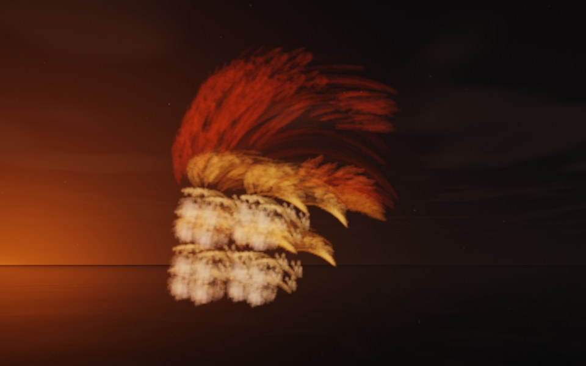

[← Infinity](flame_infinity.md) · [All fractals](../FRACTALS.md#fractal-flames) · [Sierpinski →](flame_sierpinski.md)

# Centurion (`flame`, preset `centurion`)

*Fractal flames*



A crest of plumes sweeping over rolls of white, like a centurion's helmet: long, dark red plumes swept back over curved golden vanes and a stack of white rolls. Above: palette `fire`, over a lake just after sunset.

**Animation.** Ten seconds swinging in among its threads, in full 1080p [on Google Drive](https://drive.google.com/file/d/1Pg280hCce45VSnl5jOVsiiT_9O1krY0E/view); below, a small preview of it.

[](https://drive.google.com/file/d/1Pg280hCce45VSnl5jOVsiiT_9O1krY0E/view)

**Maps.** Two maps, chosen at random with the probability of their weights. Each is an affine map (written out in the JSON below) bent by its variations; its color is the place in the palette that it pulls its points toward.

| map | weight | color | variations |
| --- | --- | --- | --- |
| 1 | 0.337 | 0 | 0.702 `spherical` + 0.298 `linear` |
| 2 | 0.495 | 1 | 0.725 `linear` + 0.275 `julia3d` (power 4) |

**Node.** The preset as a node (the picture draws it at `size` 3.2, `glow` 8, `density` 3, `resolution` 192 and 24 million `points`; see `tools/flame-images.py`):

```json
{"type": "flame", "preset": "centurion", "palette": "fire"}
```

and the same flame with its maps written out, to change them (`transforms` stand in for the preset):

```json
{"type": "flame", "palette": "fire", "transforms": [
    {"weight": 0.337, "color": 0, "matrix": [[-0.68, -0.028, -0.133], [-0.158, 0.24, 0.394], [0.073, 0.257, -0.383]], "offset": [-0.062, 0.37, -0.269], "variations": {"spherical": 0.702, "linear": 0.298}},
    {"weight": 0.495, "color": 1, "matrix": [[0.508, 0.073, -0.261], [-0.123, 0.491, -0.145], [0.173, 0.136, 0.664]], "offset": [-0.614, 0.222, 0.551], "variations": {"linear": 0.725, "julia3d": 0.275}, "power": 4}
]}
```

**Palette.** `fire`: dark red at 0, through red, orange and yellow, to white-hot at 1. Any of the eight palettes, or `colors` of your own, will do: the palette only colors the flame, it does not change its shape.

**Origin.** Made for ray by Claude (Anthropic's Claude Opus 5.5), October 2026: seed 423 of ray's random flame generator (`"preset": "random", "seed": 423`), picked by eye from many random flames and frozen as these maps, rounded to three decimals. For how a flame is drawn into voxels and rendered as a volume, its variations and its parameters, see [Fractal Flame](flame.md).

---

[← Infinity](flame_infinity.md) · [All fractals](../FRACTALS.md#fractal-flames) · [Sierpinski →](flame_sierpinski.md)
