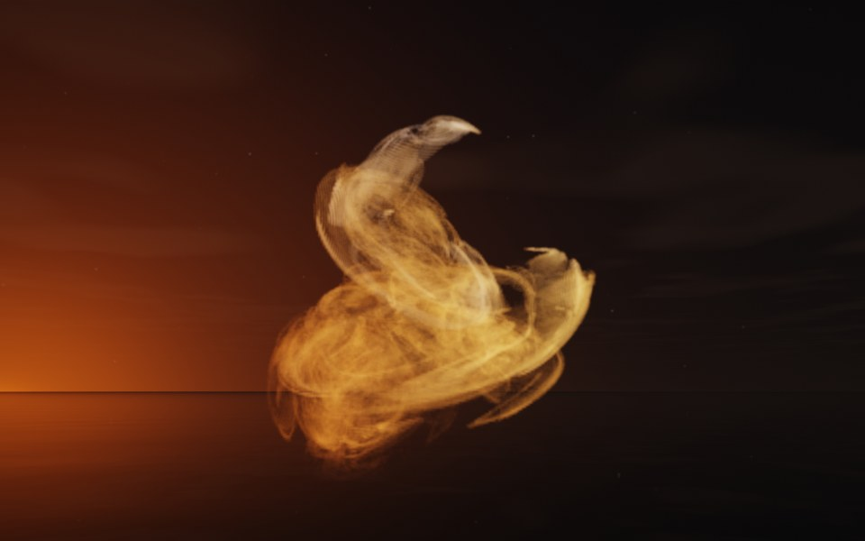

[← Pearl](flame_pearl.md) · [All fractals](../FRACTALS.md#fractal-flames) · [Anemone →](flame_anemone.md)

# Cobra (`flame`, preset `cobra`)

*Fractal flames*



A snake coiled on itself, rearing up with its hood spread: ribbons coil in a heap at the bottom and rise in a neck that bends over into a hooded head. Above: palette `gold`, over a lake just after sunset.

**Animation.** Ten seconds swinging in among its threads, in full 1080p [on Google Drive](https://drive.google.com/file/d/1u4ZQLk6KjHHpMyxt0rLGR97AA-C7p8b-/view); below, a small preview of it.

[](https://drive.google.com/file/d/1u4ZQLk6KjHHpMyxt0rLGR97AA-C7p8b-/view)

**Maps.** Four maps, chosen at random with the probability of their weights. Each is an affine map (written out in the JSON below) bent by its variations; its color is the place in the palette that it pulls its points toward.

| map | weight | color | variations |
| --- | --- | --- | --- |
| 1 | 0.439 | 0 | `horseshoe` |
| 2 | 1 | 0.333 | `swirl` |
| 3 | 0.604 | 0.667 | `eyefish` |
| 4 | 0.832 | 1 | 0.723 `eyefish` + 0.277 `spherical` |

**Node.** The preset as a node (the picture draws it at `size` 3.2, `glow` 8, `density` 3, `resolution` 192 and 24 million `points`; see `tools/flame-images.py`):

```json
{"type": "flame", "preset": "cobra", "palette": "gold"}
```

and the same flame with its maps written out, to change them (`transforms` stand in for the preset):

```json
{"type": "flame", "palette": "gold", "transforms": [
    {"weight": 0.439, "color": 0, "matrix": [[-0.306, -0.436, -0.29], [0.075, 0.46, -0.4], [0.413, -0.406, -0.142]], "offset": [-0.415, -0.78, 0.582], "variations": {"horseshoe": 1}},
    {"weight": 1, "color": 0.333, "matrix": [[0.741, 0.25, 0.087], [-0.319, 0.307, 0.469], [0.213, -0.411, 0.403]], "offset": [0.443, -0.667, -0.634], "variations": {"swirl": 1}},
    {"weight": 0.604, "color": 0.667, "matrix": [[-0.275, 0.264, -0.581], [-0.306, -0.427, 0.351], [-0.1, 0.58, 0.523]], "offset": [-0.274, -0.125, -0.492], "variations": {"eyefish": 1}},
    {"weight": 0.832, "color": 1, "matrix": [[-0.209, 0.394, -0.265], [-0.46, -0.025, 0.151], [0.096, 0.74, 0.146]], "offset": [-0.314, 0.712, 0.03], "variations": {"eyefish": 0.723, "spherical": 0.277}}
]}
```

**Palette.** `gold`: bronze at 0, through gold, to cream at 1. Any of the eight palettes, or `colors` of your own, will do: the palette only colors the flame, it does not change its shape.

**Origin.** Made for ray by Claude (Anthropic's Claude Opus 5.5), October 2026: seed 204 of ray's random flame generator (`"preset": "random", "seed": 204`), picked by eye from many random flames and frozen as these maps, rounded to three decimals. For how a flame is drawn into voxels and rendered as a volume, its variations and its parameters, see [Fractal Flame](flame.md).

---

[← Pearl](flame_pearl.md) · [All fractals](../FRACTALS.md#fractal-flames) · [Anemone →](flame_anemone.md)
