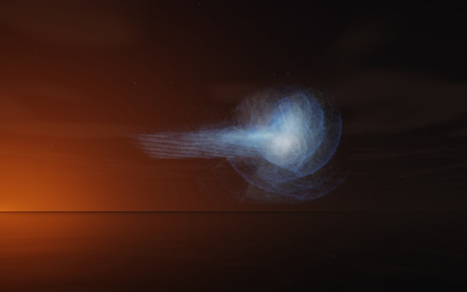

[← Veil](flame_veil.md) · [All fractals](../FRACTALS.md#fractal-flames) · [Supernova →](flame_supernova.md)

# Comet (`flame`, preset `comet`)

*Fractal flames*



A comet: a bright head in a veil of coma, trailing a long straight tail. The tail is a sheaf of fine parallel threads; the coma, faint arcs wrapped around the head. Above: palette `ice`, over a lake just after sunset.

**Maps.** Four maps, chosen at random with the probability of their weights. Each is an affine map (written out in the JSON below) bent by its variations; its color is the place in the palette that it pulls its points toward.

| map | weight | color | variations |
| --- | --- | --- | --- |
| 1 | 0.593 | 0 | `swirl` |
| 2 | 0.764 | 0.333 | `bent` |
| 3 | 0.928 | 0.667 | `linear` |
| 4 | 0.695 | 1 | 0.744 `linear` + 0.256 `cylinder` |

**Node.** The preset as a node (the picture draws it at `size` 3.2, `glow` 8, `density` 3, `resolution` 192 and 24 million `points`; see `tools/flame-images.py`):

```json
{"type": "flame", "preset": "comet", "palette": "ice"}
```

and the same flame with its maps written out, to change them (`transforms` stand in for the preset):

```json
{"type": "flame", "palette": "ice", "transforms": [
    {"weight": 0.593, "color": 0, "matrix": [[-0.606, -0.214, 0.198], [0.12, 0.087, 0.776], [-0.382, 0.366, -0.069]], "offset": [-0.512, 0.599, -0.164], "variations": {"swirl": 1}},
    {"weight": 0.764, "color": 0.333, "matrix": [[0.605, -0.039, -0.01], [0.064, 0.37, 0.116], [-0.002, -0.056, 0.767]], "offset": [-0.511, -0.426, -0.002], "variations": {"bent": 1}},
    {"weight": 0.928, "color": 0.667, "matrix": [[0.281, -0.151, -0.375], [0.459, 0.328, 0.019], [0.408, -0.265, 0.237]], "offset": [0.101, 0.218, -0.519], "variations": {"linear": 1}},
    {"weight": 0.695, "color": 1, "matrix": [[0.299, -0.318, 0.123], [-0.133, -0.239, -0.352], [0.341, 0.185, -0.245]], "offset": [-0.102, -0.788, -0.598], "variations": {"cylinder": 0.256, "linear": 0.744}}
]}
```

**Palette.** `ice`: deep blue at 0, through sky blue, to white at 1. Any of the eight palettes, or `colors` of your own, will do: the palette only colors the flame, it does not change its shape.

**Origin.** Made for ray by Claude (Anthropic's Claude Opus 5.5), October 2026: seed 147 of ray's random flame generator (`"preset": "random", "seed": 147`), picked by eye from many random flames and frozen as these maps, rounded to three decimals. For how a flame is drawn into voxels and rendered as a volume, its variations and its parameters, see [Fractal Flame](flame.md).

---

[← Veil](flame_veil.md) · [All fractals](../FRACTALS.md#fractal-flames) · [Supernova →](flame_supernova.md)
