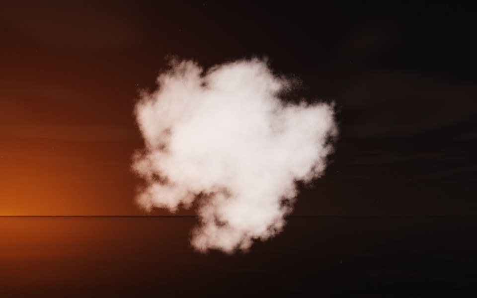

[← Saturn](flame_saturn.md) · [All fractals](../FRACTALS.md#fractal-flames) · [Snowflake →](flame_snowflake.md)

# Cumulus (`flame`, preset `cumulus`)

*Fractal flames*



A heaped summer cloud, puff upon billowing puff: a soft, dense mass of rounded lobes, each lumpy with smaller ones. Above: palette `white`, over a lake just after sunset.

**Animation.** Ten seconds swinging in among its threads, in full 1080p [on Google Drive](https://drive.google.com/file/d/1N6mbdgbJKTXQr9PqZXghzfotVPgmnXVb/view); below, a small preview of it.

[](https://drive.google.com/file/d/1N6mbdgbJKTXQr9PqZXghzfotVPgmnXVb/view)

**Maps.** Two maps, chosen at random with the probability of their weights. Each is an affine map (written out in the JSON below) bent by its variations; its color is the place in the palette that it pulls its points toward.

| map | weight | color | variations |
| --- | --- | --- | --- |
| 1 | 0.711 | 0 | `spherical` |
| 2 | 0.33 | 1 | 0.777 `linear` + 0.223 `julia3d` (power 4) |

**Node.** The preset as a node (the picture draws it at `size` 3.2, `glow` 8, `density` 3, `resolution` 192 and 24 million `points`; see `tools/flame-images.py`):

```json
{"type": "flame", "preset": "cumulus", "palette": "white"}
```

and the same flame with its maps written out, to change them (`transforms` stand in for the preset):

```json
{"type": "flame", "palette": "white", "transforms": [
    {"weight": 0.711, "color": 0, "matrix": [[-0.187, 0.231, -0.379], [0.114, -0.432, -0.274], [-0.347, -0.266, 0.115]], "offset": [0.513, 0.749, 0.53], "variations": {"spherical": 1}},
    {"weight": 0.33, "color": 1, "matrix": [[0.238, 0.571, 0.398], [-0.215, 0.597, -0.384], [-0.758, 0.01, 0.233]], "offset": [0.662, 0.693, 0.625], "variations": {"julia3d": 0.223, "linear": 0.777}, "power": 4}
]}
```

**Palette.** `white`: white all along, so only the density and the light show. Any of the eight palettes, or `colors` of your own, will do: the palette only colors the flame, it does not change its shape.

**Origin.** Made for ray by Claude (Anthropic's Claude Opus 5.5), October 2026: seed 226 of ray's random flame generator (`"preset": "random", "seed": 226`), picked by eye from many random flames and frozen as these maps, rounded to three decimals. For how a flame is drawn into voxels and rendered as a volume, its variations and its parameters, see [Fractal Flame](flame.md).

---

[← Saturn](flame_saturn.md) · [All fractals](../FRACTALS.md#fractal-flames) · [Snowflake →](flame_snowflake.md)
