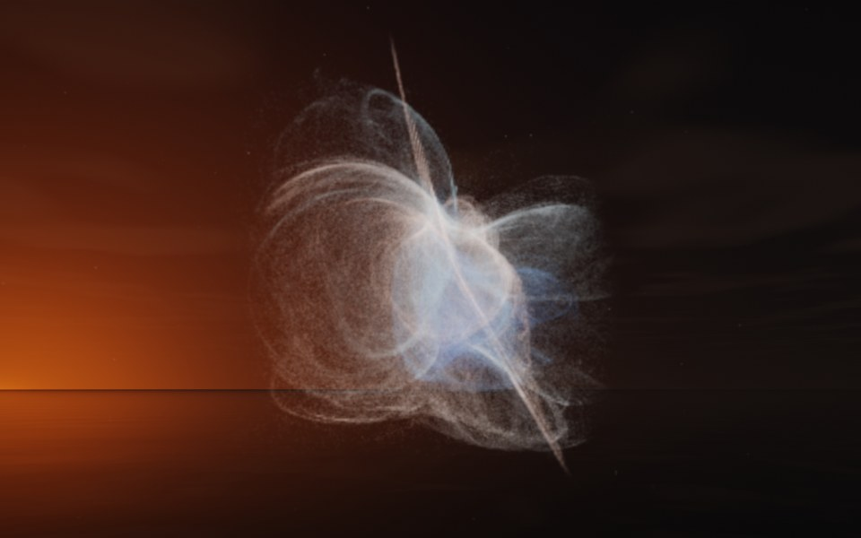

[← Bloom](flame_bloom.md) · [All fractals](../FRACTALS.md#fractal-flames) · [Veil →](flame_veil.md)

# Dandelion (`flame`, preset `dandelion`)

*Fractal flames*



A ball of fine curved filaments, a seed head: thousands of arcs crossing in a loose sphere, with a few long spikes through it. Above: palette `ice`, over a lake just after sunset.

**Maps.** Two maps, chosen at random with the probability of their weights. Each is an affine map (written out in the JSON below) bent by its variations; its color is the place in the palette that it pulls its points toward.

| map | weight | color | variations |
| --- | --- | --- | --- |
| 1 | 0.61 | 0 | 0.641 `eyefish` + 0.359 `horseshoe` |
| 2 | 0.664 | 1 | 0.579 `spherical` + 0.421 `linear` |

**Node.** The preset as a node (the picture draws it at `size` 3.2, `glow` 8, `density` 3, `resolution` 192 and 24 million `points`; see `tools/flame-images.py`):

```json
{"type": "flame", "preset": "dandelion", "palette": "ice"}
```

and the same flame with its maps written out, to change them (`transforms` stand in for the preset):

```json
{"type": "flame", "palette": "ice", "transforms": [
    {"weight": 0.61, "color": 0, "matrix": [[0.875, 0.035, 0.006], [-0.039, 0.781, 0.017], [-0.008, -0.026, 0.528]], "offset": [0.517, -0.504, -0.635], "variations": {"eyefish": 0.641, "horseshoe": 0.359}},
    {"weight": 0.664, "color": 1, "matrix": [[-0.111, 0.065, 0.366], [-0.546, 0.448, -0.068], [-0.363, -0.694, -0.01]], "offset": [0.329, 0.496, 0.104], "variations": {"linear": 0.421, "spherical": 0.579}}
]}
```

**Palette.** `ice`: deep blue at 0, through sky blue, to white at 1. Any of the eight palettes, or `colors` of your own, will do: the palette only colors the flame, it does not change its shape.

**Origin.** Made for ray by Claude (Anthropic's Claude Opus 5.5), October 2026: seed 70 of ray's random flame generator (`"preset": "random", "seed": 70`), picked by eye from many random flames and frozen as these maps, rounded to three decimals. For how a flame is drawn into voxels and rendered as a volume, its variations and its parameters, see [Fractal Flame](flame.md).

---

[← Bloom](flame_bloom.md) · [All fractals](../FRACTALS.md#fractal-flames) · [Veil →](flame_veil.md)
