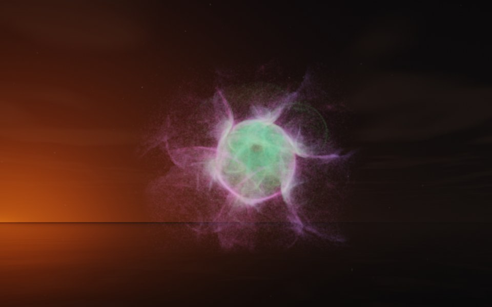

[← Starfish](flame_starfish.md) · [All fractals](../FRACTALS.md#fractal-flames) · [Fern →](flame_fern.md)

# Diatom (`flame`, preset `diatom`)

*Fractal flames*



A diatom, seen from above: a round glassy cell with six curved spines and gossamer between them, like the silica shell of the single-celled alga. Its two maps alone draw only a sparse, lopsided spray; the preset's own symmetry, 6, adds five more maps, pure turns about the flame's y axis by multiples of 60°, so the spray repeats six-fold around it. Above: palette `aurora`, over a lake just after sunset, turned 80° about x so that its symmetry axis points nearly at the camera.

**Animation.** Ten seconds swinging in among its threads, in full 1080p [on Google Drive](https://drive.google.com/file/d/16ZPbSrqPQsmjkBIhR7fE-mKocSfx4cTr/view); below, a small preview of it.

[](https://drive.google.com/file/d/16ZPbSrqPQsmjkBIhR7fE-mKocSfx4cTr/view)

**Maps.** Two maps, chosen at random with the probability of their weights. Each is an affine map (written out in the JSON below) bent by its variations; its color is the place in the palette that it pulls its points toward. Then the preset's own symmetry, 6.

| map | weight | color | variations |
| --- | --- | --- | --- |
| 1 | 0.959 | 0 | 0.688 `eyefish` + 0.312 `swirl` |
| 2 | 0.544 | 1 | 0.717 `spherical` + 0.283 `linear` |

**Node.** The preset as a node (the picture draws it at `size` 3.2, `glow` 8, `density` 3, `resolution` 192 and 24 million `points`; see `tools/flame-images.py`):

```json
{"type": "flame", "preset": "diatom", "palette": "aurora", "rotation": [80, 0, 0]}
```

and the same flame with its maps written out, to change them (`transforms` stand in for the preset, so the symmetry goes on the node):

```json
{"type": "flame", "palette": "aurora", "symmetry": 6, "transforms": [
    {"weight": 0.959, "color": 0, "matrix": [[0.695, -0.133, 0.13], [0.211, 0.558, -0.073], [-0.182, 0.141, 0.413]], "offset": [0.423, 0.634, -0.529], "variations": {"swirl": 0.312, "eyefish": 0.688}},
    {"weight": 0.544, "color": 1, "matrix": [[-0.183, -0.475, -0.446], [0.68, 0.059, -0.459], [0.397, -0.319, 0.581]], "offset": [-0.652, 0.184, 0.706], "variations": {"linear": 0.283, "spherical": 0.717}}
]}
```

**Palette.** `aurora`: dark teal at 0, through green and mint, to violet and magenta at 1. Any of the eight palettes, or `colors` of your own, will do: the palette only colors the flame, it does not change its shape.

**Origin.** Made for ray by Claude (Anthropic's Claude Opus 5.5), October 2026: seed 255 of ray's random flame generator (`"preset": "random", "seed": 255`, with `"symmetry": 6`), picked by eye from many random flames and frozen as these maps, rounded to three decimals. For how a flame is drawn into voxels and rendered as a volume, its variations and its parameters, see [Fractal Flame](flame.md).

---

[← Starfish](flame_starfish.md) · [All fractals](../FRACTALS.md#fractal-flames) · [Fern →](flame_fern.md)
