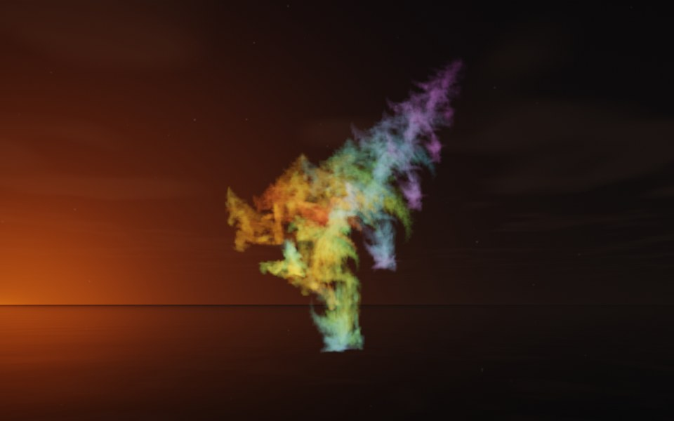

[← Diatom](flame_diatom.md) · [All fractals](../FRACTALS.md#fractal-flames) · [Ivy →](flame_ivy.md)

# Fern (`flame`, preset `fern`)

*Fractal flames*



A fern frond, its leaflets in tufts up a leaning stem: the frond rises from a narrow foot and leans to one side, leafy tufts all the way up. Above: palette `rainbow`, over a lake just after sunset.

**Animation.** Ten seconds swinging in among its threads, in full 1080p [on Google Drive](https://drive.google.com/file/d/1R2y0QTh_IV3WcWGj2Q9nHt8s3JX6rDHV/view); below, a small preview of it.

[](https://drive.google.com/file/d/1R2y0QTh_IV3WcWGj2Q9nHt8s3JX6rDHV/view)

**Maps.** Four maps, chosen at random with the probability of their weights. Each is an affine map (written out in the JSON below) bent by its variations; its color is the place in the palette that it pulls its points toward.

| map | weight | color | variations |
| --- | --- | --- | --- |
| 1 | 0.333 | 0 | 0.708 `linear` + 0.292 `sinusoidal` |
| 2 | 0.846 | 0.333 | 0.573 `bent` + 0.427 `julia3d` (power 2) |
| 3 | 0.334 | 0.667 | `sinusoidal` |
| 4 | 0.436 | 1 | `linear` |

**Node.** The preset as a node (the picture draws it at `size` 3.2, `glow` 8, `density` 3, `resolution` 192 and 24 million `points`; see `tools/flame-images.py`):

```json
{"type": "flame", "preset": "fern", "palette": "rainbow"}
```

and the same flame with its maps written out, to change them (`transforms` stand in for the preset):

```json
{"type": "flame", "palette": "rainbow", "transforms": [
    {"weight": 0.333, "color": 0, "matrix": [[0.041, 0.769, -0.012], [0.199, -0.037, -0.648], [-0.455, 0.054, -0.284]], "offset": [-0.332, 0.472, -0.557], "variations": {"sinusoidal": 0.292, "linear": 0.708}},
    {"weight": 0.846, "color": 0.333, "matrix": [[0.006, 0.007, -0.431], [0.794, -0.041, 0.002], [-0.087, -0.375, -0.008]], "offset": [-0.079, 0.055, -0.269], "variations": {"julia3d": 0.427, "bent": 0.573}, "power": 2},
    {"weight": 0.334, "color": 0.667, "matrix": [[-0.015, 0.03, 0.357], [-0.735, 0.128, -0.016], [-0.262, -0.36, 0.024]], "offset": [0.782, -0.448, 0.175], "variations": {"sinusoidal": 1}},
    {"weight": 0.436, "color": 1, "matrix": [[0.721, -0.042, -0.097], [0.007, 0.716, -0.202], [0.114, 0.224, 0.627]], "offset": [0.69, 0.744, -0.612], "variations": {"linear": 1}}
]}
```

**Palette.** `rainbow`: red at 0, through yellow, green and blue, to violet at 1. Any of the eight palettes, or `colors` of your own, will do: the palette only colors the flame, it does not change its shape.

**Origin.** Made for ray by Claude (Anthropic's Claude Opus 5.5), October 2026: seed 156 of ray's random flame generator (`"preset": "random", "seed": 156`), picked by eye from many random flames and frozen as these maps, rounded to three decimals. For how a flame is drawn into voxels and rendered as a volume, its variations and its parameters, see [Fractal Flame](flame.md).

---

[← Diatom](flame_diatom.md) · [All fractals](../FRACTALS.md#fractal-flames) · [Ivy →](flame_ivy.md)
