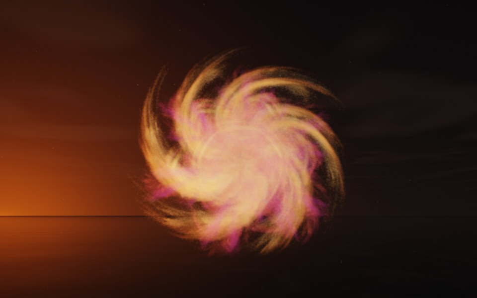

[← Supernova](flame_supernova.md) · [All fractals](../FRACTALS.md#fractal-flames) · [Saturn →](flame_saturn.md)

# Galaxy (`flame`, preset `galaxy`)

*Fractal flames*



A spiral galaxy, seen from above: six feathery arms wound about a bright core. Its two maps alone draw only a sparse, lopsided spray; the preset's own symmetry, 6, adds five more maps, pure turns about the flame's y axis by multiples of 60°, so the spray repeats six-fold around it. Above: palette `sunset`, over a lake just after sunset, turned 80° about x so that its symmetry axis points nearly at the camera.

**Maps.** Two maps, chosen at random with the probability of their weights. Each is an affine map (written out in the JSON below) bent by its variations; its color is the place in the palette that it pulls its points toward. Then the preset's own symmetry, 6.

| map | weight | color | variations |
| --- | --- | --- | --- |
| 1 | 0.799 | 0 | `bent` |
| 2 | 0.527 | 1 | `swirl` |

**Node.** The preset as a node (the picture draws it at `size` 3.2, `glow` 8, `density` 3, `resolution` 192 and 24 million `points`; see `tools/flame-images.py`):

```json
{"type": "flame", "preset": "galaxy", "palette": "sunset", "rotation": [80, 0, 0]}
```

and the same flame with its maps written out, to change them (`transforms` stand in for the preset, so the symmetry goes on the node):

```json
{"type": "flame", "palette": "sunset", "symmetry": 6, "transforms": [
    {"weight": 0.799, "color": 0, "matrix": [[0.499, -0.144, -0.236], [-0.006, 0.236, -0.355], [0.412, 0.178, 0.28]], "offset": [0.393, 0.387, 0.179], "variations": {"bent": 1}},
    {"weight": 0.527, "color": 1, "matrix": [[0.345, -0.194, -0.446], [0.466, 0.261, -0.192], [0.608, -0.09, 0.4]], "offset": [0.044, 0.47, 0.398], "variations": {"swirl": 1}}
]}
```

**Palette.** `sunset`: purple at 0, through crimson and orange, to pale gold at 1. Any of the eight palettes, or `colors` of your own, will do: the palette only colors the flame, it does not change its shape.

**Origin.** Made for ray by Claude (Anthropic's Claude Opus 5.5), October 2026: seed 200 of ray's random flame generator (`"preset": "random", "seed": 200`, with `"symmetry": 6`), picked by eye from many random flames and frozen as these maps, rounded to three decimals. For how a flame is drawn into voxels and rendered as a volume, its variations and its parameters, see [Fractal Flame](flame.md).

---

[← Supernova](flame_supernova.md) · [All fractals](../FRACTALS.md#fractal-flames) · [Saturn →](flame_saturn.md)
