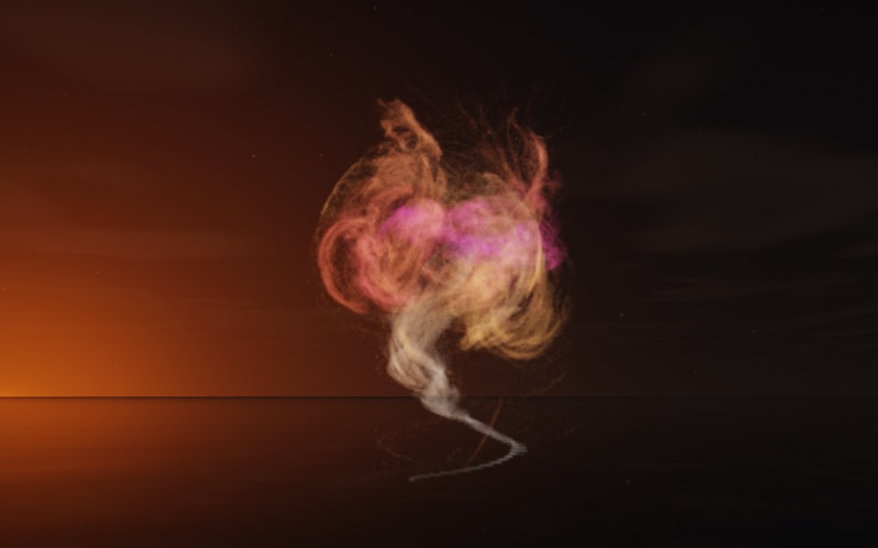

[← Reeds](flame_reeds.md) · [All fractals](../FRACTALS.md#fractal-flames) · [Lantern →](flame_lantern.md)

# Genie (`flame`, preset `genie`)

*Fractal flames*



A thread of smoke rising and billowing out, like a genie leaving its lamp: a single thin wisp curls up from below and opens into a swirling cloud. Above: palette `nebula`, over a lake just after sunset.

**Maps.** Four maps, chosen at random with the probability of their weights. Each is an affine map (written out in the JSON below) bent by its variations; its color is the place in the palette that it pulls its points toward.

| map | weight | color | variations |
| --- | --- | --- | --- |
| 1 | 0.738 | 0 | 0.674 `eyefish` + 0.326 `linear` |
| 2 | 0.91 | 0.333 | `spherical` |
| 3 | 0.532 | 0.667 | 0.54 `spherical` + 0.46 `linear` |
| 4 | 0.937 | 1 | `swirl` |

**Node.** The preset as a node (the picture draws it at `size` 3.2, `glow` 8, `density` 3, `resolution` 192 and 24 million `points`; see `tools/flame-images.py`):

```json
{"type": "flame", "preset": "genie", "palette": "nebula"}
```

and the same flame with its maps written out, to change them (`transforms` stand in for the preset):

```json
{"type": "flame", "palette": "nebula", "transforms": [
    {"weight": 0.738, "color": 0, "matrix": [[-0.559, 0.334, 0.019], [-0.081, -0.176, 0.324], [0.355, 0.486, 0.104]], "offset": [0.468, 0.463, -0.759], "variations": {"eyefish": 0.674, "linear": 0.326}},
    {"weight": 0.91, "color": 0.333, "matrix": [[-0.247, -0.295, 0.018], [-0.162, 0.029, -0.711], [0.538, -0.126, -0.206]], "offset": [-0.786, 0.302, -0.319], "variations": {"spherical": 1}},
    {"weight": 0.532, "color": 0.667, "matrix": [[0.676, 0.037, 0.026], [-0.055, 0.439, -0.037], [-0.036, 0.028, 0.546]], "offset": [0.738, 0.065, -0.27], "variations": {"spherical": 0.54, "linear": 0.46}},
    {"weight": 0.937, "color": 1, "matrix": [[0.245, -0.003, -0.411], [-0.014, 0.819, -0.027], [0.248, 0.051, 0.405]], "offset": [0.448, -0.718, 0.308], "variations": {"swirl": 1}}
]}
```

**Palette.** `nebula`: violet at 0, through magenta, coral and amber, to pale blue at 1. Any of the eight palettes, or `colors` of your own, will do: the palette only colors the flame, it does not change its shape.

**Origin.** Made for ray by Claude (Anthropic's Claude Opus 5.5), October 2026: seed 439 of ray's random flame generator (`"preset": "random", "seed": 439`), picked by eye from many random flames and frozen as these maps, rounded to three decimals. For how a flame is drawn into voxels and rendered as a volume, its variations and its parameters, see [Fractal Flame](flame.md).

---

[← Reeds](flame_reeds.md) · [All fractals](../FRACTALS.md#fractal-flames) · [Lantern →](flame_lantern.md)
