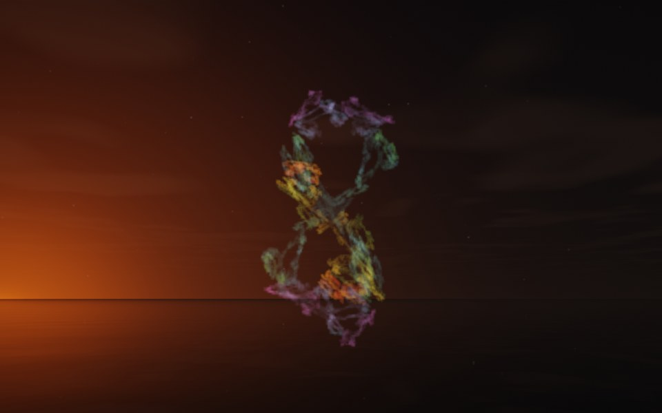

[← Pagoda](flame_pagoda.md) · [All fractals](../FRACTALS.md#fractal-flames) · [Centurion →](flame_centurion.md)

# Infinity (`flame`, preset `infinity`)

*Fractal flames*



A figure eight of knotted lace, standing on end: a loop of rough, lacy strands crossing at the waist. Both of its maps are mostly julia3d with power 2, the inverse of squaring as in a Julia set. Above: palette `rainbow`, over a lake just after sunset.

**Animation.** Ten seconds swinging in among its threads, in full 1080p [on Google Drive](https://drive.google.com/file/d/1lehMgk2uj4wpgJu9W_3m4W4RmIKCDxK8/view); below, a small preview of it.

[](https://drive.google.com/file/d/1lehMgk2uj4wpgJu9W_3m4W4RmIKCDxK8/view)

**Maps.** Two maps, chosen at random with the probability of their weights. Each is an affine map (written out in the JSON below) bent by its variations; its color is the place in the palette that it pulls its points toward.

| map | weight | color | variations |
| --- | --- | --- | --- |
| 1 | 0.458 | 0 | 0.797 `julia3d` (power 2) + 0.203 `linear` |
| 2 | 0.334 | 1 | `julia3d` (power 2) |

**Node.** The preset as a node (the picture draws it at `size` 3.2, `glow` 8, `density` 3, `resolution` 192 and 24 million `points`; see `tools/flame-images.py`):

```json
{"type": "flame", "preset": "infinity", "palette": "rainbow"}
```

and the same flame with its maps written out, to change them (`transforms` stand in for the preset):

```json
{"type": "flame", "palette": "rainbow", "transforms": [
    {"weight": 0.458, "color": 0, "matrix": [[-0.011, 0.176, 0.421], [0.778, 0.145, -0.068], [-0.316, 0.352, -0.183]], "offset": [-0.147, -0.276, -0.659], "variations": {"julia3d": 0.797, "linear": 0.203}, "power": 2},
    {"weight": 0.334, "color": 1, "matrix": [[0.141, 0.199, -0.614], [-0.365, 0.492, -0.08], [0.232, 0.653, 0.247]], "offset": [-0.359, 0.033, 0.31], "variations": {"julia3d": 1}, "power": 2}
]}
```

**Palette.** `rainbow`: red at 0, through yellow, green and blue, to violet at 1. Any of the eight palettes, or `colors` of your own, will do: the palette only colors the flame, it does not change its shape.

**Origin.** Made for ray by Claude (Anthropic's Claude Opus 5.5), October 2026: seed 105 of ray's random flame generator (`"preset": "random", "seed": 105`), picked by eye from many random flames and frozen as these maps, rounded to three decimals. For how a flame is drawn into voxels and rendered as a volume, its variations and its parameters, see [Fractal Flame](flame.md).

---

[← Pagoda](flame_pagoda.md) · [All fractals](../FRACTALS.md#fractal-flames) · [Centurion →](flame_centurion.md)
