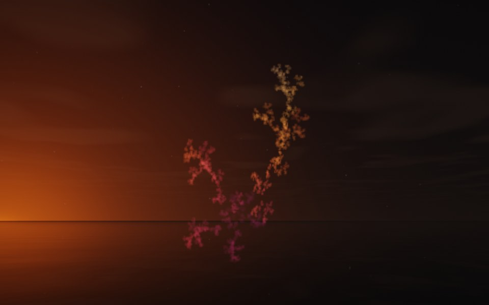

[← Fern](flame_fern.md) · [All fractals](../FRACTALS.md#fractal-flames) · [Orchid →](flame_orchid.md)

# Ivy (`flame`, preset `ivy`)

*Fractal flames*



A trailing vine of tiny clustered leaves: two strands of small, crinkled clusters climbing side by side, the finest-grained of the presets. Its three maps are nearly plain: two linear and one with a little horseshoe. Above: palette `sunset`, over a lake just after sunset.

**Maps.** Three maps, chosen at random with the probability of their weights. Each is an affine map (written out in the JSON below) bent by its variations; its color is the place in the palette that it pulls its points toward.

| map | weight | color | variations |
| --- | --- | --- | --- |
| 1 | 0.547 | 0 | 0.634 `linear` + 0.366 `horseshoe` |
| 2 | 0.409 | 0.5 | `linear` |
| 3 | 0.395 | 1 | `linear` |

**Node.** The preset as a node (the picture draws it at `size` 3.2, `glow` 8, `density` 3, `resolution` 192 and 24 million `points`; see `tools/flame-images.py`):

```json
{"type": "flame", "preset": "ivy", "palette": "sunset"}
```

and the same flame with its maps written out, to change them (`transforms` stand in for the preset):

```json
{"type": "flame", "palette": "sunset", "transforms": [
    {"weight": 0.547, "color": 0, "matrix": [[0.215, -0.443, 0.304], [0.728, 0.195, 0.079], [-0.22, 0.213, 0.561]], "offset": [0.163, -0.372, 0.51], "variations": {"linear": 0.634, "horseshoe": 0.366}},
    {"weight": 0.409, "color": 0.5, "matrix": [[0.313, 0.034, 0.05], [0.013, 0.434, -0.22], [-0.047, 0.348, 0.27]], "offset": [0.453, 0.143, -0.601], "variations": {"linear": 1}},
    {"weight": 0.395, "color": 1, "matrix": [[0.448, -0.207, 0.063], [0.226, 0.396, 0.073], [-0.089, -0.032, 0.503]], "offset": [0.624, 0.765, 0.168], "variations": {"linear": 1}}
]}
```

**Palette.** `sunset`: purple at 0, through crimson and orange, to pale gold at 1. Any of the eight palettes, or `colors` of your own, will do: the palette only colors the flame, it does not change its shape.

**Origin.** Made for ray by Claude (Anthropic's Claude Opus 5.5), October 2026: seed 205 of ray's random flame generator (`"preset": "random", "seed": 205`), picked by eye from many random flames and frozen as these maps, rounded to three decimals. For how a flame is drawn into voxels and rendered as a volume, its variations and its parameters, see [Fractal Flame](flame.md).

---

[← Fern](flame_fern.md) · [All fractals](../FRACTALS.md#fractal-flames) · [Orchid →](flame_orchid.md)
