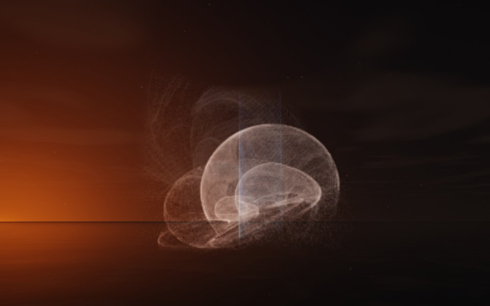

[← Wildfire](flame_wildfire.md) · [All fractals](../FRACTALS.md#fractal-flames) · [Seahorse →](flame_seahorse.md)

# Jellyfish (`flame`, preset `jellyfish`)

*Fractal flames*



A glassy bell of curved threads trailing tendrils: domes nested one inside another, with fainter threads hanging below them. The shells come from its spherical map, an inversion in the unit sphere. Above: palette `ice`, over a lake just after sunset.

**Maps.** Two maps, chosen at random with the probability of their weights. Each is an affine map (written out in the JSON below) bent by its variations; its color is the place in the palette that it pulls its points toward.

| map | weight | color | variations |
| --- | --- | --- | --- |
| 1 | 0.809 | 0 | `cylinder` |
| 2 | 0.872 | 1 | `spherical` |

**Node.** The preset as a node (the picture draws it at `size` 3.2, `glow` 8, `density` 3, `resolution` 192 and 24 million `points`; see `tools/flame-images.py`):

```json
{"type": "flame", "preset": "jellyfish", "palette": "ice"}
```

and the same flame with its maps written out, to change them (`transforms` stand in for the preset):

```json
{"type": "flame", "palette": "ice", "transforms": [
    {"weight": 0.809, "color": 0, "matrix": [[0.483, -0.064, -0.003], [0.057, 0.511, -0.135], [0.015, 0.118, 0.582]], "offset": [-0.699, 0.456, -0.777], "variations": {"cylinder": 1}},
    {"weight": 0.872, "color": 1, "matrix": [[0.207, -0.064, -0.653], [0.029, 0.33, -0.148], [0.274, 0.014, 0.51]], "offset": [0.285, 0.083, 0.201], "variations": {"spherical": 1}}
]}
```

**Palette.** `ice`: deep blue at 0, through sky blue, to white at 1. Any of the eight palettes, or `colors` of your own, will do: the palette only colors the flame, it does not change its shape.

**Origin.** Made for ray by Claude (Anthropic's Claude Opus 5.5), October 2026: seed 24 of ray's random flame generator (`"preset": "random", "seed": 24`), picked by eye from many random flames and frozen as these maps, rounded to three decimals. For how a flame is drawn into voxels and rendered as a volume, its variations and its parameters, see [Fractal Flame](flame.md).

---

[← Wildfire](flame_wildfire.md) · [All fractals](../FRACTALS.md#fractal-flames) · [Seahorse →](flame_seahorse.md)
