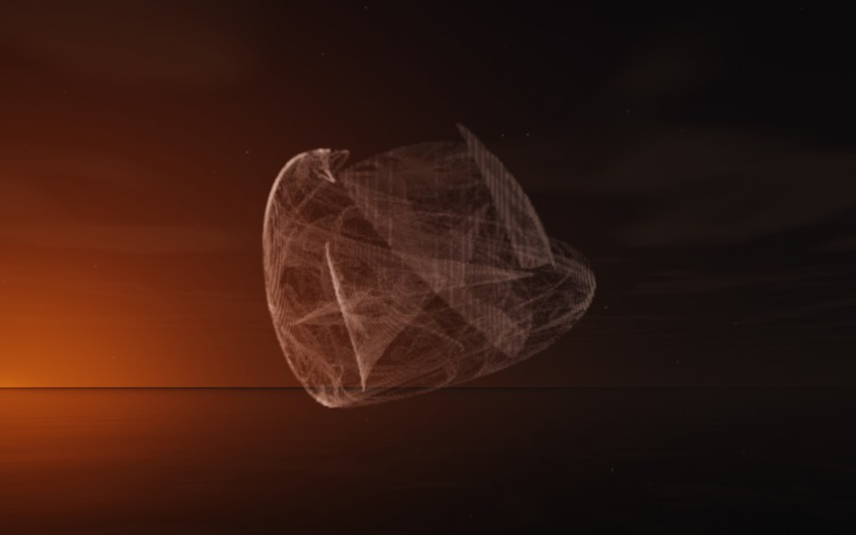

[← Genie](flame_genie.md) · [All fractals](../FRACTALS.md#fractal-flames) · [Pagoda →](flame_pagoda.md)

# Lantern (`flame`, preset `lantern`)

*Fractal flames*



A cage of fine wire, like a paper lantern's frame with only light in it: a rounded shell of fine threads, open at one end, with a few flat triangular panes inside. Wire-thin and see-through, it is the sparest of the presets. Above: palette `white`, over a lake just after sunset.

**Maps.** Two maps, chosen at random with the probability of their weights. Each is an affine map (written out in the JSON below) bent by its variations; its color is the place in the palette that it pulls its points toward.

| map | weight | color | variations |
| --- | --- | --- | --- |
| 1 | 0.792 | 0 | `cylinder` |
| 2 | 0.749 | 1 | 0.756 `swirl` + 0.244 `linear` |

**Node.** The preset as a node (the picture draws it at `size` 3.2, `glow` 8, `density` 3, `resolution` 192 and 24 million `points`; see `tools/flame-images.py`):

```json
{"type": "flame", "preset": "lantern", "palette": "white"}
```

and the same flame with its maps written out, to change them (`transforms` stand in for the preset):

```json
{"type": "flame", "palette": "white", "transforms": [
    {"weight": 0.792, "color": 0, "matrix": [[0.206, 0.597, 0.209], [0.261, -0.539, 0.132], [0.159, 0.11, -0.488]], "offset": [0.405, -0.159, 0.64], "variations": {"cylinder": 1}},
    {"weight": 0.749, "color": 1, "matrix": [[-0.023, 0.778, -0.397], [0.705, -0.196, -0.428], [-0.451, -0.346, -0.649]], "offset": [-0.54, -0.231, 0.69], "variations": {"linear": 0.244, "swirl": 0.756}}
]}
```

**Palette.** `white`: white all along, so only the density and the light show. Any of the eight palettes, or `colors` of your own, will do: the palette only colors the flame, it does not change its shape.

**Origin.** Made for ray by Claude (Anthropic's Claude Opus 5.5), October 2026: seed 450 of ray's random flame generator (`"preset": "random", "seed": 450`), picked by eye from many random flames and frozen as these maps, rounded to three decimals. For how a flame is drawn into voxels and rendered as a volume, its variations and its parameters, see [Fractal Flame](flame.md).

---

[← Genie](flame_genie.md) · [All fractals](../FRACTALS.md#fractal-flames) · [Pagoda →](flame_pagoda.md)
