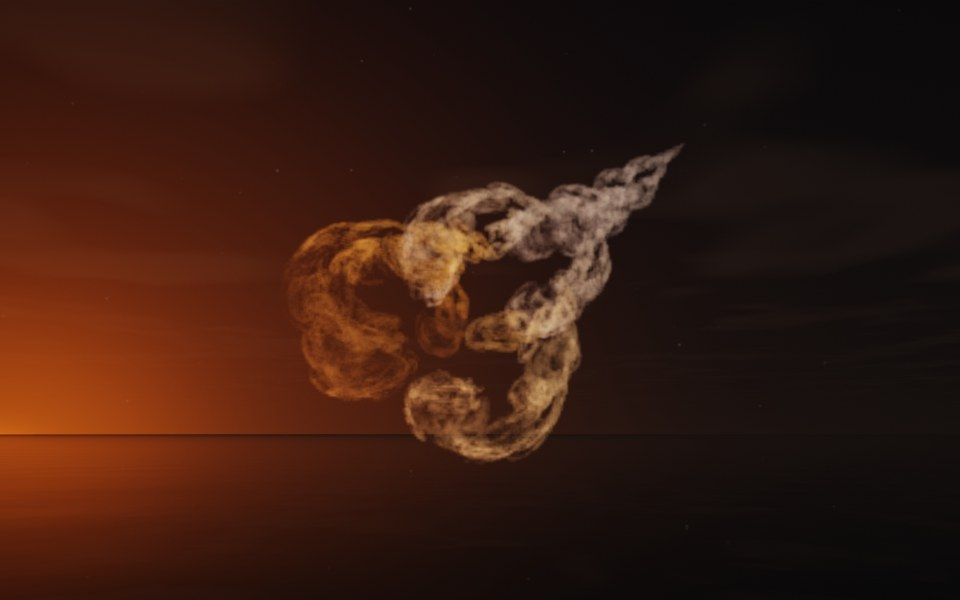

[← Spiral](flame_spiral.md) · [All fractals](../FRACTALS.md#fractal-flames) · [Bloom →](flame_bloom.md)

# Nautilus (`flame`, preset `nautilus`)

*Fractal flames*



A coiled shell of lace, spiraling out to a point: chambers of foamy lace, each smaller than the last, winding out to a sharp tip. Two maps are all it takes, one spherical and one plain. Above: palette `gold`, over a lake just after sunset.

**Maps.** Two maps, chosen at random with the probability of their weights. Each is an affine map (written out in the JSON below) bent by its variations; its color is the place in the palette that it pulls its points toward.

| map | weight | color | variations |
| --- | --- | --- | --- |
| 1 | 0.452 | 0 | `spherical` |
| 2 | 0.996 | 1 | `linear` |

**Node.** The preset as a node (the picture draws it at `size` 3.2, `glow` 8, `density` 3, `resolution` 192 and 24 million `points`; see `tools/flame-images.py`):

```json
{"type": "flame", "preset": "nautilus", "palette": "gold"}
```

and the same flame with its maps written out, to change them (`transforms` stand in for the preset):

```json
{"type": "flame", "palette": "gold", "transforms": [
    {"weight": 0.452, "color": 0, "matrix": [[0.32, 0.158, -0.079], [-0.07, 0.758, -0.095], [0.023, 0.106, 0.8]], "offset": [-0.575, 0.322, -0.454], "variations": {"spherical": 1}},
    {"weight": 0.996, "color": 1, "matrix": [[0.208, 0.741, 0.116], [0.6, -0.228, 0.463], [0.521, -0.034, -0.58]], "offset": [-0.232, 0.781, 0.405], "variations": {"linear": 1}}
]}
```

**Palette.** `gold`: bronze at 0, through gold, to cream at 1. Any of the eight palettes, or `colors` of your own, will do: the palette only colors the flame, it does not change its shape.

**Origin.** Made for ray by Claude (Anthropic's Claude Opus 5.5), October 2026: seed 43 of ray's random flame generator (`"preset": "random", "seed": 43`), picked by eye from many random flames and frozen as these maps, rounded to three decimals. For how a flame is drawn into voxels and rendered as a volume, its variations and its parameters, see [Fractal Flame](flame.md).

---

[← Spiral](flame_spiral.md) · [All fractals](../FRACTALS.md#fractal-flames) · [Bloom →](flame_bloom.md)
