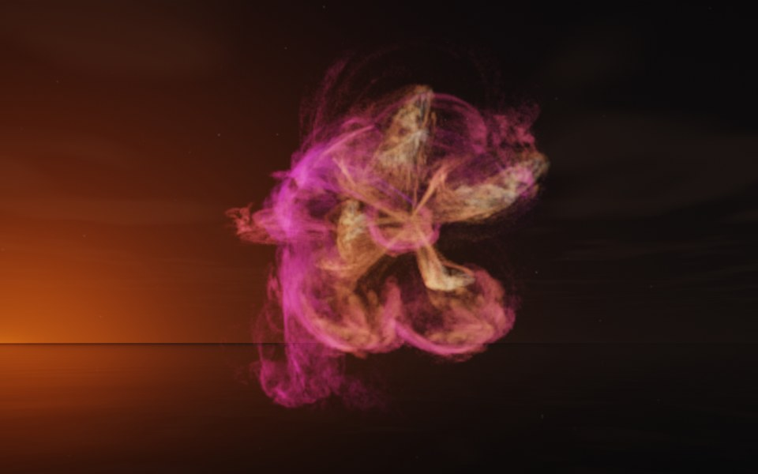

[← Ivy](flame_ivy.md) · [All fractals](../FRACTALS.md#fractal-flames) · [Reeds →](flame_reeds.md)

# Orchid (`flame`, preset `orchid`)

*Fractal flames*



An open flower of ruffled petals around a pale throat: broad, ruffled petals spread around a paler, finely veined center. Two of its maps take julia3d's roots, the cube root in one and the fourth in the other. Above: palette `nebula`, over a lake just after sunset.

**Maps.** Three maps, chosen at random with the probability of their weights. Each is an affine map (written out in the JSON below) bent by its variations; its color is the place in the palette that it pulls its points toward.

| map | weight | color | variations |
| --- | --- | --- | --- |
| 1 | 0.767 | 0 | 0.8 `linear` + 0.2 `spherical` |
| 2 | 0.946 | 0.5 | 0.567 `eyefish` + 0.433 `julia3d` (power 3) |
| 3 | 0.375 | 1 | 0.606 `julia3d` (power 4) + 0.394 `sinusoidal` |

**Node.** The preset as a node (the picture draws it at `size` 3.2, `glow` 8, `density` 3, `resolution` 192 and 24 million `points`; see `tools/flame-images.py`):

```json
{"type": "flame", "preset": "orchid", "palette": "nebula"}
```

and the same flame with its maps written out, to change them (`transforms` stand in for the preset):

```json
{"type": "flame", "palette": "nebula", "transforms": [
    {"weight": 0.767, "color": 0, "matrix": [[0.612, 0.155, -0.283], [-0.32, 0.35, -0.041], [0.216, 0.079, 0.742]], "offset": [-0.232, 0.237, -0.272], "variations": {"spherical": 0.2, "linear": 0.8}},
    {"weight": 0.946, "color": 0.5, "matrix": [[-0.032, -0.368, 0.351], [0.282, -0.25, -0.379], [0.451, 0.131, 0.262]], "offset": [-0.093, -0.538, 0.661], "variations": {"julia3d": 0.433, "eyefish": 0.567}, "power": 3},
    {"weight": 0.375, "color": 1, "matrix": [[0.496, 0.057, 0.322], [0.591, -0.255, -0.245], [0.151, 0.81, -0.1]], "offset": [0.155, 0.522, 0.732], "variations": {"sinusoidal": 0.394, "julia3d": 0.606}, "power": 4}
]}
```

**Palette.** `nebula`: violet at 0, through magenta, coral and amber, to pale blue at 1. Any of the eight palettes, or `colors` of your own, will do: the palette only colors the flame, it does not change its shape.

**Origin.** Made for ray by Claude (Anthropic's Claude Opus 5.5), October 2026: seed 413 of ray's random flame generator (`"preset": "random", "seed": 413`), picked by eye from many random flames and frozen as these maps, rounded to three decimals. For how a flame is drawn into voxels and rendered as a volume, its variations and its parameters, see [Fractal Flame](flame.md).

---

[← Ivy](flame_ivy.md) · [All fractals](../FRACTALS.md#fractal-flames) · [Reeds →](flame_reeds.md)
