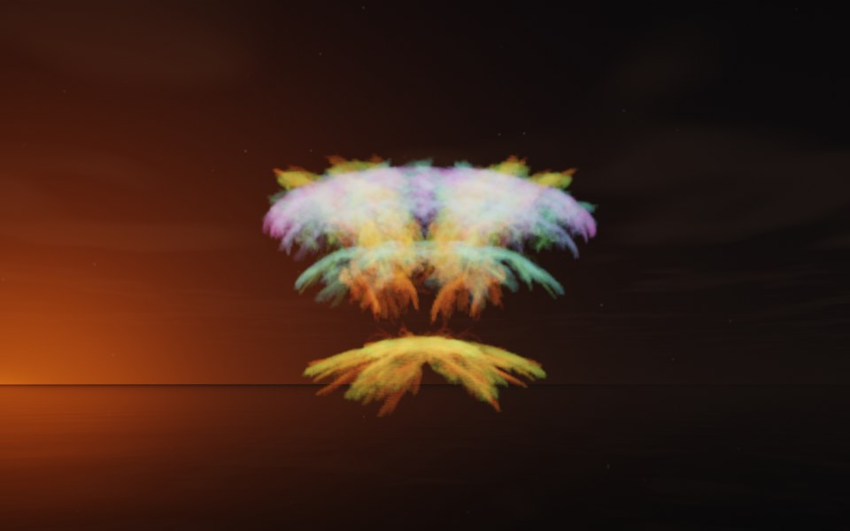

[← Lantern](flame_lantern.md) · [All fractals](../FRACTALS.md#fractal-flames) · [Infinity →](flame_infinity.md)

# Pagoda (`flame`, preset `pagoda`)

*Fractal flames*



Tiers of feathered eaves stacked one above another: two broad, feathery tiers over a narrower one, seen from a little above. Its two maps alone draw only a sparse, lopsided spray; the preset's own symmetry, 6, adds five more maps, pure turns about the flame's y axis by multiples of 60°, so the spray repeats six-fold around it. Above: palette `rainbow`, over a lake just after sunset, turned by `rotation` [12, 0, 0].

**Maps.** Two maps, chosen at random with the probability of their weights. Each is an affine map (written out in the JSON below) bent by its variations; its color is the place in the palette that it pulls its points toward. Then the preset's own symmetry, 6.

| map | weight | color | variations |
| --- | --- | --- | --- |
| 1 | 0.385 | 0 | 0.589 `julia3d` (power 3) + 0.411 `horseshoe` |
| 2 | 0.368 | 1 | `sinusoidal` |

**Node.** The preset as a node (the picture draws it at `size` 3.2, `glow` 8, `density` 3, `resolution` 192 and 24 million `points`; see `tools/flame-images.py`):

```json
{"type": "flame", "preset": "pagoda", "palette": "rainbow", "rotation": [12, 0, 0]}
```

and the same flame with its maps written out, to change them (`transforms` stand in for the preset, so the symmetry goes on the node):

```json
{"type": "flame", "palette": "rainbow", "symmetry": 6, "transforms": [
    {"weight": 0.385, "color": 0, "matrix": [[-0.691, -0.156, 0.069], [-0.194, 0.637, -0.073], [-0.097, -0.166, -0.346]], "offset": [-0.36, 0.281, 0.162], "variations": {"julia3d": 0.589, "horseshoe": 0.411}, "power": 3},
    {"weight": 0.368, "color": 1, "matrix": [[0.553, 0.151, -0.149], [-0.2, 0.456, 0.022], [0.231, 0.034, 0.375]], "offset": [0.515, 0.369, 0.016], "variations": {"sinusoidal": 1}}
]}
```

**Palette.** `rainbow`: red at 0, through yellow, green and blue, to violet at 1. Any of the eight palettes, or `colors` of your own, will do: the palette only colors the flame, it does not change its shape.

**Origin.** Made for ray by Claude (Anthropic's Claude Opus 5.5), October 2026: seed 273 of ray's random flame generator (`"preset": "random", "seed": 273`, with `"symmetry": 6`), picked by eye from many random flames and frozen as these maps, rounded to three decimals. For how a flame is drawn into voxels and rendered as a volume, its variations and its parameters, see [Fractal Flame](flame.md).

---

[← Lantern](flame_lantern.md) · [All fractals](../FRACTALS.md#fractal-flames) · [Infinity →](flame_infinity.md)
