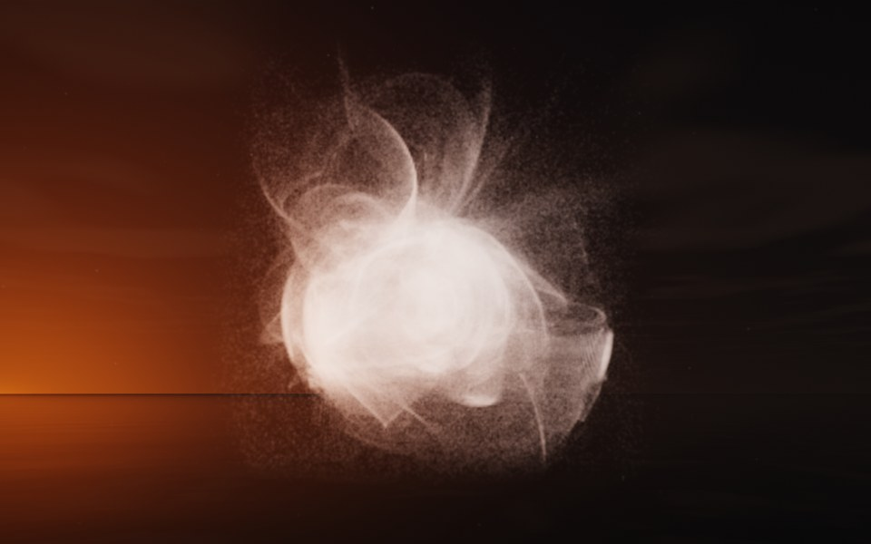

[← Snowflake](flame_snowflake.md) · [All fractals](../FRACTALS.md#fractal-flames) · [Cobra →](flame_cobra.md)

# Pearl (`flame`, preset `pearl`)

*Fractal flames*



A glowing pearl wrapped in veils of mist: a dense round core, sharp-edged on one side, inside loose veils that loop out and around it. Above: palette `white`, over a lake just after sunset.

**Animation.** Ten seconds swinging in among its threads, in full 1080p [on Google Drive](https://drive.google.com/file/d/1W_RCvVGHOXM9Pryu0v37GfaB7MlIvmSY/view); below, a small preview of it.

[](https://drive.google.com/file/d/1W_RCvVGHOXM9Pryu0v37GfaB7MlIvmSY/view)

**Maps.** Three maps, chosen at random with the probability of their weights. Each is an affine map (written out in the JSON below) bent by its variations; its color is the place in the palette that it pulls its points toward.

| map | weight | color | variations |
| --- | --- | --- | --- |
| 1 | 0.402 | 0 | 0.513 `sinusoidal` + 0.487 `spherical` |
| 2 | 0.31 | 0.5 | 0.688 `linear` + 0.312 `julia3d` (power 2) |
| 3 | 0.612 | 1 | `swirl` |

**Node.** The preset as a node (the picture draws it at `size` 3.2, `glow` 8, `density` 3, `resolution` 192 and 24 million `points`; see `tools/flame-images.py`):

```json
{"type": "flame", "preset": "pearl", "palette": "white"}
```

and the same flame with its maps written out, to change them (`transforms` stand in for the preset):

```json
{"type": "flame", "palette": "white", "transforms": [
    {"weight": 0.402, "color": 0, "matrix": [[0.554, 0.327, -0.027], [-0.346, 0.519, -0.084], [-0.021, 0.077, 0.675]], "offset": [-0.288, 0.378, -0.173], "variations": {"spherical": 0.487, "sinusoidal": 0.513}},
    {"weight": 0.31, "color": 0.5, "matrix": [[-0.058, 0.59, -0.263], [-0.419, 0.069, 0.562], [0.345, 0.182, 0.638]], "offset": [0.551, 0.086, 0.437], "variations": {"linear": 0.688, "julia3d": 0.312}, "power": 2},
    {"weight": 0.612, "color": 1, "matrix": [[-0.778, -0.296, -0.121], [0.384, -0.621, -0.01], [-0.136, -0.063, 0.661]], "offset": [0.77, -0.125, 0.598], "variations": {"swirl": 1}}
]}
```

**Palette.** `white`: white all along, so only the density and the light show. Any of the eight palettes, or `colors` of your own, will do: the palette only colors the flame, it does not change its shape.

**Origin.** Made for ray by Claude (Anthropic's Claude Opus 5.5), October 2026: seed 109 of ray's random flame generator (`"preset": "random", "seed": 109`), picked by eye from many random flames and frozen as these maps, rounded to three decimals. For how a flame is drawn into voxels and rendered as a volume, its variations and its parameters, see [Fractal Flame](flame.md).

---

[← Snowflake](flame_snowflake.md) · [All fractals](../FRACTALS.md#fractal-flames) · [Cobra →](flame_cobra.md)
