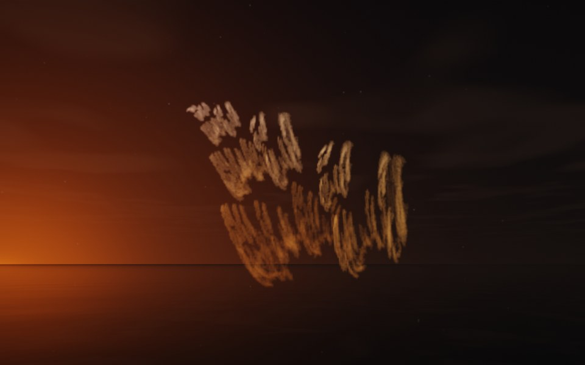

[← Orchid](flame_orchid.md) · [All fractals](../FRACTALS.md#fractal-flames) · [Genie →](flame_genie.md)

# Reeds (`flame`, preset `reeds`)

*Fractal flames*



Rows of slanting blades, like reeds in a marsh or a brush's strokes: two rows of short, slanting blades, each a bundle of fine parallel strokes, the blades shrinking along each row. Above: palette `gold`, over a lake just after sunset.

**Animation.** Ten seconds swinging in among its threads, in full 1080p [on Google Drive](https://drive.google.com/file/d/1QrwnKxRpV-vWUKmd84LCy7mZBB-U7Y_r/view); below, a small preview of it.

[](https://drive.google.com/file/d/1QrwnKxRpV-vWUKmd84LCy7mZBB-U7Y_r/view)

**Maps.** Three maps, chosen at random with the probability of their weights. Each is an affine map (written out in the JSON below) bent by its variations; its color is the place in the palette that it pulls its points toward.

| map | weight | color | variations |
| --- | --- | --- | --- |
| 1 | 0.579 | 0 | 0.617 `linear` + 0.383 `swirl` |
| 2 | 0.349 | 0.5 | 0.728 `linear` + 0.272 `eyefish` |
| 3 | 0.844 | 1 | 0.764 `linear` + 0.236 `sinusoidal` |

**Node.** The preset as a node (the picture draws it at `size` 3.2, `glow` 8, `density` 3, `resolution` 192 and 24 million `points`; see `tools/flame-images.py`):

```json
{"type": "flame", "preset": "reeds", "palette": "gold"}
```

and the same flame with its maps written out, to change them (`transforms` stand in for the preset):

```json
{"type": "flame", "palette": "gold", "transforms": [
    {"weight": 0.579, "color": 0, "matrix": [[0.575, 0.071, 0.268], [0.039, 0.233, -0.605], [-0.23, 0.216, 0.566]], "offset": [-0.179, -0.217, 0.058], "variations": {"linear": 0.617, "swirl": 0.383}},
    {"weight": 0.349, "color": 0.5, "matrix": [[0.303, -0.087, -0.432], [0.08, 0.801, 0.022], [0.296, -0.127, 0.437]], "offset": [0.483, 0.019, -0.08], "variations": {"eyefish": 0.272, "linear": 0.728}},
    {"weight": 0.844, "color": 1, "matrix": [[0.48, -0.182, -0.025], [0.118, 0.696, 0.141], [-0.015, -0.325, 0.317]], "offset": [-0.565, 0.561, 0.213], "variations": {"linear": 0.764, "sinusoidal": 0.236}}
]}
```

**Palette.** `gold`: bronze at 0, through gold, to cream at 1. Any of the eight palettes, or `colors` of your own, will do: the palette only colors the flame, it does not change its shape.

**Origin.** Made for ray by Claude (Anthropic's Claude Opus 5.5), October 2026: seed 269 of ray's random flame generator (`"preset": "random", "seed": 269`), picked by eye from many random flames and frozen as these maps, rounded to three decimals. For how a flame is drawn into voxels and rendered as a volume, its variations and its parameters, see [Fractal Flame](flame.md).

---

[← Orchid](flame_orchid.md) · [All fractals](../FRACTALS.md#fractal-flames) · [Genie →](flame_genie.md)
