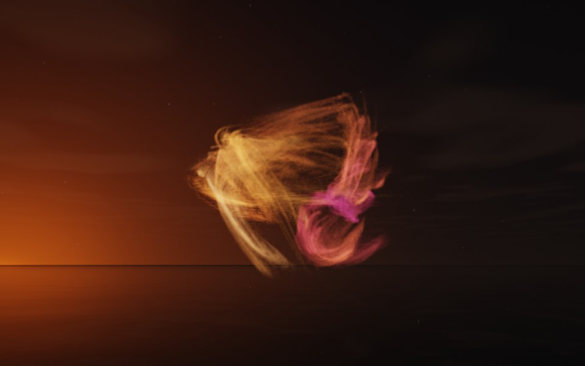

[← Seahorse](flame_seahorse.md) · [All fractals](../FRACTALS.md#fractal-flames) · [Spiral →](flame_spiral.md)

# Rosebud (`flame`, preset `rosebud`)

*Fractal flames*



Petals of fine threads furled around a bud: sheaves of thread swept around a denser knot, as a rose's petals are around its heart. Above: palette `sunset`, over a lake just after sunset.

**Maps.** Three maps, chosen at random with the probability of their weights. Each is an affine map (written out in the JSON below) bent by its variations; its color is the place in the palette that it pulls its points toward.

| map | weight | color | variations |
| --- | --- | --- | --- |
| 1 | 0.955 | 0 | `linear` |
| 2 | 0.448 | 0.5 | `bent` |
| 3 | 0.477 | 1 | `swirl` |

**Node.** The preset as a node (the picture draws it at `size` 3.2, `glow` 8, `density` 3, `resolution` 192 and 24 million `points`; see `tools/flame-images.py`):

```json
{"type": "flame", "preset": "rosebud", "palette": "sunset"}
```

and the same flame with its maps written out, to change them (`transforms` stand in for the preset):

```json
{"type": "flame", "palette": "sunset", "transforms": [
    {"weight": 0.955, "color": 0, "matrix": [[0.048, -0.133, -0.332], [0.442, -0.019, 0.039], [-0.02, -0.746, 0.058]], "offset": [-0.033, -0.15, -0.302], "variations": {"linear": 1}},
    {"weight": 0.448, "color": 0.5, "matrix": [[0.569, -0.229, 0.027], [0.287, 0.385, 0.289], [-0.137, -0.147, 0.716]], "offset": [0.121, 0.262, 0.142], "variations": {"bent": 1}},
    {"weight": 0.477, "color": 1, "matrix": [[0.178, -0.559, -0.21], [0.154, 0.068, 0.742], [-0.203, -0.44, 0.381]], "offset": [-0.517, 0.283, 0.713], "variations": {"swirl": 1}}
]}
```

**Palette.** `sunset`: purple at 0, through crimson and orange, to pale gold at 1. Any of the eight palettes, or `colors` of your own, will do: the palette only colors the flame, it does not change its shape.

**Origin.** Made for ray by Claude (Anthropic's Claude Opus 5.5), October 2026: seed 30 of ray's random flame generator (`"preset": "random", "seed": 30`), picked by eye from many random flames and frozen as these maps, rounded to three decimals. For how a flame is drawn into voxels and rendered as a volume, its variations and its parameters, see [Fractal Flame](flame.md).

---

[← Seahorse](flame_seahorse.md) · [All fractals](../FRACTALS.md#fractal-flames) · [Spiral →](flame_spiral.md)
