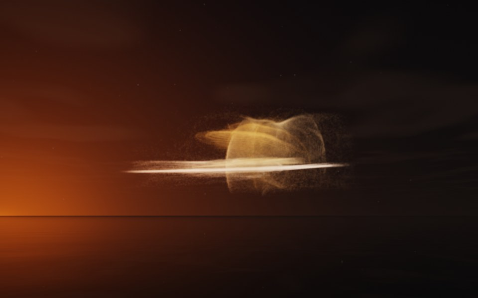

[← Galaxy](flame_galaxy.md) · [All fractals](../FRACTALS.md#fractal-flames) · [Cumulus →](flame_cumulus.md)

# Saturn (`flame`, preset `saturn`)

*Fractal flames*



A ringed planet seen edge on: a flat disc of streaks with a ring arching over it, and fainter arcs around. Above: palette `gold`, over a lake just after sunset.

**Animation.** Ten seconds swinging in among its threads, in full 1080p [on Google Drive](https://drive.google.com/file/d/17DUEm9YCpnd5LO0G1hjSylj9xVhOxxMV/view); below, a small preview of it.

[](https://drive.google.com/file/d/17DUEm9YCpnd5LO0G1hjSylj9xVhOxxMV/view)

**Maps.** Three maps, chosen at random with the probability of their weights. Each is an affine map (written out in the JSON below) bent by its variations; its color is the place in the palette that it pulls its points toward.

| map | weight | color | variations |
| --- | --- | --- | --- |
| 1 | 0.41 | 0 | `eyefish` |
| 2 | 0.861 | 0.5 | 0.576 `swirl` + 0.424 `spherical` |
| 3 | 0.6 | 1 | `bent` |

**Node.** The preset as a node (the picture draws it at `size` 3.2, `glow` 8, `density` 3, `resolution` 192 and 24 million `points`; see `tools/flame-images.py`):

```json
{"type": "flame", "preset": "saturn", "palette": "gold"}
```

and the same flame with its maps written out, to change them (`transforms` stand in for the preset):

```json
{"type": "flame", "palette": "gold", "transforms": [
    {"weight": 0.41, "color": 0, "matrix": [[0.545, 0.102, 0.187], [-0.167, 0.361, 0.032], [-0.126, -0.04, 0.768]], "offset": [-0.267, 0.536, -0.333], "variations": {"eyefish": 1}},
    {"weight": 0.861, "color": 0.5, "matrix": [[-0.049, -0.338, 0.098], [0.048, 0.055, 0.569], [-0.524, 0.037, 0.044]], "offset": [0.283, 0.273, 0.621], "variations": {"spherical": 0.424, "swirl": 0.576}},
    {"weight": 0.6, "color": 1, "matrix": [[-0.834, -0.028, -0.295], [-0.144, 0.297, 0.169], [0.273, 0.072, -0.811]], "offset": [-0.187, -0.207, 0.387], "variations": {"bent": 1}}
]}
```

**Palette.** `gold`: bronze at 0, through gold, to cream at 1. Any of the eight palettes, or `colors` of your own, will do: the palette only colors the flame, it does not change its shape.

**Origin.** Made for ray by Claude (Anthropic's Claude Opus 5.5), October 2026: seed 183 of ray's random flame generator (`"preset": "random", "seed": 183`), picked by eye from many random flames and frozen as these maps, rounded to three decimals. For how a flame is drawn into voxels and rendered as a volume, its variations and its parameters, see [Fractal Flame](flame.md).

---

[← Galaxy](flame_galaxy.md) · [All fractals](../FRACTALS.md#fractal-flames) · [Cumulus →](flame_cumulus.md)
