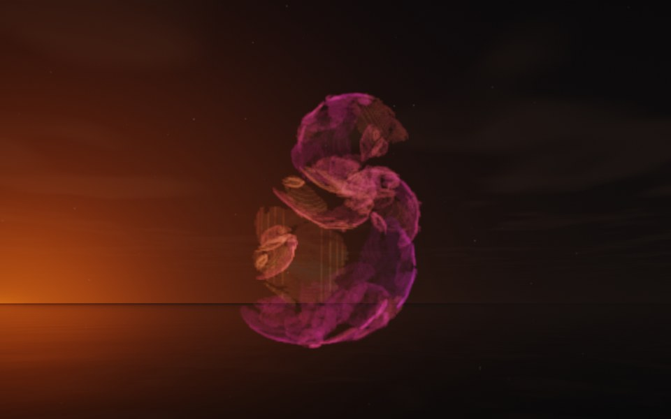

[← Jellyfish](flame_jellyfish.md) · [All fractals](../FRACTALS.md#fractal-flames) · [Rosebud →](flame_rosebud.md)

# Seahorse (`flame`, preset `seahorse`)

*Fractal flames*



A curled S of ribbons, like a seahorse's tail: two broad curls, one above the other, built of overlapping ribbons. Above: palette `nebula`, over a lake just after sunset.

**Maps.** Four maps, chosen at random with the probability of their weights. Each is an affine map (written out in the JSON below) bent by its variations; its color is the place in the palette that it pulls its points toward.

| map | weight | color | variations |
| --- | --- | --- | --- |
| 1 | 0.957 | 0 | 0.741 `linear` + 0.259 `spherical` |
| 2 | 0.891 | 0.333 | `linear` |
| 3 | 0.755 | 0.667 | 0.524 `linear` + 0.476 `julia3d` (power 2) |
| 4 | 0.852 | 1 | `cylinder` |

**Node.** The preset as a node (the picture draws it at `size` 3.2, `glow` 8, `density` 3, `resolution` 192 and 24 million `points`; see `tools/flame-images.py`):

```json
{"type": "flame", "preset": "seahorse", "palette": "nebula"}
```

and the same flame with its maps written out, to change them (`transforms` stand in for the preset):

```json
{"type": "flame", "palette": "nebula", "transforms": [
    {"weight": 0.957, "color": 0, "matrix": [[-0.042, -0.675, 0.126], [0.364, -0.183, -0.335], [0.45, 0.084, 0.283]], "offset": [0.405, -0.27, -0.001], "variations": {"linear": 0.741, "spherical": 0.259}},
    {"weight": 0.891, "color": 0.333, "matrix": [[-0.421, 0.358, 0.204], [-0.279, -0.551, 0.121], [0.233, -0.013, 0.514]], "offset": [0.449, 0.796, 0.344], "variations": {"linear": 1}},
    {"weight": 0.755, "color": 0.667, "matrix": [[0.757, 0.056, 0.06], [-0.046, 0.361, -0.122], [-0.181, 0.145, 0.281]], "offset": [-0.309, 0.485, 0.185], "variations": {"linear": 0.524, "julia3d": 0.476}, "power": 2},
    {"weight": 0.852, "color": 1, "matrix": [[-0.516, 0.081, -0.096], [0.122, -0.238, -0.291], [-0.126, -0.563, 0.109]], "offset": [0.156, -0.025, 0.06], "variations": {"cylinder": 1}}
]}
```

**Palette.** `nebula`: violet at 0, through magenta, coral and amber, to pale blue at 1. Any of the eight palettes, or `colors` of your own, will do: the palette only colors the flame, it does not change its shape.

**Origin.** Made for ray by Claude (Anthropic's Claude Opus 5.5), October 2026: seed 29 of ray's random flame generator (`"preset": "random", "seed": 29`), picked by eye from many random flames and frozen as these maps, rounded to three decimals. For how a flame is drawn into voxels and rendered as a volume, its variations and its parameters, see [Fractal Flame](flame.md).

---

[← Jellyfish](flame_jellyfish.md) · [All fractals](../FRACTALS.md#fractal-flames) · [Rosebud →](flame_rosebud.md)
