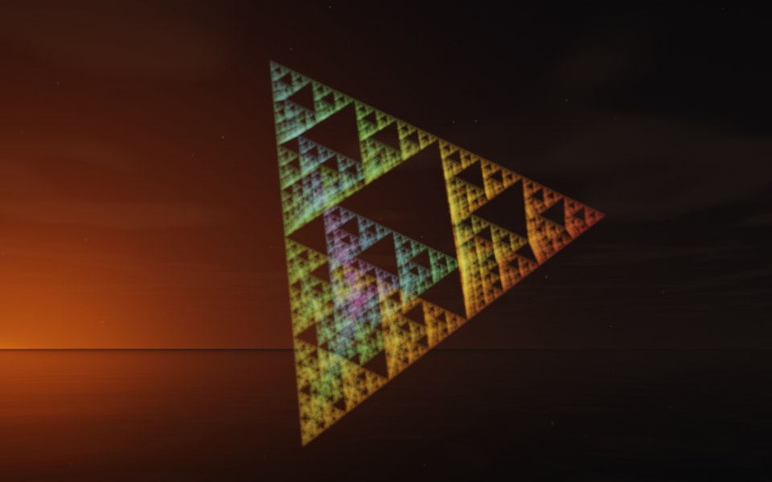

[← Centurion](flame_centurion.md) · [All fractals](../FRACTALS.md#fractal-flames)

# Sierpinski (`flame`, preset `sierpinski`)

*Fractal flames*



The Sierpinski tetrahedron: four maps that halve toward the corners of a tetrahedron, the plainest flame of all. Each map halves the distance to one corner and has no variation but linear, so the flame is the classic attractor itself: four half-size copies of the tetrahedron, each made of four quarter-size ones, and so on. ray also draws the same set as a surface, by folding space: the [Sierpinski Tetrahedron](sierpinski.md). Above: palette `rainbow`, over a lake just after sunset, turned by `rotation` [35, 45, 0] and drawn at `scale` 0.85.

**Animation.** Ten seconds swinging in among its threads, in full 1080p [on Google Drive](https://drive.google.com/file/d/1X8P2tCGy4GuSOwIFYxFxB1TC44BvzHDA/view); below, a small preview of it.

[](https://drive.google.com/file/d/1X8P2tCGy4GuSOwIFYxFxB1TC44BvzHDA/view)

**Maps.** Four maps, chosen at random with the probability of their weights. Each is an affine map (written out in the JSON below) bent by its variations; its color is the place in the palette that it pulls its points toward.

| map | weight | color | variations |
| --- | --- | --- | --- |
| 1 | 1 | 0 | `linear` |
| 2 | 1 | 0.33 | `linear` |
| 3 | 1 | 0.67 | `linear` |
| 4 | 1 | 1 | `linear` |

**Node.** The preset as a node (the picture draws it at `size` 3.2, `glow` 8, `density` 3, `resolution` 192 and 24 million `points`; see `tools/flame-images.py`):

```json
{"type": "flame", "preset": "sierpinski", "palette": "rainbow", "rotation": [35, 45, 0], "scale": 0.85}
```

and the same flame with its maps written out, to change them (`transforms` stand in for the preset):

```json
{"type": "flame", "palette": "rainbow", "transforms": [
    {"color": 0, "matrix": [[0.5, 0, 0], [0, 0.5, 0], [0, 0, 0.5]], "offset": [0.5, 0.5, 0.5]},
    {"color": 0.33, "matrix": [[0.5, 0, 0], [0, 0.5, 0], [0, 0, 0.5]], "offset": [-0.5, -0.5, 0.5]},
    {"color": 0.67, "matrix": [[0.5, 0, 0], [0, 0.5, 0], [0, 0, 0.5]], "offset": [-0.5, 0.5, -0.5]},
    {"color": 1, "matrix": [[0.5, 0, 0], [0, 0.5, 0], [0, 0, 0.5]], "offset": [0.5, -0.5, -0.5]}
]}
```

**Palette.** `rainbow`: red at 0, through yellow, green and blue, to violet at 1. Any of the eight palettes, or `colors` of your own, will do: the palette only colors the flame, it does not change its shape.

**Origin.** Wacław Sierpiński described the triangle in 1915; the tetrahedron is its standard 3D analog. Drawing such a set by applying its maps in random order is Michael Barnsley's chaos game (*Fractals Everywhere*, 1988), which the flame algorithm grew out of. As a preset it was written out by hand for ray by Claude (Anthropic's Claude Opus 5.5), October 2026. For how a flame is drawn into voxels and rendered as a volume, its variations and its parameters, see [Fractal Flame](flame.md).

---

[← Centurion](flame_centurion.md) · [All fractals](../FRACTALS.md#fractal-flames)
