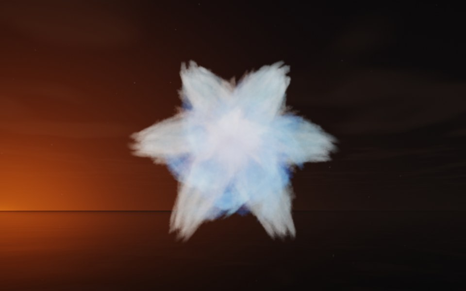

[← Cumulus](flame_cumulus.md) · [All fractals](../FRACTALS.md#fractal-flames) · [Pearl →](flame_pearl.md)

# Snowflake (`flame`, preset `snowflake`)

*Fractal flames*



A six-pointed star of feathered ice, seen from above: six broad, feathery points around a bright center. Its two maps alone draw only a sparse, lopsided spray; the preset's own symmetry, 6, adds five more maps, pure turns about the flame's y axis by multiples of 60°, so the spray repeats six-fold around it. Above: palette `ice`, over a lake just after sunset, turned 80° about x so that its symmetry axis points nearly at the camera.

**Animation.** Ten seconds swinging in among its threads, in full 1080p [on Google Drive](https://drive.google.com/file/d/1aGxqkifsW2Ej5_sI_yC6OQ_njPVFcXlW/view); below, a small preview of it.

[](https://drive.google.com/file/d/1aGxqkifsW2Ej5_sI_yC6OQ_njPVFcXlW/view)

**Maps.** Two maps, chosen at random with the probability of their weights. Each is an affine map (written out in the JSON below) bent by its variations; its color is the place in the palette that it pulls its points toward. Then the preset's own symmetry, 6.

| map | weight | color | variations |
| --- | --- | --- | --- |
| 1 | 0.927 | 0 | 0.725 `linear` + 0.275 `sinusoidal` |
| 2 | 0.831 | 1 | 0.63 `sinusoidal` + 0.37 `bent` |

**Node.** The preset as a node (the picture draws it at `size` 3.2, `glow` 8, `density` 3, `resolution` 192 and 24 million `points`; see `tools/flame-images.py`):

```json
{"type": "flame", "preset": "snowflake", "palette": "ice", "rotation": [80, 0, 0]}
```

and the same flame with its maps written out, to change them (`transforms` stand in for the preset, so the symmetry goes on the node):

```json
{"type": "flame", "palette": "ice", "symmetry": 6, "transforms": [
    {"weight": 0.927, "color": 0, "matrix": [[0.561, 0.168, 0.144], [-0.092, -0.066, 0.786], [0.17, -0.591, -0.047]], "offset": [0.523, -0.215, -0.038], "variations": {"linear": 0.725, "sinusoidal": 0.275}},
    {"weight": 0.831, "color": 1, "matrix": [[-0.277, -0.5, 0.079], [-0.023, 0.38, 0.293], [-0.227, 0.571, -0.126]], "offset": [0.514, 0.778, -0.582], "variations": {"bent": 0.37, "sinusoidal": 0.63}}
]}
```

**Palette.** `ice`: deep blue at 0, through sky blue, to white at 1. Any of the eight palettes, or `colors` of your own, will do: the palette only colors the flame, it does not change its shape.

**Origin.** Made for ray by Claude (Anthropic's Claude Opus 5.5), October 2026: seed 84 of ray's random flame generator (`"preset": "random", "seed": 84`, with `"symmetry": 6`), picked by eye from many random flames and frozen as these maps, rounded to three decimals. For how a flame is drawn into voxels and rendered as a volume, its variations and its parameters, see [Fractal Flame](flame.md).

---

[← Cumulus](flame_cumulus.md) · [All fractals](../FRACTALS.md#fractal-flames) · [Pearl →](flame_pearl.md)
