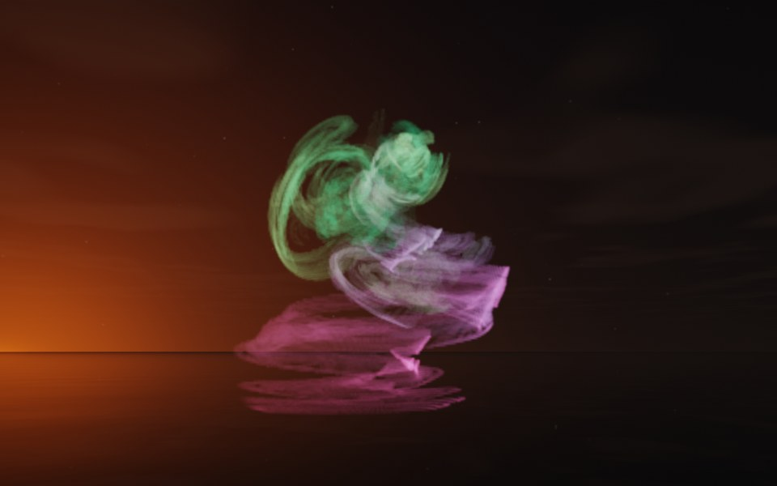

[← Rosebud](flame_rosebud.md) · [All fractals](../FRACTALS.md#fractal-flames) · [Nautilus →](flame_nautilus.md)

# Spiral (`flame`, preset `spiral`)

*Fractal flames*



Ribbons winding up in a helix: flat ribbons stacked at the bottom, twisting as they rise. Above: palette `aurora`, over a lake just after sunset.

**Animation.** Ten seconds swinging in among its threads, in full 1080p [on Google Drive](https://drive.google.com/file/d/1atK0N5hNlJkFr8aulN8Hybfl8JGyXD_7/view); below, a small preview of it.

[](https://drive.google.com/file/d/1atK0N5hNlJkFr8aulN8Hybfl8JGyXD_7/view)

**Maps.** Three maps, chosen at random with the probability of their weights. Each is an affine map (written out in the JSON below) bent by its variations; its color is the place in the palette that it pulls its points toward.

| map | weight | color | variations |
| --- | --- | --- | --- |
| 1 | 0.31 | 0 | `eyefish` |
| 2 | 0.674 | 0.5 | 0.665 `sinusoidal` + 0.335 `linear` |
| 3 | 0.845 | 1 | `swirl` |

**Node.** The preset as a node (the picture draws it at `size` 3.2, `glow` 8, `density` 3, `resolution` 192 and 24 million `points`; see `tools/flame-images.py`):

```json
{"type": "flame", "preset": "spiral", "palette": "aurora"}
```

and the same flame with its maps written out, to change them (`transforms` stand in for the preset):

```json
{"type": "flame", "palette": "aurora", "transforms": [
    {"weight": 0.31, "color": 0, "matrix": [[-0.442, 0.243, 0.3], [-0.551, 0.014, -0.362], [-0.336, -0.342, 0.199]], "offset": [-0.029, 0.125, 0.462], "variations": {"eyefish": 1}},
    {"weight": 0.674, "color": 0.5, "matrix": [[0.179, 0.174, 0.372], [-0.041, 0.522, -0.127], [-0.716, 0.014, 0.101]], "offset": [0.265, 0.385, 0.003], "variations": {"sinusoidal": 0.665, "linear": 0.335}},
    {"weight": 0.845, "color": 1, "matrix": [[0.611, 0.091, 0.25], [-0.026, 0.647, -0.062], [-0.593, 0.066, 0.26]], "offset": [-0.289, -0.595, -0.686], "variations": {"swirl": 1}}
]}
```

**Palette.** `aurora`: dark teal at 0, through green and mint, to violet and magenta at 1. Any of the eight palettes, or `colors` of your own, will do: the palette only colors the flame, it does not change its shape.

**Origin.** Made for ray by Claude (Anthropic's Claude Opus 5.5), October 2026: seed 32 of ray's random flame generator (`"preset": "random", "seed": 32`), picked by eye from many random flames and frozen as these maps, rounded to three decimals. For how a flame is drawn into voxels and rendered as a volume, its variations and its parameters, see [Fractal Flame](flame.md).

---

[← Rosebud](flame_rosebud.md) · [All fractals](../FRACTALS.md#fractal-flames) · [Nautilus →](flame_nautilus.md)
