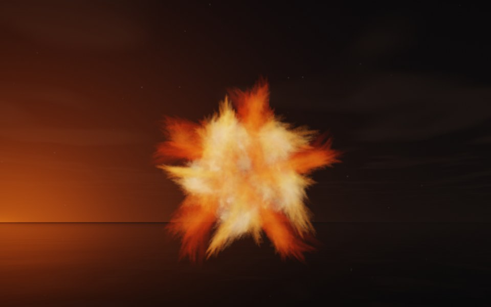

[← Anemone](flame_anemone.md) · [All fractals](../FRACTALS.md#fractal-flames) · [Diatom →](flame_diatom.md)

# Starfish (`flame`, preset `starfish`)

*Fractal flames*



A five-armed star of bristling spines, seen from above: five arms around a dense center, each a sheaf of spines. Its two maps alone draw only a sparse, lopsided spray; the preset's own symmetry, 5, adds four more maps, pure turns about the flame's y axis by multiples of 72°, so the spray repeats five-fold around it. Above: palette `fire`, over a lake just after sunset, turned 80° about x so that its symmetry axis points nearly at the camera.

**Maps.** Two maps, chosen at random with the probability of their weights. Each is an affine map (written out in the JSON below) bent by its variations; its color is the place in the palette that it pulls its points toward. Then the preset's own symmetry, 5.

| map | weight | color | variations |
| --- | --- | --- | --- |
| 1 | 0.617 | 0 | 0.646 `bent` + 0.354 `sinusoidal` |
| 2 | 0.453 | 1 | `linear` |

**Node.** The preset as a node (the picture draws it at `size` 3.2, `glow` 8, `density` 3, `resolution` 192 and 24 million `points`; see `tools/flame-images.py`):

```json
{"type": "flame", "preset": "starfish", "palette": "fire", "rotation": [80, 0, 0]}
```

and the same flame with its maps written out, to change them (`transforms` stand in for the preset, so the symmetry goes on the node):

```json
{"type": "flame", "palette": "fire", "symmetry": 5, "transforms": [
    {"weight": 0.617, "color": 0, "matrix": [[0.028, -0.389, 0.231], [0.338, 0.091, 0.548], [-0.31, 0.064, 0.619]], "offset": [0.683, 0.519, -0.608], "variations": {"bent": 0.646, "sinusoidal": 0.354}},
    {"weight": 0.453, "color": 1, "matrix": [[0.343, -0.284, 0.03], [0.164, 0.477, 0.308], [-0.091, -0.208, 0.664]], "offset": [-0.653, 0.216, -0.729], "variations": {"linear": 1}}
]}
```

**Palette.** `fire`: dark red at 0, through red, orange and yellow, to white-hot at 1. Any of the eight palettes, or `colors` of your own, will do: the palette only colors the flame, it does not change its shape.

**Origin.** Made for ray by Claude (Anthropic's Claude Opus 5.5), October 2026: seed 370 of ray's random flame generator (`"preset": "random", "seed": 370`, with `"symmetry": 5`), picked by eye from many random flames and frozen as these maps, rounded to three decimals. For how a flame is drawn into voxels and rendered as a volume, its variations and its parameters, see [Fractal Flame](flame.md).

---

[← Anemone](flame_anemone.md) · [All fractals](../FRACTALS.md#fractal-flames) · [Diatom →](flame_diatom.md)
