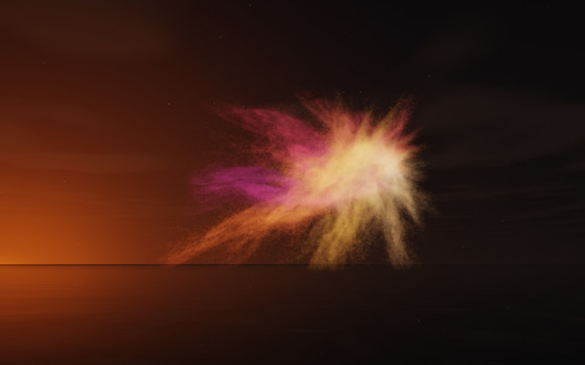

[← Comet](flame_comet.md) · [All fractals](../FRACTALS.md#fractal-flames) · [Galaxy →](flame_galaxy.md)

# Supernova (`flame`, preset `supernova`)

*Fractal flames*



A star blowing apart: streamers of gas bursting from a white-hot core, longest to one side. It has only two maps, one plain and one mostly bent. Above: palette `sunset`, over a lake just after sunset.

**Maps.** Two maps, chosen at random with the probability of their weights. Each is an affine map (written out in the JSON below) bent by its variations; its color is the place in the palette that it pulls its points toward.

| map | weight | color | variations |
| --- | --- | --- | --- |
| 1 | 0.356 | 0 | 0.682 `bent` + 0.318 `linear` |
| 2 | 0.778 | 1 | `linear` |

**Node.** The preset as a node (the picture draws it at `size` 3.2, `glow` 8, `density` 3, `resolution` 192 and 24 million `points`; see `tools/flame-images.py`):

```json
{"type": "flame", "preset": "supernova", "palette": "sunset"}
```

and the same flame with its maps written out, to change them (`transforms` stand in for the preset):

```json
{"type": "flame", "palette": "sunset", "transforms": [
    {"weight": 0.356, "color": 0, "matrix": [[0.462, 0.282, 0.477], [-0.392, 0.084, 0.668], [0.145, -0.671, 0.284]], "offset": [-0.019, -0.305, -0.728], "variations": {"linear": 0.318, "bent": 0.682}},
    {"weight": 0.778, "color": 1, "matrix": [[0.52, -0.287, 0.396], [0.396, 0.602, -0.066], [-0.324, 0.276, 0.556]], "offset": [-0.519, 0.401, -0.048], "variations": {"linear": 1}}
]}
```

**Palette.** `sunset`: purple at 0, through crimson and orange, to pale gold at 1. Any of the eight palettes, or `colors` of your own, will do: the palette only colors the flame, it does not change its shape.

**Origin.** Made for ray by Claude (Anthropic's Claude Opus 5.5), October 2026: seed 72 of ray's random flame generator (`"preset": "random", "seed": 72`), picked by eye from many random flames and frozen as these maps, rounded to three decimals. For how a flame is drawn into voxels and rendered as a volume, its variations and its parameters, see [Fractal Flame](flame.md).

---

[← Comet](flame_comet.md) · [All fractals](../FRACTALS.md#fractal-flames) · [Galaxy →](flame_galaxy.md)
