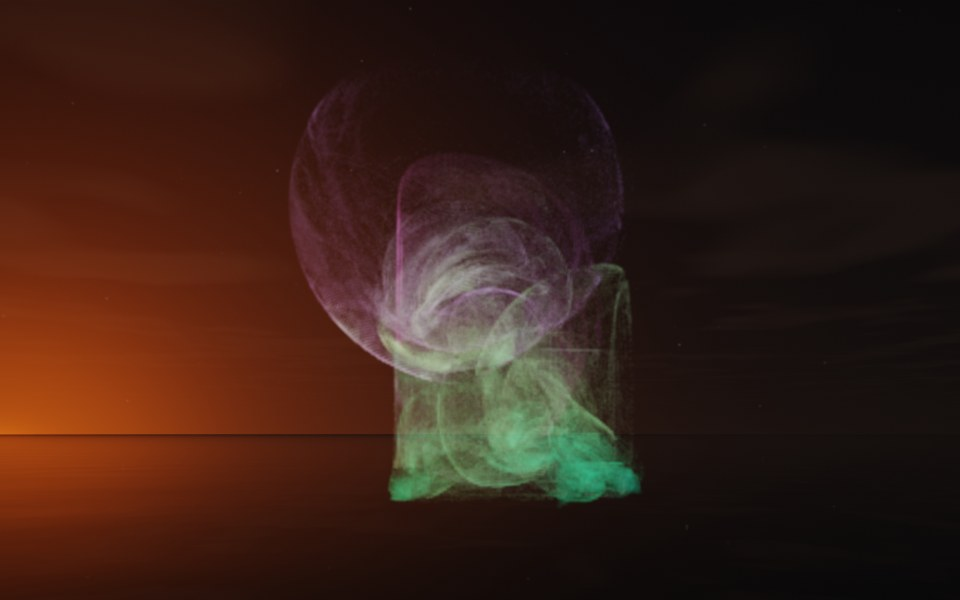

[← Dandelion](flame_dandelion.md) · [All fractals](../FRACTALS.md#fractal-flames) · [Comet →](flame_comet.md)

# Veil (`flame`, preset `veil`)

*Fractal flames*



A dome of arching threads over a dense heap: a thin, nearly round veil of arcs stands over a block of denser, brighter matter. Above: palette `aurora`, over a lake just after sunset.

**Maps.** Four maps, chosen at random with the probability of their weights. Each is an affine map (written out in the JSON below) bent by its variations; its color is the place in the palette that it pulls its points toward.

| map | weight | color | variations |
| --- | --- | --- | --- |
| 1 | 0.883 | 0 | 0.791 `linear` + 0.209 `horseshoe` |
| 2 | 0.344 | 0.333 | 0.698 `sinusoidal` + 0.302 `linear` |
| 3 | 0.712 | 0.667 | `spherical` |
| 4 | 0.49 | 1 | `cylinder` |

**Node.** The preset as a node (the picture draws it at `size` 3.2, `glow` 8, `density` 3, `resolution` 192 and 24 million `points`; see `tools/flame-images.py`):

```json
{"type": "flame", "preset": "veil", "palette": "aurora"}
```

and the same flame with its maps written out, to change them (`transforms` stand in for the preset):

```json
{"type": "flame", "palette": "aurora", "transforms": [
    {"weight": 0.883, "color": 0, "matrix": [[0.47, -0.23, 0.097], [0.088, 0.278, 0.246], [-0.348, -0.24, 0.192]], "offset": [0.775, -0.756, -0.498], "variations": {"linear": 0.791, "horseshoe": 0.209}},
    {"weight": 0.344, "color": 0.333, "matrix": [[-0.018, 0.816, 0.082], [-0.872, 0.016, -0.068], [-0.157, -0.178, 0.369]], "offset": [-0.149, -0.699, 0.113], "variations": {"linear": 0.302, "sinusoidal": 0.698}},
    {"weight": 0.712, "color": 0.667, "matrix": [[0.762, 0.265, 0.074], [0.092, 0.229, -0.289], [-0.38, 0.586, 0.079]], "offset": [-0.287, 0.413, -0.504], "variations": {"spherical": 1}},
    {"weight": 0.49, "color": 1, "matrix": [[-0.008, 0.181, 0.809], [-0.528, 0.262, -0.237], [-0.443, -0.315, 0.267]], "offset": [-0.254, -0.04, 0.241], "variations": {"cylinder": 1}}
]}
```

**Palette.** `aurora`: dark teal at 0, through green and mint, to violet and magenta at 1. Any of the eight palettes, or `colors` of your own, will do: the palette only colors the flame, it does not change its shape.

**Origin.** Made for ray by Claude (Anthropic's Claude Opus 5.5), October 2026: seed 20 of ray's random flame generator (`"preset": "random", "seed": 20`), picked by eye from many random flames and frozen as these maps, rounded to three decimals. For how a flame is drawn into voxels and rendered as a volume, its variations and its parameters, see [Fractal Flame](flame.md).

---

[← Dandelion](flame_dandelion.md) · [All fractals](../FRACTALS.md#fractal-flames) · [Comet →](flame_comet.md)
