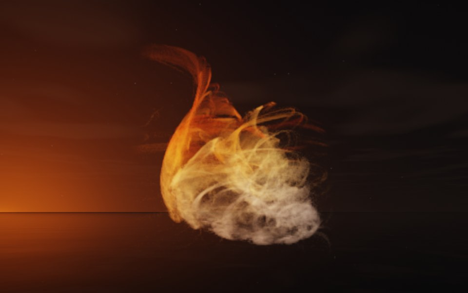

[All fractals](../FRACTALS.md#fractal-flames) · [Jellyfish →](flame_jellyfish.md)

# Wildfire (`flame`, preset `wildfire`)

*Fractal flames*



A tongue of flame curling up out of a smoldering heap: threads sweep up out of a dense, pale tangle and curl over at the top. It is the default flame: a new flame node is a wildfire. Above: palette `fire`, over a lake just after sunset.

**Animation.** Ten seconds swinging in among its threads, in full 1080p [on Google Drive](https://drive.google.com/file/d/1D4RGWXG3xURc9cFbYmw3vOXlCwpGYPO3/view); below, a small preview of it.

[](https://drive.google.com/file/d/1D4RGWXG3xURc9cFbYmw3vOXlCwpGYPO3/view)

**Maps.** Four maps, chosen at random with the probability of their weights. Each is an affine map (written out in the JSON below) bent by its variations; its color is the place in the palette that it pulls its points toward.

| map | weight | color | variations |
| --- | --- | --- | --- |
| 1 | 0.659 | 0 | 0.713 `swirl` + 0.287 `spherical` |
| 2 | 0.364 | 0.333 | 0.688 `linear` + 0.312 `swirl` |
| 3 | 0.393 | 0.667 | `horseshoe` |
| 4 | 0.606 | 1 | `linear` |

**Node.** The preset as a node (the picture draws it at `size` 3.2, `glow` 8, `density` 3, `resolution` 192 and 24 million `points`; see `tools/flame-images.py`):

```json
{"type": "flame", "preset": "wildfire", "palette": "fire"}
```

and the same flame with its maps written out, to change them (`transforms` stand in for the preset):

```json
{"type": "flame", "palette": "fire", "transforms": [
    {"weight": 0.659, "color": 0, "matrix": [[0.382, 0.022, -0.06], [-0.02, 0.388, 0.048], [0.028, -0.02, 0.872]], "offset": [0.462, 0.636, 0.67], "variations": {"swirl": 0.713, "spherical": 0.287}},
    {"weight": 0.364, "color": 0.333, "matrix": [[0.511, -0.059, -0.641], [-0.197, 0.742, -0.298], [0.508, 0.347, 0.529]], "offset": [-0.662, 0.547, 0.306], "variations": {"swirl": 0.312, "linear": 0.688}},
    {"weight": 0.393, "color": 0.667, "matrix": [[0.448, -0.202, -0.022], [0.129, 0.279, -0.41], [0.177, 0.309, 0.356]], "offset": [0.655, 0.49, 0.035], "variations": {"horseshoe": 1}},
    {"weight": 0.606, "color": 1, "matrix": [[0.767, -0.033, 0.281], [0.136, 0.485, -0.19], [-0.277, 0.148, 0.685]], "offset": [0.07, -0.181, 0.527], "variations": {"linear": 1}}
]}
```

**Palette.** `fire`: dark red at 0, through red, orange and yellow, to white-hot at 1. Any of the eight palettes, or `colors` of your own, will do: the palette only colors the flame, it does not change its shape.

**Origin.** Made for ray by Claude (Anthropic's Claude Opus 5.5), October 2026: seed 26 of ray's random flame generator (`"preset": "random", "seed": 26`), picked by eye from many random flames and frozen as these maps, rounded to three decimals. For how a flame is drawn into voxels and rendered as a volume, its variations and its parameters, see [Fractal Flame](flame.md).

---

[All fractals](../FRACTALS.md#fractal-flames) · [Jellyfish →](flame_jellyfish.md)
