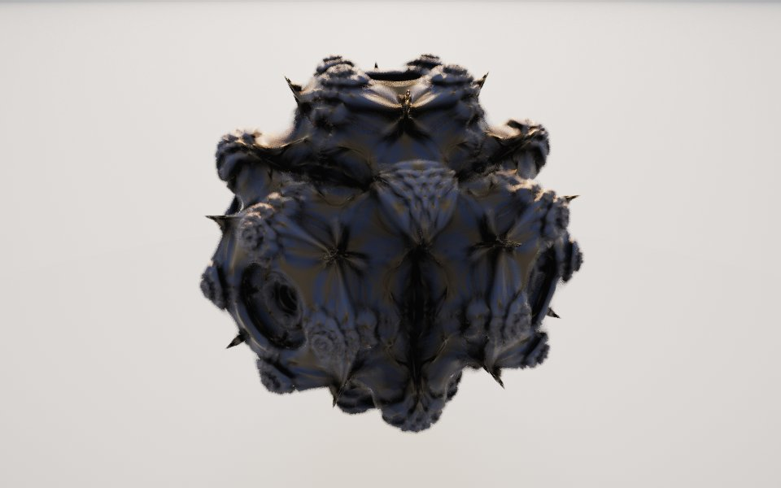

[← eiffie's bulb](eiffie.md) · [All fractals](../FRACTALS.md#more)

# Mandelnest (`mandelnest`)

*More*



A power-9 bulb built axis by axis: each coordinate's angle to its own axis is multiplied, instead of the Mandelbulb's two spherical angles, so the result has a cube's symmetry rather than a pole. It is a ball of nested, pinched lobes, with star-shaped seams where they meet and a porthole on each axis.

**Formula.** Start from $`z = p`$ and repeat, with $`r = |z|`$ and power $`n`$:

```math
v_i = \cos\!\left(n \arccos\frac{z_i}{r} + \varphi\right) \quad (i = x, y, z), \qquad z \leftarrow r^{\,n-1}\,\frac{v}{|v|} + c
```

with $`c = p`$ (Mandelbrot form) or the Julia constant, and $`\varphi`$ the `shift`. $`\cos(n \arccos t)`$ is the Chebyshev polynomial $`T_n(t)`$ for whole $`n`$; in a plane through two axes with $`n = 9`$ the step is $`z^9 / |z| + c`$, the power-9 Mandelbrot's angles with the radius raised only to the 8th. Distance estimate: $`d = \tfrac12\, r \ln r / \partial r`$ with $`\partial r \leftarrow n\, r^{\,n-2}\, \partial r + 1`$, bailing out at $`r = 10`$. Mandelbulber's derivative also divides by $`|v|`$, but that makes the estimate jump wherever $`|v|`$ dips. Without it, the estimate measured along rays stays below the true distance except in rare spots (at most 1.4 times it), so the march steps 0.8 of it. The orbit texture follows the smallest $`|v|`$ along the orbit, which is low on the seams between lobes.

**Origin.** Jeannot shared the Mandelnest on Fractal Forums ([Mandelbrot 3D: Mandelnest](https://fractalforums.org/share-a-fractal/22/mandelbrot-3d-mandelnest/4028/)) and as a [Shadertoy](https://www.shadertoy.com/view/4lKfzy). Ported from Mandelbulber 2's [Mandelnest](https://github.com/buddhi1980/mandelbulber2/blob/master/mandelbulber2/formula/opencl/mandelnest.cl).

**Parameters.** `power` (9): the power each axis's angle is multiplied by (5 to 16); higher packs in more, smaller lobes. Odd whole powers keep the cube's mirror symmetry; others break it. `shift` (0): a phase added to every multiplied angle, in half turns (-1 to 1); 0.1 to 0.3 swells some lobes and sinks others into a blockier, more cubic form. `julia` (0): 0 is the Mandelbrot form (each point its own constant); 1 draws the Julia set of `c`. `c` ([-0.8, 0, 0]): the Julia constant (-1.5 to 1.5 per axis); (-0.8, 0, 0) is a banded barrel, and nearer the center it is a lumpy ball. `iterations` (8): escape-time iterations (up to 30); more adds finer lobes along the seams.

---

[← eiffie's bulb](eiffie.md) · [All fractals](../FRACTALS.md#more)
