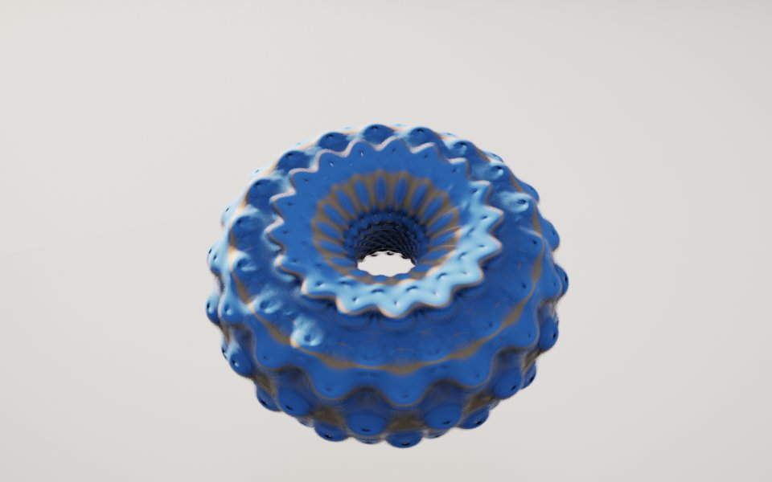

[← Msltoe Donut](msltoe_donut.md) · [All fractals](../FRACTALS.md#spheres-and-tori) · [Sphere Tree →](spheretree.md)

# Mandeltorus (`mandeltorus`)

*Spheres and tori*



A Mandelbulb wrapped around a ring. The bulb's power map takes its radius from the distance to a circle instead of a point, so lobes run around a doughnut and ridges wrap its tube, with a fluted crater in the hole.

**Formula.** Start from $`z = p`$. With $`\rho = \sqrt{z_x^2 + z_z^2}`$, $`\varphi = \mathrm{atan2}(z_z, z_x)`$, $`\theta = \mathrm{atan2}(\rho, z_y)`$ and $`q = \sqrt{(\rho - R)^2 + z_y^2}`$, the distance to the ring of radius $`R`$, repeat:

```math
z \leftarrow \left(q^{a}\sin(b\theta)\cos(a\varphi),\ q^{b}\cos(b\theta),\ q^{a}\sin(b\theta)\sin(a\varphi)\right) + p
```

with $`a`$ = `power` and $`b`$ = `power2`, until $`|z| \ge 10`$. In mode 2, $`\theta`$ becomes $`\tau = \mathrm{atan2}(|\rho - R|, z_y)`$, measured from the ring, and the map is $`\left((R + \cos b\tau)\,q^a\cos a\varphi,\ q^b\sin b\tau,\ (R + \cos b\tau)\,q^a\sin a\varphi\right) + p`$. Distance estimate: $`d = \tfrac12\, q \ln q / \partial`$, where $`q`$ is the escaped point's distance to the ring and $`\partial \leftarrow \max(a, b)\,|F|/q\;\partial + 1`$, with $`F`$ the map's output before $`p`$ is added. An orbit that never escapes is inside.

**Origin.** By Aexion on Fractal Forums, 6 August 2014 ("MandelDonuts", [thread](http://www.fractalforums.com/the-3d-mandelbulb/mandeldonuts/)), as a toroidal Mandelbulb. Ported to [Mandelbulber 2](https://github.com/buddhi1980/mandelbulber2) by mclarekin in 2019. Mandelbulber's analytic estimate grows its derivative by $`(a - 1)\,q^a`$ and measures $`|z|`$, which makes the estimate jump wherever the escape count changes and draws onion-skin shells. This port follows the map's actual growth and the ring distance instead. The default powers of 18 are those of Mandelbulber's example image; its own defaults of 8 give a lumpy blob.

**Parameters.** `power` (18): the power around the ring, or how many lobes run around the doughnut; 4 to 24. `power2` (18): the power across the tube, or how many ridges wrap its cross-section; low values make a lumpy blob. `ring` (1.5): the radius of the circle the map is measured from; 1 to 2, and larger opens the hole. `mode` (1): 1 measures the angle across the tube from the center, giving a fluted doughnut; 2 measures it from the ring, giving stacked, wavy rings. `iterations` (10): escape-time iterations, up to 20; more give finer lobes.

---

[← Msltoe Donut](msltoe_donut.md) · [All fractals](../FRACTALS.md#spheres-and-tori) · [Sphere Tree →](spheretree.md)
