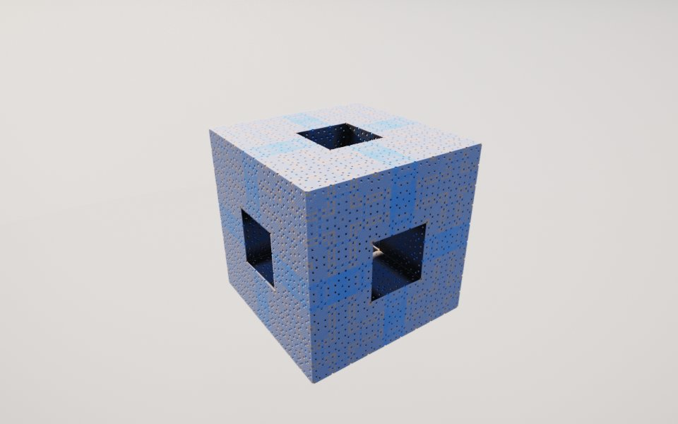

[All fractals](../FRACTALS.md#4d-slices) · [Sierpinski 4D →](sierpinski4d.md)

# Menger 4D (`menger4d`)

*4D slices*



A slice through a four-dimensional Menger sponge (pictured at `w` = 0.15). Its holes run in all four directions, so a 3D slice cuts them at angles. Each slice is a cube, and sliding `w` changes its pattern of tunnels and pores.

**Formula.** Start from $`z = (x, y, z, w)`$ and repeat $`n`$ times: fold into the positive orthant, $`z_i \leftarrow |z_i|`$; sort so that $`z_1 \ge z_2 \ge z_3 \ge z_4`$; then

```math
z_{1,2,4} \leftarrow s\,z_{1,2,4} - (s-1)\,c_{1,2,4}, \qquad z_3 \leftarrow s\,\bigl(h - |z_3 - h|\bigr),\quad h = \tfrac{(s-1)\,c_3}{2s}.
```

The two largest axes and the smallest are pushed toward the corners; the third is folded about its middle. Distance estimate: the distance from $`z`$ to the 4D box of half size $`c_1`$, divided by $`s^n`$ (past $`c_1`$ the largest axis only grows, so the box holds the whole sponge). The offsets here are scaled by $`s - 1`$, as in Knighty's original, so the sponge keeps its size as $`s`$ changes; Mandelbulber's defaults (1, 1, 1, 0.5) without that factor give the same shape at half the size. Iterations add finer holes close up on their own.

**Origin.** Syntopia's and DarkBeam's Menger4 formula for Mandelbulb 3D, released in DarkBeam's [custom formulas thread](http://www.fractalforums.com/mandelbulb-3d/custom-formulas-and-transforms-release-t17106/) on Fractal Forums, built on Knighty's kaleidoscopic IFS folding (Fractal Forums). Ported from Mandelbulber 2's Menger 4D (`menger4d.cl`). Mandelbulber's optional six-plane rotation is left out.

**Parameters.** `w` (0): the slice's 4th coordinate, from −1 to 1; −w gives the same slice as w. At 0 the slice is a ragged cube with cross-shaped holes. From 0.1 to 0.2 each face has one square tunnel and fine pores, at 0.33 a grid of holes, and at 0.45 the block is nearly solid. At 0.6 each face has a ring of eight square holes, and near ±1 the block turns rugged and crumbling. Past ±1 the slice is empty. `fold_scale` (3): how much smaller each level's copies are. 3 is the sponge; from 1.5 to 3 the copies overlap into solid lattices, from 3 to 4 they part into dust. `offset` ([1, 1, 1, 0.5]): where the copies sit along each sorted axis, largest first. The first is also the sponge's half size; lowering any one pulls its copies in and fills holes. The 4th, at 0.5, puts the smallest axis's copies halfway, which is what makes the 4D holes cross the slices (0.05 to 1.5). `iterations` (5, up to 10): levels of holes, each three times finer.

---

[All fractals](../FRACTALS.md#4d-slices) · [Sierpinski 4D →](sierpinski4d.md)
