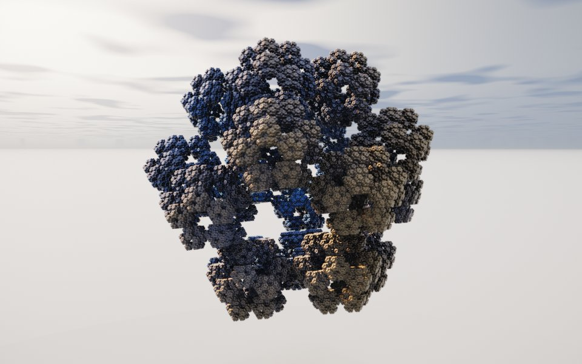

[← Jerusalem Cube](jerusalem.md) · [All fractals](../FRACTALS.md#geometric) · [Koch Delta →](koch.md)

# Polyhedral IFS (`polyhedral`)

*Geometric*



Knighty's kaleidoscopic IFS for all three polyhedral mirror groups: space is folded into one cell of the tetrahedral, octahedral or icosahedral group, then scaled away from a point of that cell. Moving the point around the cell's corners and setting the scale gives the icosahedral, dodecahedral and octahedral flakes, the Sierpinski tetrahedron and everything between them. The built-in `kifs` folds by the octahedral group alone, sorting the axes; this one takes any of the three groups and any point of the cell, and ends each copy as that point's polyhedron.

**Formula.** With $`n`$ the symmetry (3, 4 or 5) and $`c = \cos(\pi/n)`$, the third mirror has normal $`\mathbf{m} = (-\tfrac12, -c, \sqrt{3/4 - c^2})`$; the other two are the planes $`x = 0`$ and $`y = 0`$. The fold $`F`$ repeats $`n`$ times

```math
(x, y) \leftarrow (|x|, |y|), \qquad \mathbf{z} \leftarrow \mathbf{z} - 2\min(0, \mathbf{z}\cdot\mathbf{m})\,\mathbf{m}
```

which lands every point in the cell whose corners are the unit vectors $`\mathbf{a}`$ (a 2-fold axis, the midpoint of an edge), $`\mathbf{b} \propto (\sqrt{3/4 - c^2}, 0, \tfrac12)`$ (the $`n`$-fold axis, a vertex of the tetrahedron, octahedron or icosahedron) and $`\mathbf{c} \propto (0, \sqrt{3/4 - c^2}, c)`$ (a 3-fold axis, the center of a face). The vertex is $`\mathbf{v} = \mathrm{normalize}(u\,\mathbf{a} + v\,\mathbf{b} + w\,\mathbf{c})`$ for the weights $`(u, v, w)`$. Start from $`\mathbf{z} = \mathbf{p}`$ and repeat $`N`$ times

```math
\mathbf{z} \leftarrow s\,R_{\mathbf{v}}(F(\mathbf{z})) - (s - 1)\,\mathbf{v}
```

with $`R_{\mathbf{v}}`$ the twist about the axis through $`\mathbf{v}`$. Each copy ends as the Wythoff polyhedron of vertex $`r\mathbf{v}`$, whose faces are square to the cell's corners, blended with a ball by the roundness $`k`$: with $`\mathbf{q} = F(\mathbf{z})`$,

```math
d = s^{-N}\Big[(1 - k)\max_{\mathbf{e} \in \{\mathbf{a}, \mathbf{b}, \mathbf{c}\}} \big(\mathbf{q}\cdot\mathbf{e} - r\,\mathbf{v}\cdot\mathbf{e}\big) + k\,(|\mathbf{z}| - r)\Big].
```

The folds and the twist are isometries, so only the scale has to be divided out. The orbit trap counts the reflections the first few folds made, which tells the copies apart.

**Origin.** Knighty introduced kaleidoscopic IFS on Fractal Forums in May 2010 ([Kaleidoscopic (escape time IFS)](https://www.fractalforums.com/sierpinski-gasket/kaleidoscopic-(escape-time-ifs)/)), with Sierpinski, Menger, octahedral, icosahedral and dodecahedral examples. Syntopia (Mikael Hvidtfeldt Christensen) wrote them up in [Folding Space II: Kaleidoscopic Fractals](https://blog.hvidtfeldts.net/index.php/2010/06/folding-space-ii-kaleidoscopic-fractals/) (2010) and shipped them as [Fragmentarium](https://github.com/Syntopia/Fragmentarium) examples (Icosahedron, Dodecahedron, Octahedron). The fold for any of the three groups and the vertex picked by weights on the cell's corners (a Wythoff construction) come from Knighty's later Fragmentarium work: his iterated icosahedral polyhedra (2011) and fold-and-cut regular polyhedra (2012, from the Fractal Forums thread "Solids, many many solids").

**Parameters.** `symmetry` (5): the mirror group, 3 tetrahedral, 4 octahedral, 5 icosahedral. `vertex` ([0, 0, 1]): the weights of the cell's corners (edge midpoint, vertex, face center) that pick the point copies are scaled away from; mixtures give truncated forms. The recipes: icosahedral flake `symmetry` 5, `vertex` [0, 1, 0], `fold_scale` 2.618; dodecahedral flake 5, [0, 0, 1], 3.618 (the default); octahedral flake 4, [0, 1, 0], 2; Sierpinski tetrahedron 3, [0, 1, 0], 2. `fold_scale` (3.618): how much smaller each generation is, 1.2 to 4.5; at the flakes' values the copies just touch, less fuses them into a solid, more scatters them into dust. `size` (1): the size of each copy's final shape against the vertex at 1, 0.2 to 1.3; smaller beads the copies apart, larger swells them together. `roundness` (0): 0 ends each copy as the polyhedron of that vertex (an icosahedron, a dodecahedron, a truncated form), 1 as a ball. `twist` (0): degrees each generation turns about its vertex's axis, -180 to 180; small turns wind the copies into whorls. `iterations` (6): generations of copies; more are added close up.

---

[← Jerusalem Cube](jerusalem.md) · [All fractals](../FRACTALS.md#geometric) · [Koch Delta →](koch.md)
